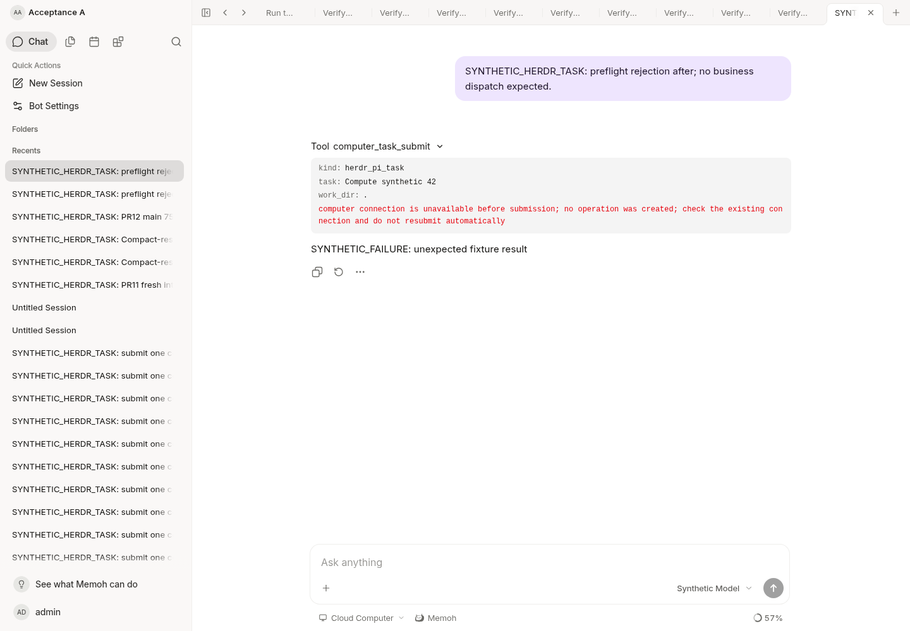

# Compact Pi completion results

This is a separate, unshipped follow-up to the merged versioned path resolver in PR #11.
It does not change Pi, Memoh's Agent runtime/contextview, the configured provider,
MCP/skills settings, task authorization, or production storage locations.

## Problem and boundary

The original `pi-json-v1` recovery path fetched complete stdout and stderr before
running the Pi JSON verifier on the server. Diagnostic volume therefore delayed
ordinary task results and could require several model-driven result calls.

New operations persist `completion_version: 1` before remote mutation. The fixed
Bash envelope runs the same unmodified Pi CLI, waits for its actual exit, and
invokes a finite Memoh-owned Node script in the exclusive attempt directory.
That script reads the official JSONL **locally**, projects a small `result.json`,
and atomically renames it before the envelope commits `receipt.json`. It is not
a Pi extension, hook, daemon, provider, or second file service. Node must already
be available in the configured execution PATH; no installer or credential is
added. A missing Node executable is a pre-Pi `not_started` result.

The protocol follows [Pi v1.2.0 print-mode](https://github.com/earendil-works/pi/blob/v1.2.0/packages/coding-agent/src/modes/print-mode.ts#L108-L172).
JSON mode emits the session header and event stream; its process exit code alone
does not establish semantic success. The projection requires the matching
session/provider/model, closed tool/message/turn/agent events, final assistant
stop reason and `agent_settled`. Early errors may be followed by a successful
retry. Missing/unknown/malformed events, partial final records and invalid UTF-8
produce `invalid_protocol`. Slash/skill handling with no model run does not
fabricate success. Only assistant text is projected: thinking, tool bodies and
error diagnostics are not result content. This is a structural projection, not
a general secret redactor: assistant text can itself contain sensitive values.
It remains subject to the task authorization and ordinary result-handling policy.

## Separate contracts

| Concern | Evidence and API |
| --- | --- |
| Invocation exit | Existing correlated receipt; may release only this invocation's slot. Does not imply AI or business success. |
| Pi result | `computer_task_result` validates the receipt's result size/hash, attempt/session/pane/request identity and source stdout metadata. Returns outcome plus a bounded final-text preview. |
| Business acceptance | Remains separate. A Pi `succeeded` result does not prove that an image, file or real-world objective was delivered correctly. |
| Artifacts | Existing NAS file module and ready references. `computer_task_artifact` returns available refs; it does not start diagnostic collection or invent delivered files. |
| Diagnostics | Explicit `computer_task_logs`, using the same operation scope and existing media storage. Can collect full logs in bounded calls; failure cannot change or retry the completed Pi invocation. No raw logs enter its tool response. |

`diagnostics_state` distinguishes `not_collected`, `collecting` and `ready`.
An empty file has its existing explicit empty/hash contract, never a fake media
reference. Diagnostic logs may contain sensitive tool content. Existing media
hash-download authorization remains Bot-scoped; this change does not claim to
solve the separately tracked operation-scoped attachment-download boundary.

The small result is at most 8 KiB, including escaped JSON, with at most 2 KiB of
UTF-8 assistant text. Reading it takes at most four existing 2 KiB pages within
one bounded result call; timeout may still require another **read-only** call.
No new background service or infinite tool wait is introduced. The local parser
retains the existing 64 MiB semantic-input ceiling; exceeding it returns
`output_limit`, not success. Diagnostics have their independent existing limits.
A large stderr does not gate normal completion. LF framing retains fresh read
chunks and assembles a split record only once; it does not repeatedly copy or
scan the growing prefix of a long line.

The Node projector runs in its own worker thread with a fixed **30-second**
parent watchdog. Synchronous reads or JSON parsing cannot block that watchdog;
expiry terminates this helper process only, after Pi has already exited. The
Bash envelope can then publish exit evidence without a semantic result. The
service reports unknown and never restarts Pi. The 64 MiB threshold bounds
semantic parsing, not total file size or elapsed time: hashing can consume more
bytes. This watchdog does not cap Pi's business runtime or the existing Bash
receipt-hash phase; a pending receipt remains unknown to a bounded caller.

## Recovery and trust

- Operations with no completion version keep the original full-log recovery
  protocol, saved chunks/offsets and directory layout. No directory migration,
  SQL migration, replay, automatic close, or automatic task retry occurs.
- Both writer and reader use the PR #11 versioned layout resolver. Unknown
  completion versions are rejected before PC IO.
- A valid exit receipt without a completion file releases the invocation slot
  but leaves semantic result unknown. Projection/read failures never resubmit
  Pi. A later service restart can retry reading an immutable result using the
  durable identity; successful results are cached in the existing ledger.
- Reads, cached results and explicit diagnostics retain trusted host binding,
  PC/NAS target scope, current grants, registration fingerprint and CAS checks.
  Revocation prevents subsequent reads, including cached data. No model header
  or self-reported session establishes authority.
- The nonce called `generation` is **not** a native atomic Herdr generation.
  Existing pane lookup/run races across a Herdr restart are not solved here.
  The Windows account can alter its own files; this protocol is not a sandbox
  against that account or a cryptographic attestation of business success.
- The fixed helper adds launcher bytes; the existing 48,000-character Agenvo
  preflight limit still rejects oversized requests before a claim/mutation.
  No silent truncation or fallback is added.

## Validation checkpoint

### Connection preflight classification

An Agent submission checks the existing target policy through the workspace
resolver. For Agenvo this includes a read-only `workspace.list` probe. A failed
connection probe used to become a workspace-offline error and then a generic
conversation denial. This could mislead a caller into changing the target or
retrying with an omitted target, although no operation had been claimed.

The host authorizer now reports a separate preflight-unavailable error for
that offline result. It states that no operation was created and that the
existing connection must be checked before another submission. It does not
infer OAuth expiration from arbitrary transport errors, expose private causes,
change grants, or alter unknown outcomes after a business dispatch.

The real tool source, authorizer, workspace resolver and Agenvo probe are
covered together with a synthetic failing transport. Explicit and inferred PC
targets in a native root conversation both reproduce the old error; missing
binding, mismatched session, another selected PC and each missing permission
remain rejected. Every case asserts zero ledger claims; rejected authority
also asserts zero probe calls. The injected private diagnostic stays out of
the tool response.

The current server and Web app were exercised at localhost ports 18080/18082
with a synthetic offline relay. The expanded tool response shows the corrected
preflight message, with unchanged relay business counters and no browser
errors. The scripted provider's `SYNTHETIC_FAILURE` final reply is its expected
stop on a failed tool, not a real-model routing or successful-PC-task result.
This verification does not renew or validate any production OAuth connection.

### Protocol and integration checks

- Actual Bash envelope plus actual embedded Node helper: task remains stdin
  data, exact session arguments, nonzero exit, atomic completion and receipt,
  exclusive attempt/session, matching restored read paths. Missing Node does
  not start Pi; projection failure preserves the real process exit.
- Actual Node protocol fixtures: normal, tool round, retry success, nonzero,
  exit-zero error, aborted, length, missing settlement, partial line, wrong
  session/provider, empty/slash-like no-run output, invalid UTF-8, private
  thinking exclusion, bounded Unicode/escaped text, and cross-attempt/hash
  rejection. No Windows or paid provider is involved in these fixtures.
- Standard MCP/service: success without log reads or media ingestion; media
  outage does not gate result; explicit log failure preserves the saved result;
  result read failure plus service restart does not dispatch again; revocation,
  cancellation/unknown, corrupt identity, legacy offsets and 500-line vendor
  limits remain covered.
- Fault follow-up: actual Node interruption during temporary-file writes,
  before/after atomic rename, and an existing temporary file cannot publish an
  uncommitted result or rerun the same attempt. These are process-interruption
  tests, not Windows NTFS/power-loss durability guarantees.
- Independent instrumentation of actual fs/Buffer operations checks a 63 MiB
  legal JSONL line and a 65 MiB over-limit line. The valid case read/scanned
  66,060,787 bytes and copied 66,060,374 bytes, returning `succeeded`; the larger
  case returned `output_limit`. Input, scans and copy volume are linear rather
  than approximately 32 GiB of repeated-prefix work. A deliberately blocked
  worker is terminated by the same watchdog using a shortened test deadline.
- Service fault cases include another attempt's correctly rehashed completion,
  abort/error results, missing completion, repeated read-only recovery, and
  historical full-log offsets. No failure is permission to resubmit.
- Both packages passed race tests; targeted golangci-lint and Server build
  passed. Official runtime/contextview boundary passed.
- Current Server and actual Web at the isolated loopback development endpoints
  were exercised through a fresh conversation. The transport/provider were
  synthetic; the transport ran the actual embedded Node helper on fixture Pi
  JSONL. Exactly one task was dispatched, only `result.json` was remotely read,
  and three synthetic model requests covered submit, result, final reply.
  There were no stdout/stderr ready refs, diagnostics stayed `not_collected`,
  and no browser page errors occurred.

[Current browser evidence after the linear-parser/watchdog fix](validation/compact-result-linear-web.png) shows that fresh
conversation. This is not autonomous real-model acceptance, real Windows/Git
Bash/Node/Pi/Magpie acceptance, or proof that arbitrary business tasks succeed.
Those remain controlled release gates; no production deployment is included.
The original pre-review screenshot remains at
[initial compact-result checkpoint](validation/compact-result-web.png).
## Integration with current main (2026-10-22)

Normally merged main `75a70fe961808ed5ec2284767cb92ea85f30890f`, containing
PR #8 resumable uploads, PR #9 task summaries and PR #11 path consistency.
There were no conflicts or history rewrites. The compact-result implementation
and its tests remain byte-for-byte equal to reviewed `c07a82b0`; main's config,
media/localfs and task-summary implementations remain unchanged. The PR is now
based on main and remains draft. Runtime/contextview still match the official
`bf0318c5` baseline.

Fresh integration checks passed:

- Race tests for config, agenvo, computertask, sessiontask, media and localfs,
  including long-line parsing, the bounded parser watchdog, interrupted atomic
  result writes, correlation failures and legacy saved-offset recovery.
- Task authorization/no-store and upload/resumable HTTP regressions, plus the
  isolated PostgreSQL owned-tree/stable-cursor test.
- A rebuilt cloud Server and the real Web UI with synthetic model/Agenvo
  endpoints: one new synthetic batch dispatch, three scripted provider requests,
  only `result.json` recovered, a correlated `succeeded` result, no stdout/stderr
  references and `diagnostics_state=not_collected`. The mock transport executes
  the embedded Node projector over synthetic Pi JSONL. This is not real Windows,
  Pi/Magpie or autonomous model acceptance.
- The same current application selected an unsent synthetic attachment and
  separately verified authenticated HTTP upload/readback of a 38-byte original
  and a 1,610-byte two-chunk resumable upload. SHA-256, saved offsets, ready state,
  physical originals and the upload journal matched the configured relative
  root. The owned empty task list returned 200; 401/400/404 error responses kept
  no-store. These storage checks dispatched no model or computer task.

[Current synthetic compact-result flow](validation/compact-result-integrated-web.png)
and [current attachment draft](validation/compact-result-integrated-storage.png)
are actual browser captures, not proof of vendor/production acceptance. Earlier
screenshots and fault evidence remain historical checkpoints. No existing real
operation was replayed.

PR #9 deliberately keeps Pi outcome/content unavailable in its task-summary
HTTP projection. A valid compact result through the MCP task API does not
silently extend that mobile-facing contract. Controlled Windows acceptance and
any candidate release remain separate from this cloud integration evidence.
