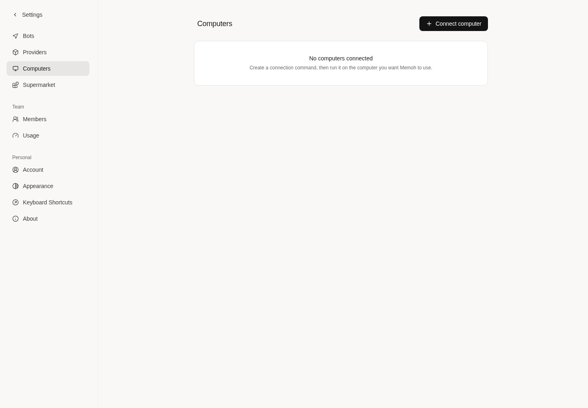

# Retired Agenvo source cleanup

This increment starts at PR90 head `910589c10e363545dd220cc3b9c212def0c815ec`
on `cleanup/agenvo-owner-writers`, based on
`e2cb0767eb12a54abd670d754c72ab7b4b7798c8`. It removes executable retired
implementations, not historical identities or records. Independent review,
unified integration, Windows execution and onsite retirement remain pending.

## Removed and retained boundaries

Removed: SourceCaller/CallTool and MCP JavaScript dispatch/decoding; service
discovery, enrollment and account probes; legacy runtime create/configuration
helpers and their SQL queries; TUI startup/input and follow-up reservation/CAS
writers; plugin collector and unpacked legacy batch-launch fallbacks. Useful
fixtures now call NativeCaller directly and use native profiles. Retired input
receipts are seeded as saved fixture data instead of creating new old input.

[Source inventory](source-inventory.json) records zero retired definitions in
the affected compiled packages. This is not an empty-string inventory:
historical migrations, JSON fields, target fingerprints, unknown states,
receipts and bounded read decoders remain. OwnedHTTPMCPConnectionBot retains
historical receipt authorization and reserved-MCP endpoint checks remain.
Client.Probe and the grant/fingerprint-checked native dispatch remain active.
The package and durable fields are not renamed. Official Agent runtime and
contextview match `bf0318c5e363b62dd67ddf3fe8855a5b7c8b0046`.

## Automated verification

Go 1.25.7, existing module cache, no TLS/CA changes:

- [Adapter suites](adapters.txt): `go test -p 3 -count=1 -timeout=2m
  ./internal/agenvo ./internal/computertask ./internal/nativeherdr` passed.
  Service-dependent PostgreSQL and Windows/PowerShell tests explicitly skip
  without their isolated environments; they are not counted as live acceptance.
- [Race checks](race.txt): native unknown replay, changed target/permission,
  historical follow-up receipt replay, evidence CAS and concurrent batch resume
  passed in `internal/computertask` with `-race`.
- [PostgreSQL](postgres.txt): isolated disposable databases ran
  `NativeRuntimeCutover`, `ProjectWideAgenvoRetirement`, `NativeHerdrAdmission`,
  `ComputerAdmissionDurability`, `ComputerOperationsMigration` and
  `ComputerDeliveryPostgresAuthorization` tests with `-tags=integration`.
  These cover retained rows/unknowns, native admission and delivery isolation.
  Direct historical fixture inserts retain activation/pending-state invariants;
  they do not restore a production enrollment/configuration helper.
- [Error/handler suites](errors.txt): `internal/apperror`, `internal/server`,
  `internal/handlers` passed. Native account/runtime and core preflight tests
  also passed separately.
- [Frontend error regressions](frontend-errors.txt): both error utility suites
  passed, 123 assertions. No frontend source or dependency lockfile was changed.
- [Diff lint](lint.txt) passed across the six affected package scopes using
  checksum-verified golangci-lint v2.10.1. Obsolete fixture-only interfaces and
  writer capacity constants were also removed; [fixture checks](fixture-contracts.txt)
  passed after that final cleanup.
- SQL bindings were regenerated with sqlc v1.31.1; only removed query bindings
  changed. The generator selected its required Go 1.26.10 toolchain; application
  tests/build used Go 1.25.7. Formatting, diff checks and the official Agent
  boundary check passed.

## Actual application verification

The current source was built into `/tmp/pr90-memoh-server` and restarted at
`http://127.0.0.1:28080`. Current Vite source ran at
`http://127.0.0.1:28082`, using the pinned UI commit
`f69402a55dd87a59c10722fe11507ad8fd7048f5` and this checkout's generated SDK.
The separate local `pr90_cleanup_acceptance` database migrated to 177 with
`dirty=false`; the pre-existing application database was not migrated.
Only the public development admin fixture was used; its onboarding metadata
was seeded to reach settings without creating a Bot. No Runtime, grant,
connector, provider or real credential was created or changed.

The existing frozen dependencies were linked into the isolated checkout.
Missing cached hash-module links and an initially stale SDK link were repaired
locally before the successful browser check. These are not repository edits.
Vite logged font allow-list warnings from the shared install; the actual
rendered screenshot was inspected. Chromium submitted the real login form and
opened Settings → Computers. It showed the native Connect computer action and
no retired enrollment action, with zero connected runtimes and no page errors.
[Browser record](browser-proof.json), [inspected screenshot](computers.png).

Full-application HTTP checks found an additional retirement boundary issue:
an unknown Runtime URL could fall into the generic `/users/:id` account route.
The actual old endpoint PUT returned 500 after rejecting an invalid UUID, with
no mutation. The [red regression](retired-route-red.txt) includes the real users
handler; its read fixture demonstrated the same routing fallthrough as a 200.
The Runtime namespace now has a generic unknown-path 404 handler, leaving
specific native routes intact and adding no retired endpoint implementation.

After rebuilding/restarting, the old endpoint, Agent configuration and discover
URLs returned `404/http.not_found`; `provider=agenvo` creation returned
`400/request.field_invalid`. The account runtime list stayed empty and unchanged.
[Final HTTP proof](http-proof.json). API checks supplement the real UI check;
they do not replace the missing native device execution flow.

## Integration and acceptance still required

PR88 source `d88e3bc2ff8333a2d54f424a57aa6cb2d600cd82` and unified
`912e85dec518f5a6930b45b0b88eecd62074a594` have the same complete tree; all
ten files are unchanged at `98ebb47ba8de52e88f4e27f130766f96d36ffd58`.
Do not redevelop authority or reapply that patch. Retain its native owner,
activation, both mounts, Runtime ID, fingerprint and current permission checks,
plus historical read compatibility.

After independent review, merge this cleanup into the existing unified line.
The [temporary three-way merge preview](merge-preview.json) found three
conflict blocks in two files; the other four overlapping files merged cleanly. In
`internal/handlers/user_runtime.go`, retain unified workspace-storage routes
and error cases; place the namespace fallback after specific Runtime routes;
remove only ErrEndpointConfigConflict from the old conflict case. Where the
native test fixture overlaps the unified ANSI snapshot change, keep direct
NativeCaller receipts and its explicit format checks, without restoring a
JavaScript/MCP simulator. Preserve the unified result-read diagnostics and
selected-workdir behavior.

No live PC/NAS, model, installed bundle, schedule, authority implementation or
release ref was changed. There is no connected Runtime in this isolated app,
so Runtime → Herdr → Pi execution/results, real historical device receipts,
Windows/PowerShell, per-schedule retirement and human QA are unverified.
The local screenshot establishes only the stated account/settings flow.
Keep the PR Draft until the designated independent review, unified and onsite
acceptance steps are completed; no merge or deployment was performed here.
