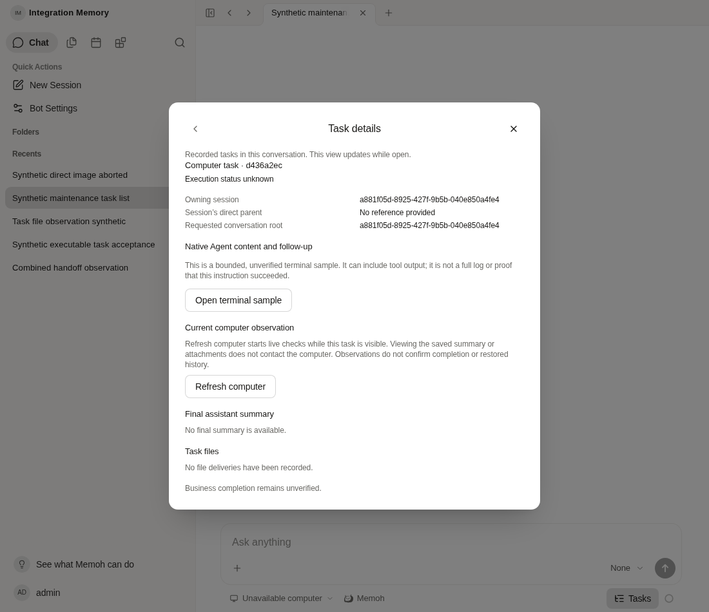

# Explicit native batch continuation without a model turn

Base: `58e39866057bf798b0789053d3215ddf4600c612`. Agent-produced evidence, not human QA or a production recovery.

## Confirmed gap

The deployed base exposes `computer_task_submit.resume_operation_id` through the host-bound tool mount, but no HTTP resume action. A public MCP client cannot create that host binding with identity headers. A finished run's expired execution context cannot be reused. The existing HTTP follow-up action is for interactive Agents, not Pi batches. The actual base Server returned 404 with `no-store` for the proposed route (`baseline-route.json`).

The underlying bounded continuation already supports reuse of the original persisted RunID; it does not need another model turn. This patch exposes that existing operation through the same authenticated task-handler authority used by content/follow-up. It adds no new execution engine, queue, approval, credential or database state.

## Call contract and field handoff

Use the existing logged-in API client and API base (including its normal `/api` proxy prefix where configured):

`POST /bots/{bot_id}/sessions/{session_id}/tasks/computer_operation/{task_id}/resume`

- Path IDs identify the original Bot, an owned conversation with the original operation in its authorized ancestry, and the original operation. The server resolves the actual owning session and original RunID. A terminal original run does **not** require a replacement active run.
- Body: the original `kind: "herdr_pi_task"`, complete original `task`, and original `target_id`, `work_dir`, `artifact` / `artifacts` when present. Normal defaults are unchanged. The original normalized request hash and target fingerprint must still match. Do not infer the task text from a summary or hash.
- Do **not** put `resume_operation_id`, `operation_id`, `run_id`, user/session identity, workspace/pane references or a new request ID in the body. No `X-Memoh-*` headers establish identity. Strict decoding rejects unknown body fields.
- The current user must still have Bot chat access, own the operation's conversation path, and retain the selected target's execute grant. Existing admission, policy, CAS, original receipt/phase and uncertain-dispatch fences remain authoritative. There is no new-work claim path.
- Runtime disconnected is an execution blocker. Restore the existing Runtime through its normal connection mechanism first, without changing the original registration/task identity. This endpoint does not reconnect Runtime or restore credentials. Then explicitly submit the unchanged request once. It can reuse the saved workspace and safely continue the allowed pre-prompt phases; it cannot replay an uncertain prompt submission.
- Read the same task ID after the response or a lost response. `outcome` is `submitted`, `unchanged`, `unknown`, `unavailable` or `blocked`; `automatic_retry` is always false and `business_outcome` remains `unknown`. `submitted` means input acknowledgement, not task completion or collected results. A failure/unknown response is not permission to create another operation or automatically repeat.
- HTTP 401/403/404 preserve existing authentication and visibility boundaries; invalid/changed input is 400/409. All responses retain `no-store`. No raw native output or diagnostic cause is returned.

The shared task page still has **no resume button**. This delivery provides the formal generated HTTP/SDK entry for an existing authenticated client; it does not add a manual JSON editor or pretend that the UI already performs recovery. A client must have the exact original arguments before offering this operation. Neither this code nor its tests execute a production recovery.

## Implementation boundary

New adapter: `internal/computertask/resume_view.go`. New HTTP handler: `internal/handlers/session_task_resume.go`, registered in the existing task handler. Swagger and SDK were regenerated with `go generate ./internal/handlers` and `pnpm run generate-sdk`. All 370 existing OpenAPI operations are unchanged; one POST operation is added (`api-union.json`). No migration, configuration, official Agent/runtime/contextview, file transfer, cancellation-source or media changes.

## Verification

| Check | Result |
| --- | --- |
| Host adapter and original-run attribution | PASS: expired original execution context is rejected; fresh authenticated host uses the stored RunID, with no new model turn. Original operation/workspace/attempt/session/producer identity retained. |
| Changed owner/run/task/work_dir, injected resume ID, lost authority | PASS: refused, original record unchanged, no new native call. |
| Disconnected preflight | PASS in service fixture: unknown original operation, unchanged record, zero new native calls. |
| Lost prompt receipt and repeated explicit continuation after restart | PASS in service fixture: one prompt only; uncertain phase cannot replay. Existing bounded recovery owns CAS. |
| Actual Echo JWT chain and task binding | PASS: anonymous, wrong owner/Bot/session, forged body identity, malformed/oversized JSON, late revocation, conflict and safe error/outcome responses. |
| SDK/Web typecheck, affected Go lint, errors/server packages, core boundary | PASS, exit 0. |
| Current compiled Server + existing synthetic PostgreSQL | PASS: new route rejects anonymous401, forged identity400, wrong kind400 and an old Agenvo operation400, all no-store. These are actual HTTP requests, not stubbed responses. |
| Current Web + same Server/PG | PASS: open original synthetic conversation → Tasks → unknown operation detail → reload → same ID/status/parent. No writes or device-observation/content calls; no page error. |
| Durable-data preservation | All-row hashes unchanged for 9 operations, 18 sessions, 14 runs and 29 messages, before/after the HTTP/UI checks. |

The isolated PG has legacy Agenvo synthetic operations, **not** a connected native Runtime fixture. Therefore successful continuation and disconnected Runtime behavior are demonstrated by the service/middleware fixtures, not claimed as a real PG/native-device execution. The browser screenshot shows persistence and absence of implicit native calls, not successful resume. All materials are synthetic; no production identifiers, task body, configuration, credentials or external endpoint are included.

Commands (local Go 1.25.7, golangci-lint 2.10.1):

```sh
go test -p=1 -count=1 -v -timeout=3m ./internal/computertask ./internal/handlers ./internal/toolcontext -run 'TestResumeNativeHost|TestSessionTaskResumeHTTP|TestComputerBinding'
go test -p=1 -ldflags='-s -w' -count=1 -v -timeout=3m ./internal/handlers -run 'TestSessionTask.*(HTTP|Observation|Native)'
go test -p=1 -ldflags='-s -w' -count=1 -timeout=3m ./internal/apperror ./internal/server
golangci-lint run --concurrency=2 ./internal/computertask ./internal/handlers
pnpm --filter @memohai/sdk typecheck
pnpm --filter @memohai/web typecheck
bash scripts/check-agent-core-boundary.sh
go build -p=1 -ldflags='-s -w' -o <isolated-binary> ./cmd/agent
```

The first combined command passed computertask and toolcontext but **failed to link handlers due to disk capacity**. Its FAIL is retained. A second handler link attempt while the Server build was competing also failed. The final stripped-debug handler test passed; no assertion or test scope was removed. Only verified unused task-generated binaries and two old task-owned compiled Go cache archives were removed; sources, databases, logs, originals and the base binary remain. The isolated Server initially failed to start because the operator used `MEMOH_CONFIG` instead of the repository's `CONFIG_PATH`; corrected using the same existing private configuration, then `/ping` returned200. The private startup log is retained locally and excluded here.

UI was served on loopback port18402, current Server on18400, existing synthetic PG on15432. The unrelated workspace-target sidebar response was replaced with an empty list to avoid device probes; task list/detail and new POST responses came from the actual Server/PG. Full unrelated business tests and real Windows/TLS/Herdr execution were not rerun. The staged aggregate passed Web lint, Go lint and the complete computertask package, but its complete handlers run failed two unchanged large-upload tests (201 MiB and over-limit streaming) with HTTP500 while the temporary filesystem had only about214 MiB available. After reclaiming369,393,664 bytes from two old compiled Go archives, those exact tests passed (1.919s); no file-module code changed. The failed aggregate is retained and is **not** described as an entire successful rerun. An earlier aggregate invocation stopped at package selection due to incorrectly quoted local GOFLAGS; the corrected invocation used `GOFLAGS=-ldflags=-s`. Remote CI belongs to the eventual exact commit and is not inferred from base58e.



Raw selected outputs and before/after digests are adjacent; `files.json` gives their bytes and SHA256. Empty lint log means the command exited0 without diagnostics, not that it was omitted. Original capacity failures remain visible. No deployment, migration, image publication, model request or production task mutation was performed.
