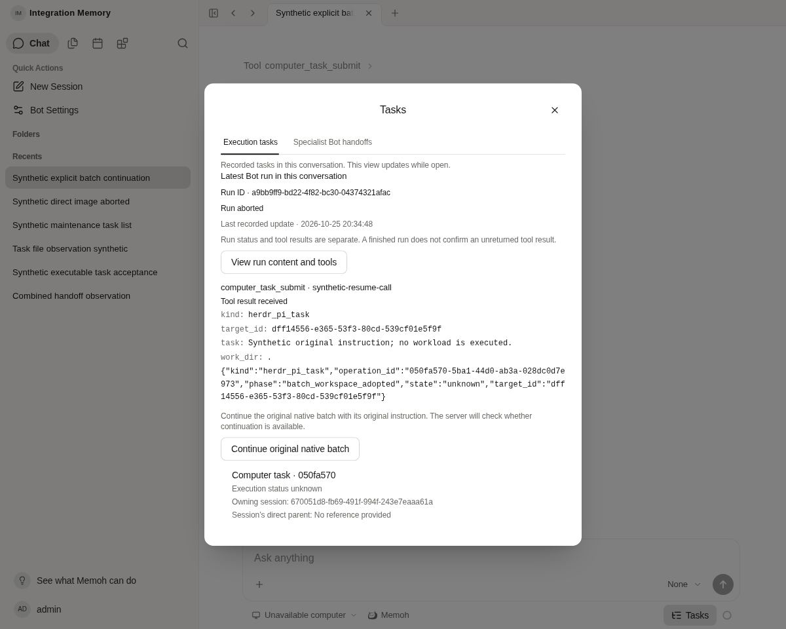
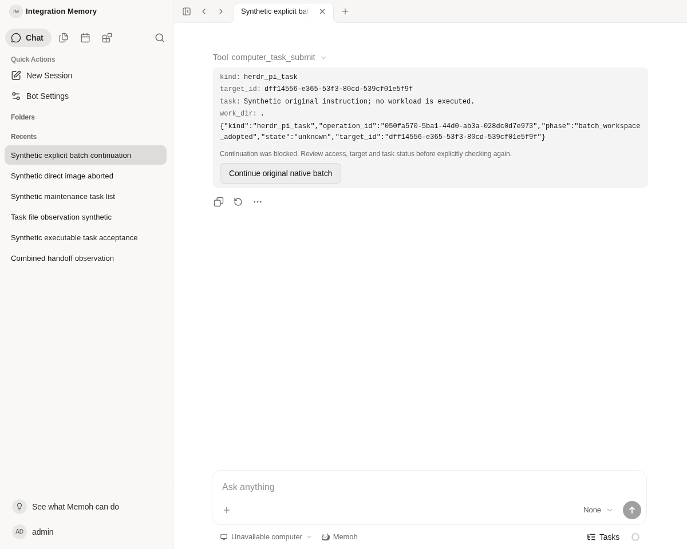
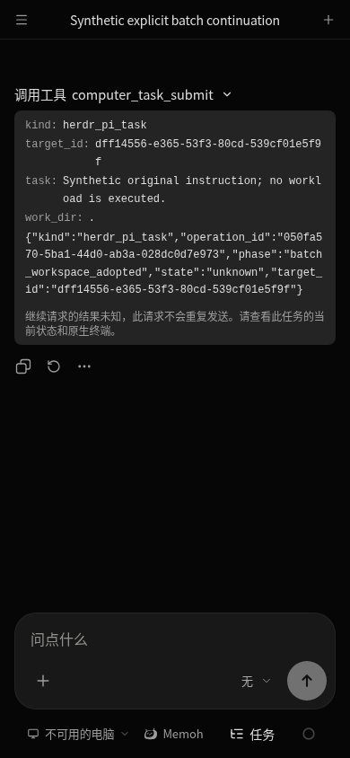

# Shared original-batch continuation action

API base checkpoint: `fb904ee36f12e67c9b7e2deba9160041655533e8`. Its six exact-head CI runs passed on the first attempt (Go40229983790, Native40229983435, large-byte40229983572, DockerPR40229983562, ESLint40229983462, policy40229983504). These were not rerun for this UI work. Governance skipped is not counted. This is agent verification with synthetic data, not human QA or a production recovery.

## User entry and existing API

Open the original conversation's `computer_task_submit` tool card. The same action is available under Tasks → View run content and tools when that original call is in the received latest-run content. The conversation supplies the actual Bot/session context; no globally selected Bot or guessed task relation is used.

The action is offered only when the card contains the complete original arguments and a structured unknown batch receipt in one of the supported pre-prompt phases. It uses the existing account client and the [authenticated resume API](../native-resume-http/README.md). Original task text, target, work directory and artifact fields are sent unchanged. It creates no model turn, new operation, queue, native workspace or authentication flow. The server remains authoritative for account ownership, current permissions, request hash/fingerprint, admission and CAS.

Missing original arguments/receipt remains read-only. A plain error or summary is not enough to reconstruct a request. The UI does not search arbitrary historical records or offer a JSON editor. Runtime must reconnect through its existing mechanism; this action cannot repair a disconnected Runtime or restore credentials.

Opening/refreshing a card sends no POST. Before an explicit click sends the request, an operation-scoped sessionStorage marker is recorded under a hashed user identity; no token or task text is stored there. An unknown/lost response is not retried automatically or on page reload. Duplicate views in the same page share that marker. This browser guard is not a cross-browser execution lock; the existing server CAS/phase fence remains the execution boundary. An explicit server refusal/unavailability can be rechecked by a later user click. HTTP404 is displayed as unsupported. Acknowledged input is described as acknowledged input, with business success still unknown.

Scope changes, token changes and same-token login generation changes invalidate pending UI responses. Original input/result remains visible. Normal transcript rendering, the shared Tasks host, file controls, cancellation semantics and media behavior are retained.

## Verification

- Helper/action and existing latest-run component: **3 files, 39 tests passed**, duration12.53s. Includes exact original body/operation, no mount POST, duplicate views/clicks, lost result/reload, blocked/unavailable, 400/401/403/404/409/500, A→B→A, token and same-token login changes, missing originals, and harmless display changes during a pending request.
- Web typecheck exited0. Targeted ESLint had no diagnostics; grouped final lint/whitespace command exited0. UI-contract reported OK with three existing warnings in Sidebar.vue, SidebarInset.vue and mcp-server-detail.vue. These sub-agent results are recorded in the execution transcript; no raw local test log was retained, and this directory does not pretend to contain one.
- Staged aggregate exited0 (Web lint passed; no Go changes selected). No check was skipped or disabled.
- Root ran the current production Web build: exit0. `build.log` is the complete output, including the existing chunk-size warning.
- Existing loopback development Web18402 / rebuilt Server18400 / PostgreSQL15432 were reused. A new **synthetic** terminal run, original tool call/result and unknown operation were inserted into the isolated test DB only. Pre-existing session/run/operation/message all-row hashes remained identical before/after the actual request. No model, device, credential or production data was accessed.
- Actual browser with real persisted history: opening the original card produced zero writes/native reads. Clicking once sent the exact original body and original operation to the actual Server. The deliberately incompatible legacy target fixture was refused with400/no-store. This verifies the real route/refusal and preserved ledger, **not** successful native execution.
- Actual browser with the same real history plus an explicitly synthetic POST response: acknowledged input did not become task success, the action disappeared, and reload did not resend. Synthetic network abort likewise remained unknown with no repeat after reload. These response fixtures are UI checks, not device recovery evidence.
- Actual Tasks dialog resolved the terminal original run and offered the same scoped action; opening it made no native call. Narrow390px Chinese dark mode rendered the unknown outcome after reload without a repeat button. Screenshots were captured after the existing collapse animation and inspected by the agent.

The first browser invocation passed actual rejection and acknowledged-response checks but failed its narrow case because the test attempted to locate the desktop sidebar after starting at a mobile viewport. The failed output is retained. Corrected navigation selected the conversation first, then resized to390px; only that missing case was rerun. The additional capture waited for the existing collapse animation so the screenshot contained the complete status. No product change was made to hide that test failure.

Commands (after the existing cloud tool environment):

```sh
pnpm exec vitest run --project web apps/web/src/pages/home/components/native-task-resume.test.ts apps/web/src/pages/home/components/session-bot-run.test.ts apps/web/src/pages/home/composables/useNativeTaskResume.test.ts
pnpm --filter @memohai/web typecheck
pnpm exec eslint apps/web/src/pages/home/composables/native-task-resume-scope.ts apps/web/src/pages/home/composables/useNativeTaskResume.ts apps/web/src/pages/home/composables/useNativeTaskResume.test.ts apps/web/src/pages/home/components/native-task-resume.vue apps/web/src/pages/home/components/native-task-resume.test.ts apps/web/src/pages/home/components/tool-call-detail-generic.vue apps/web/src/pages/home/components/message-item.vue apps/web/src/pages/home/components/session-bot-run.vue
node scripts/check-ui-contract.mjs
pnpm --filter @memohai/web build
```





No schema/config/API/core change accompanies this UI increment. No image publication, deployment, production resume, Windows/Herdr/Pi execution or mobile package build was performed. The original API's service/HTTP fixture evidence and real-device limits remain unchanged. Public files contain synthetic material only; `files.json` records exact bytes/hashes of the selected outputs and screenshots. This incremental head's remote CI must be assessed separately from the passed API checkpoint.
