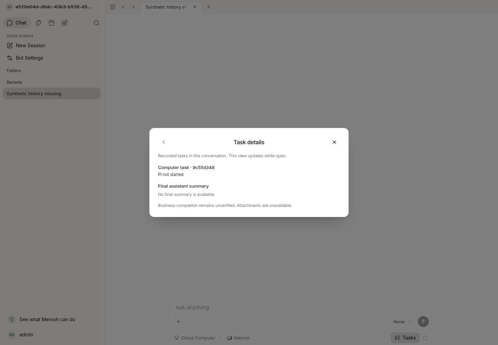

# Cloud UI evidence

The screenshot was captured from the real Vite application at loopback port
18082, backed by a server compiled from this change and the prepared cloud
PostgreSQL/pgvector services. No real PC, NAS, provider or external transport was
used. The frontend is unchanged from the prepared checkout; the modified backend
was rebuilt and restarted before capture.

The agent signed in with the existing development account, opened the synthetic
`Synthetic history missing` conversation, opened Tasks, then opened the recorded
computer operation. The panel displays **Pi not started**, no final assistant
summary, and business completion unverified. No browser page errors occurred.

The operation is a clearly synthetic, disconnected database fixture representing
the guard's missing-history receipt. This screenshot validates the existing task
registry/read UI, not an end-to-end Windows execution or a user's business result.
The actual generated Bash/Node guard and application dispatch behavior are tested
separately with synthetic fixtures. This is agent evidence, not human QA.

The backend was rebuilt and this interaction recaptured after the official
compaction/branch-summary/user-only compatibility corrections. The screenshot
still demonstrates only the synthetic missing-history task projection; it is
not a visual test of those session formats or of official Pi on Windows.

