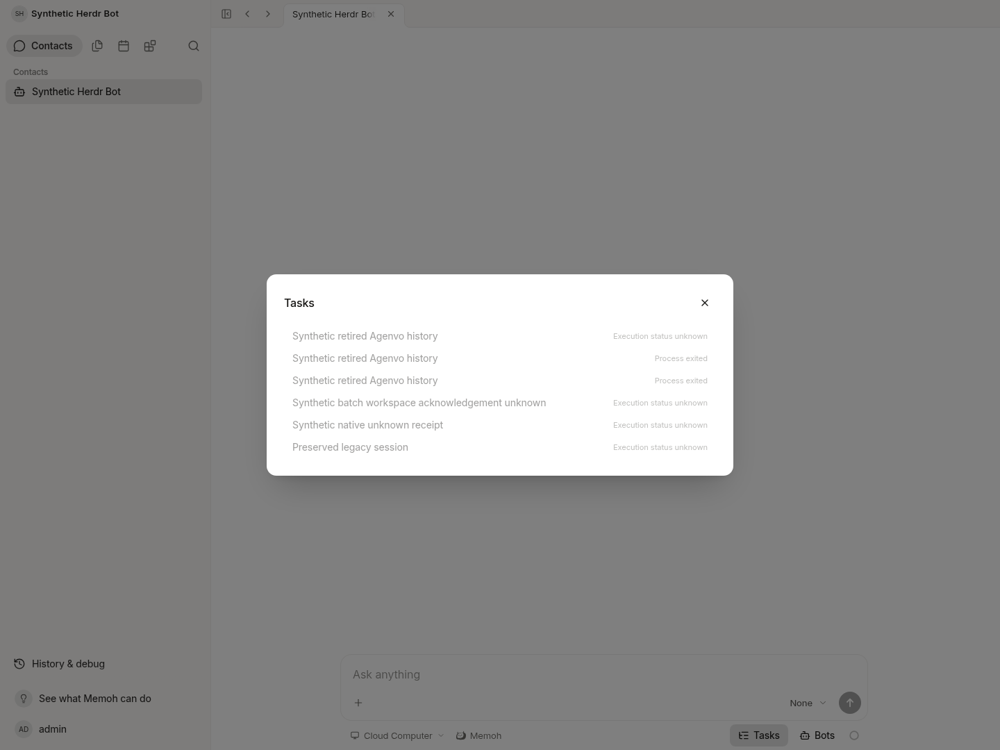

# Retired computer operation history: isolated verification

Verified on 2026-10-29 with the current Go server at `http://127.0.0.1:58080` and actual Vue/Vite application at `http://127.0.0.1:58083`. Only dedicated synthetic PostgreSQL/pgvector containers were used. The frontend mirror was checked against the worktree sources and installed from its frozen lockfile; the pinned UI submodule was reused. `mise` was unavailable, so the equivalent current Go and Vite processes ran directly.

Three synthetic historical Agenvo operations (two `completed`, one `unknown`) were read with the binding retained, after runtime revocation, and after binding deletion. Each phase passed three owner detail reads (200), three foreign-user denials (403), and a wrong-session denial (404); list reads also returned all three. Seven additional checks passed after browser verification. Completed foreground invocations project as `process_exited`, with business completion still `unknown`.

All six operation rows, the original and fixture history sessions, and all three fixture message rows remained identical, including IDs, owners, state, revisions, timestamps and details. The earlier three operations were preserved. The OAuth token table remained empty and the synthetic Agenvo request sink received **zero requests**. No task was dispatched or changed.

The actual browser opened Contact → Tasks, closed the dialog, and reopened it. The three retired entries remained visible alongside the original history; the unknown entry stayed unknown. There were zero page errors, task write requests and OAuth requests. The screenshot was inspected.

The current UI mounts the Bot Tasks directory. Its former `session-tasks.vue` detail component has no production importer. These hand-seeded receipts have no execution run/turn destination, so navigation buttons are intentionally disabled. **The screenshot verifies directory visibility; individual details and scope restrictions were verified through the real HTTP API.** No fake execution destination or substitute component was added. The preserved message rows were not seeded as visible execution turns; their rendered content is not claimed verified.

An initial environment-only Contact conflict (HTTP 409) came from multiple unbound legacy candidates. Setup added a separate empty synthetic Contact session and route, leaving all historical rows untouched. The final browser's Contact resolver request reused that setup. No product code or UI was changed for verification.

See [verification-summary.json](verification-summary.json) for source/binary hashes, the row snapshot digest, HTTP results and limitations. The development environment remains available under `/workspace/native-herdr-verification/retired-history/`. There was no real credential access, OAuth flow, Windows enrollment/call, model request or production deployment. This is agent verification, not human QA.
