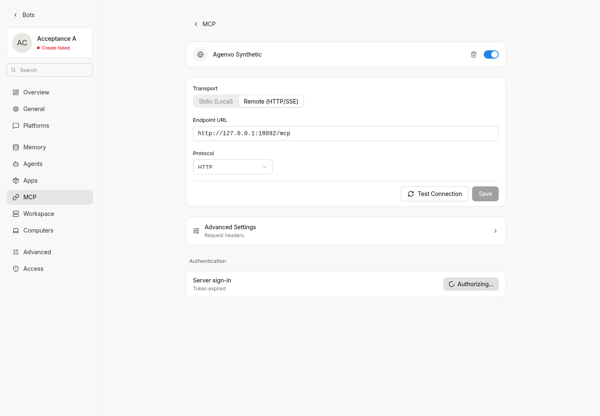
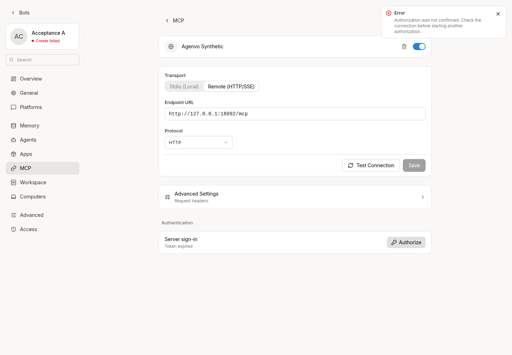
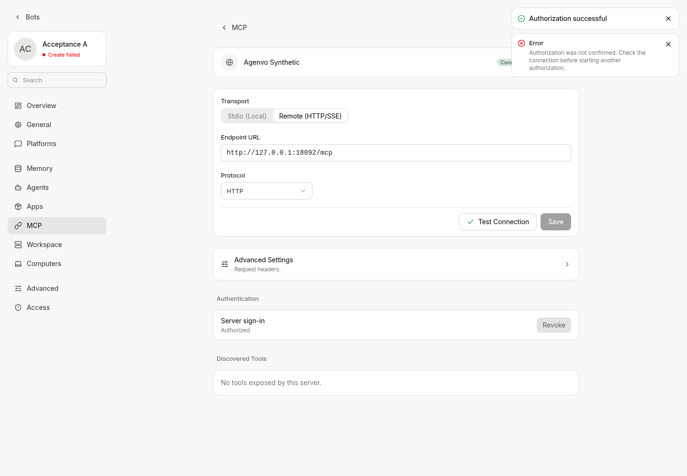

# MCP reauthorization verification

An existing token is not evidence that a new authorization completed. The Web
MCP settings flow now requires both the current authorization transaction's
successful receipt and a successful live connection probe before showing its
success toast. It never uses token presence, expiry changes or a window message
as a substitute for that receipt.

## Contract

- Starting authorization returns an opaque `authorization_id` alongside the
  existing URL. The normal PKCE, registered client, callback and scopes remain
  unchanged.
- The authenticated status endpoint accepts that ID and returns `pending`,
  `succeeded`, `failed` or `unknown`. The ID is an observation selector, not a
  credential. Both start and status verify the Bot/connection association in
  addition to Bot access. Status responses use `Cache-Control: no-store`.
- `succeeded` means this code exchange saved its tokens and enabled OAuth for
  the connection. It does not mean the remote MCP connection is usable. The
  callback page says authorization was saved; Web then checks the connection.
- An old token, failed exchange, closed popup, wrong receipt, late response or
  response from a previous Bot cannot finish the current flow successfully.
  Closing or timing out reports an unconfirmed outcome, without revoking a
  possibly completed exchange or starting authorization again.
- Polling is serialized, bounded to two minutes and aborted on disposal. Only
  the captured Bot/connection is probed. A saved exchange with a failed probe
  has a distinct message. No task is submitted by this flow.

Receipts are bounded process-local observations: one current transaction per
connection, at most 1,024 connections, ten-minute expiry. Request-scoped service
copies share the observer. A restart, eviction or another replica without the
observation returns `unknown`; it must not infer completion from stored tokens.
This patch adds no database migration or distributed receipt mechanism. Deploying
across replicas requires routing the flow to the same process to observe success.
The existing authorization-state storage and concurrent token-refresh behavior
are not redesigned. An older backend without transaction receipts cannot produce
a successful result in the new Web flow.

## Verification

The cloud development server was built from `./cmd/agent`, with the current Web
source served at `http://127.0.0.1:18082`. The actual Bot MCP settings page used an
isolated localhost provider, synthetic expired token and existing synthetic
client. No production credential or endpoint was used.

The browser left consent pending while an old token existed, ignored a forged
callback message, closed that popup without a success toast, then completed a
new synthetic consent through actual S256 PKCE exchange and a live MCP probe.
That completed fixture made one code exchange, zero registrations, one successful
tools probe and zero business calls. Existing independent health probes made
refresh attempts while the expired token was present; this change does not add
refresh rate limiting. Computer-operation and session-run snapshots were
unchanged. Temporary credentials and connection changes were restored afterward.

Automated tests cover token and connection persistence failures, exchange
rejection, receipt expiry/restart/supersession, connection ownership, late status
and probe results, Bot switches, cancellation and timeout. Race tests pass for
MCP and handlers; targeted Web tests, lint and SDK type checking pass. The Agent
runtime/contextview trees still match the recorded official baseline. This is
synthetic verification, not evidence of production reauthorization or a Windows
Pi task completing.

The screenshots show the running application. They do not replace the backend
regressions or constitute human QA. The synthetic Bot's unrelated workspace
creation status is not part of this authorization check.
