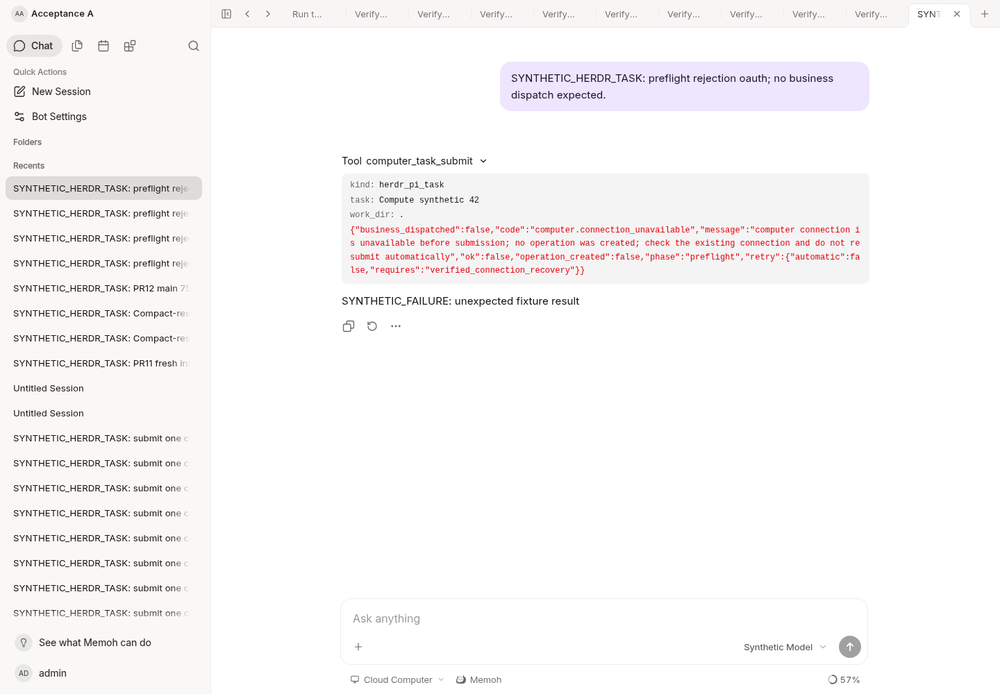

# MCP OAuth refresh diagnostics

This change adds bounded diagnostics to the existing OAuth token-refresh path.
It does not renew credentials, create connections, change grants, retry a task,
or establish that a Windows task can run. Connection recovery remains a
separate deployment action after the observed failure has been classified.

The federation warning retains its existing connection identifier and request
context. Instead of stringifying the underlying error, it emits:

- `oauth_failure_category`: a fixed category from the table below.
- `oauth_http_status`: the received HTTP status, only when available.
- `oauth_error_code`: an allowlisted OAuth error code, only when recognized.

| Category | Evidence |
| --- | --- |
| `oauth_rejected` | A recognized OAuth error in a bounded JSON/form response. The code is one of `invalid_request`, `invalid_client`, `invalid_grant`, `unauthorized_client`, `unsupported_grant_type`, `invalid_scope`, `access_denied`, `server_error`, or `temporarily_unavailable`. |
| `http_error` | A non-200 response without a recognized OAuth error code. The status alone does not prove reauthorization is needed. |
| `timeout`, `canceled` | Typed timeout/cancellation evidence. Cancellation identity is preserved without retaining a URL-bearing wrapper. |
| `dns`, `connection`, `tls`, `transport` | Typed transport evidence; unclassified failures stay `transport`. No error-message substring classification is used. |
| `request_invalid` | The refresh request could not be constructed. |
| `response_read`, `response_invalid` | The bounded response could not be read or parsed into a valid token response. |
| `access_token_missing`, `refresh_token_missing` | The required stored token is absent. |
| `token_persist_failed` | The existing attempt to save refreshed tokens failed. This observation does not change the existing return behavior. |
| `token_unavailable` | A token acquisition error without a known safe classification, such as a token lookup failure. |

No refresh token, access token, client secret, response body or description,
request header, endpoint, resource URL, DNS name or raw transport error is
included in these diagnostic fields. Refresh errors discard those private
causes after classification. Other OAuth flows, including initial discovery
and code exchange, are outside this refresh-only change.

There is no new retry loop, credential fallback, refresh lock or scheduler.
Each `GetValidToken` invocation still performs at most its existing one refresh
request. Independent incoming requests can each attempt a refresh; this is not
a global rate limit or a claim that refresh rotation races are solved. Existing
federation transport behavior is unchanged. A failure category must not be
treated as successful authentication or as permission to resubmit a business
task.

## Synthetic verification

Tests exercise actual refresh request construction, HTTP/form errors, invalid
JSON, missing tokens, response-read failures, cancellation, timeout, DNS,
connection, TLS and unclassified errors. They assert fixed metadata, one
request per invocation, no credentials stored after rejection and no secret
markers in diagnostics. The real federation logger is covered with an expired
synthetic token, including token lookup and persistence failures. Existing
successful OAuth journey/refresh tests remain in the suite.

The current cloud server and Web app at localhost ports 18080/18082 were also
exercised with an isolated fake token endpoint returning `invalid_grant` and a
synthetic offline MCP relay. One chat request reached the structured preflight
failure; there were zero new computer operations or Pi dispatches. Its UI
probes produced 15 safe diagnostic records. The temporary local OAuth row and
connection settings were restored afterward. This is synthetic verification,
not a production refresh diagnosis or real Windows acceptance.

The initial verification script expected JSON logs, while this development
server used text logs. Existing output was verified read-only; no task was
submitted again to repair the verifier.

## Existing unknown operation regression

The real source/host authorizer/workspace resolver is tested with an existing
unknown record, an earlier run and a nonzero revision. Both explicit and inferred
target submissions fail at the synthetic connection probe without claiming,
saving, changing the old record/revision or issuing any business method.
A separate standard MCP HTTP client test first creates one synthetic uncertain
Pi dispatch, then exercises same/different task attempts with an unavailable
connection. The complete ledger snapshot stays unchanged. After synthetic
connection recovery, the same request returns the old unknown receipt and a
different request returns its explicit conflict; neither dispatches again.
These are adversarial fixture calls, not an automatic retry policy.

Race tests and lint pass for the core and computer-task packages. The current
unchanged application was reopened read-only and the previous synthetic error
expanded; no new chat, task or OAuth authorization was started. This screenshot
shows the current-call error contract only. The new automated tests establish
the unknown-record invariant; the screenshot does not establish that invariant
or real Windows task completion.

