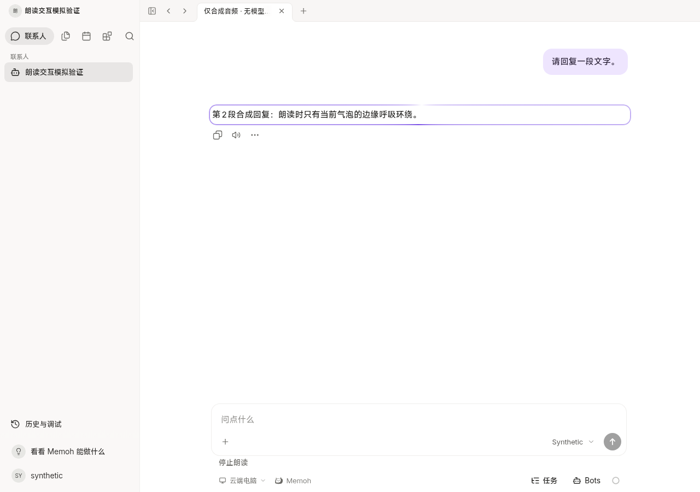
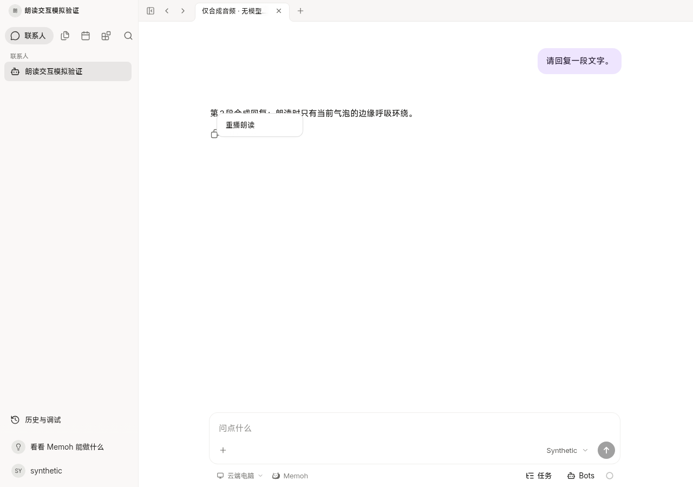
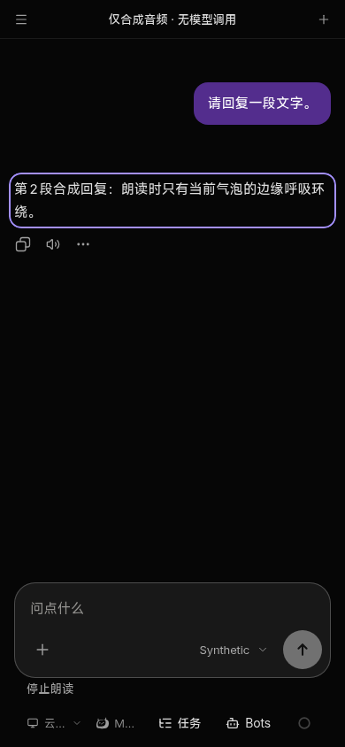

# Chat read-aloud source handoff

Base: `565c0b4b3386d87d057234efe6828479d35fcee0` (`particleflow/Memoh`). Independent branch: `feat/chat-read-aloud-20261028`. This is source and synthetic verification for the designated integration owner; no deployment, signing, production acceptance or real paid model invocation.

## Behavior and contract

The existing Bot `tts_model_id` binding enables reading new live replies. The client reads completed assistant text, excludes reasoning/tool/command/error content and explicit audio/voice attachments, and creates no chat message, attachment, durable history or audio control. Existing explicit `speak`/audio attachment generation and rendering are unchanged. The model's choice to invoke that existing tool is not modified in Agent core.

`POST /bots/{bot_id}/tts/playback` accepts `{ "text": "..." }`, at most 500 Unicode code points. It requires the same Bot `chat` permission as the local conversation, fails closed without its authorizer, and uses the existing audio service and selected model/voice configuration with no overrides. It returns audio bytes with their actual Content-Type, `private, no-store` and `nosniff`; it creates no temporary-file or media/history record. The old `/tts/synthesize` JSON/temp-ID contract remains unchanged. Swagger and the shared SDK are regenerated. Clients use the configured SDK origin/authentication, never a guessed origin or voice/model ID.

Long replies split into sequential requests within the existing 500-code-point limit. One media element plays one segment at a time. A generation guard plus AbortController discards late synthesis/play failures after interruption. Message click (capture phase), input including IME input, send, disabling voice, scope changes, pane hiding and unmount stop playback and clear the entire local speech queue. An interrupted live run's later segments cannot reclaim playback. No existing server follow-up/steer queue is changed. Opening/paginating/restoring history does not read it automatically; right click or touch long-press offers replay, with a keyboard-accessible replay action as well.

The frame belongs to a single assistant bubble. Only the native media `playing` event enables it; pause, waiting, end, interruption and errors remove it. Stable turn identity follows REST/history replacement while run identity separately prevents duplicate reading. Reduced motion uses a stationary frame; forced colors uses a system-color outline. Accessible playing status and composer stop/resume actions accompany the visual indicator.

Autoplay is conditional on browser policy. `NotAllowedError` retains the loaded segment and offers **Enable reading aloud**, whose gesture calls the existing media element's `play()` synchronously without a new synthesis. Other failures stop the queue without automatic retry; replay is explicit.

## Executed verification

- New media/eligibility/composable cases plus the added message-state case: **15 passed**, 5 unrelated existing cases skipped by name filter. Tests simulate synthesis, late success/failure, audio events, blocked autoplay/resume, Unicode chunking, input/click interruption, scope/config/unmount cancellation, retry runs, and single-bubble state.
- Two new Go test functions (including five rejection subcases) pass. They verify the configured model/config/context, ephemeral binary response and authorization-before-settings/synthesis boundary. No external provider is used.
- The task limits tests to the new differences. Package-wide legacy Go tests and aggregate CI were not rerun; commit size checks, affected lint and targeted regressions were executed explicitly without changing guard configuration.
- Changed-file ESLint, whole Web types, shared SDK types, Go lint for `internal/handlers` and `cmd/agent`, and the UI contract guard pass. The guard reports three pre-existing warnings. Required generation used `go generate ./internal/handlers` and the pinned `@hey-api/openapi-ts` generator. These are source checks, not field acceptance.
- Actual current Vite UI at `http://127.0.0.1:18082`, using intercepted API/WebSocket responses and a playable quiet synthetic PCM WAV: actual audio time advancement, pause/resume, click/input interruption, late-response cancellation, right-click replay, touch-pointer long-press, a single active frame, no audio controls, narrow/dark/reduced-motion state. Zero page errors. All server/provider traffic is simulated. This is not a healthy full Server/PG/TTS environment or real-provider UI acceptance.
- This controlled Chromium run **permitted autoplay** before a page gesture. It does not demonstrate unconditional autoplay elsewhere. The rejection/gesture-resume branch passed in mocked media tests, and must be checked on the field browsers/ArkWeb.

[Browser proof](browser-result.json), [browser runner](browser.mjs), [new test output](vitest.log), [Go tests](go-test.log), [Go lint](go-lint.log), [Web types](typecheck.log), [SDK types](sdk-typecheck.log), [ESLint](eslint.log), [UI contract](ui-contract.log).

## Harmony source compatibility and remaining acceptance

The production-base tree has no `mobile/` or ArkTS project. Read-only inspection used the exact historical Harmony source checkpoint `d213ee7842fc76527de712cd5b2d825a5697a613` recorded by the existing integration documentation. It is not asserted to be the current phone source or signed package.

- `mobile/client/mobile/build_memoh_web.py` consumes pinned shared Web source, patches `chat-pane.vue`, and patches `message-item.vue`'s existing media callback type. Its `HarmonyVoicePlayer` substitution applies to attachment audio, which this automatic reading path does not create or replace. Native microphone/voice upload remains untouched.
- [Anchor comparison](harmony-anchor-check.json), reproducible via `python3 docs/testing/chat-read-aloud/harmony-anchor-check.py`, compares 54 literal overlay anchors affecting changed shared files against the specified server baseline: **zero counts changed**. Some historical anchors already do not match the newer baseline; unchanged counts do not establish a complete generated phone build.
- `SharedChat.ets` and `SharedWebPolicy.ets` permit requests inside the already configured authenticated API prefix and `blob:begonia-client://app/` resources. The playback path needs no new origin, native bridge command, service, credential scope or TLS exception. Native context handling specializes images, leaving text to the shared page. Actual ArkWeb long-press/menu precedence, Blob audio playback, system reduced-motion propagation and autoplay behavior remain unverified.

The unique integration/native owner must lift the reviewed shared source and regenerated SDK into the **current** mobile source lock/archive and preserve all its existing overlays, identity checks, upload journals, permissions and queues. No full phone branch is copied into the server tree. Current native source/build inputs and a Harmony device were not provided here, so current generated-context compilation and signed-HAP/field experience are pending with that owner. The designated writer must also verify real configured TTS and actual browser autoplay constraints. No production or HAP action was attempted.
