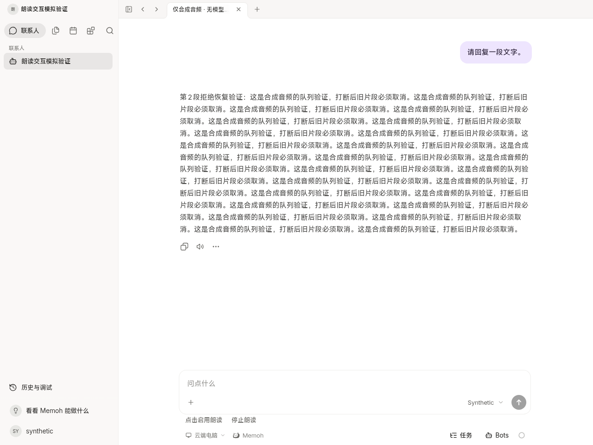
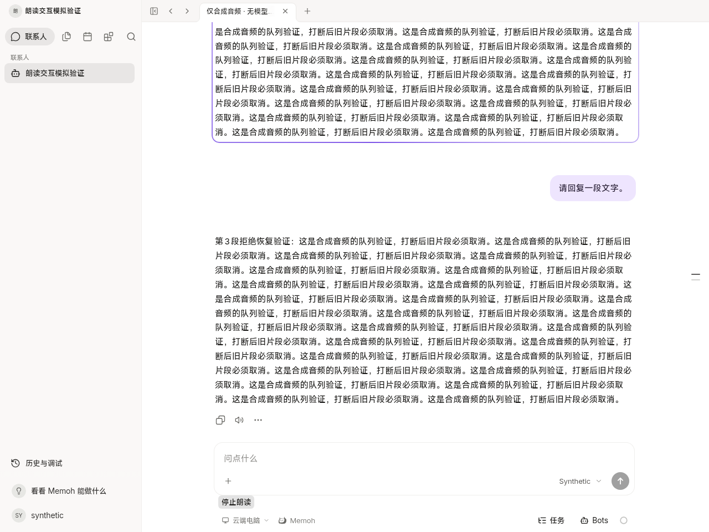
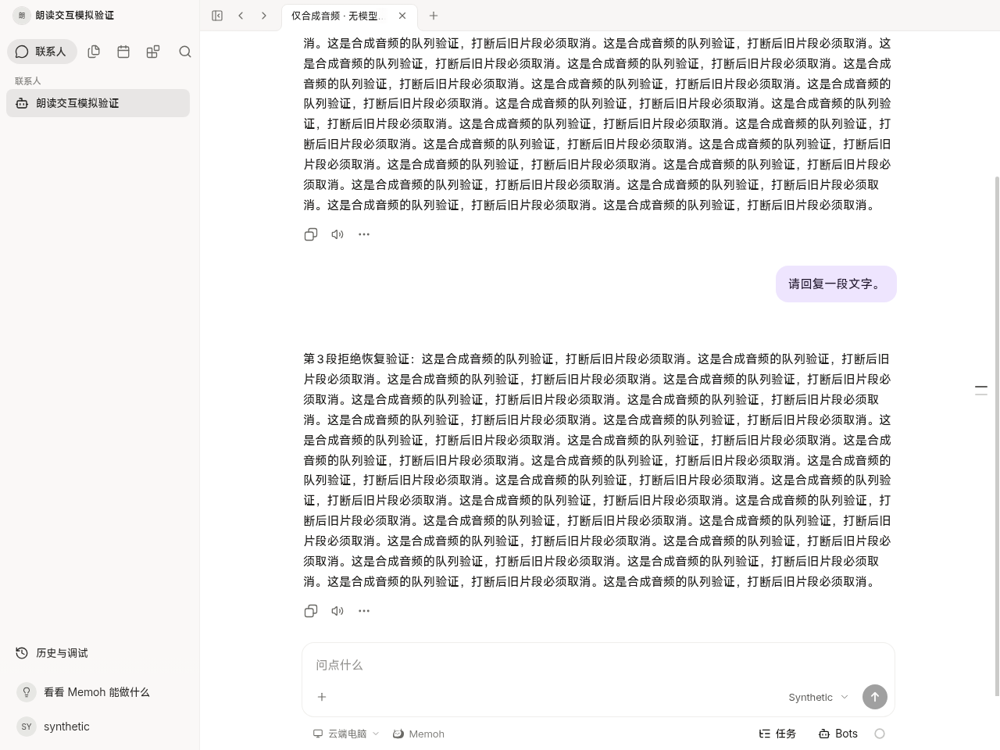
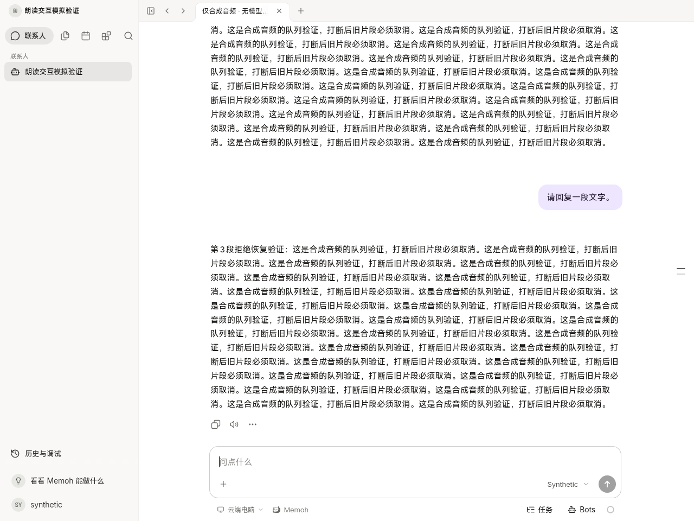

# Real Chromium autoplay refusal follow-up

This closes the Chromium refusal/gesture-recovery evidence gap for the existing read-aloud implementation. No product fix was required. The original source branch, tests and screenshots are preserved; this is an additional targeted run, not a rerun of the general playback suite.

## Source and environment

Tested source: `62abcbe1a50f2c0b9f29de855222dcf7d3da9661`. The six read-aloud controller/composable/chat/component/style files are byte-identical to the reported deployed source `a0a821a4cdaa32121a945d04e80c76bba4b6f2b4`; all three locale read-aloud dictionaries also match. [Exact hashes](source-comparison.json). This comparison does not test a deployed browser or server.

The current shared Web app ran in the original isolated environment at loopback `http://127.0.0.1:18482` with Chromium `154.0.8037.57`. A temporary native WebSocket fixture supplied synthetic runtime frames through Vite's ordinary proxy. HTTP API fixtures returned synthetic Bot/session/settings records and a playable two-second PCM WAV. No TTS provider, production account, NAS, field browser or signed Harmony package was used. Both task-owned preview and fixture closed in `finally`; the preview port was checked closed after completion.

## Why the previous fixture could not establish refusal

The installed Playwright Chromium evaluation implementation marks page function calls as user gestures. Its WebSocket routing dispatcher also uses page evaluation to inject routed messages. The original fixture used both; a diagnostic run observed `navigator.userActivation.hasBeenActive === true` before requesting playback. The original allowed-playback evidence remains valid for its stated scope, but cannot prove a fresh-document policy rejection. [Playwright implementation](https://github.com/microsoft/playwright/blob/main/packages/playwright-core/src/server/chromium/crExecutionContext.ts).

This runner uses raw CDP `Runtime.evaluate` with `userGesture: false` for all observation and polling, and raw `Page.captureScreenshot` for capture. It does not use Playwright's page-function evaluation, locator inspection or `routeWebSocket` before refusal. CDP documents the explicit evaluation gesture parameter. [CDP Runtime.evaluate](https://chromedevtools.github.io/devtools-protocol/tot/Runtime/#method-evaluate).

The browser uses the actual document-activation policy and disables media-engagement bypass/preload through Chrome's documented developer switches. No synthetic `NotAllowedError`, media event or rejection Promise is injected. The media observer invokes the captured native `HTMLMediaElement.play` implementation and returns its original Promise unchanged; it only records settlement. The `Audio` constructor is unchanged. Native input is delivered through CDP Input and captured as trusted browser events. The headless driver's output mute does not change the tested media element: recorded `muted=false`, `volume=1`. [Chrome autoplay policy and test switches](https://developer.chrome.com/blog/autoplay).

## New observed checkpoints

| Checkpoint | Actual result |
| --- | --- |
| Fresh document refusal | Before any input, activation was false/never active. The native Promise rejected with `NotAllowedError`, a genuine DOMException. Media remained paused at time zero; the bubble state was `blocked`, with animation `none` and a visible Enable reading aloud action. |
| Trusted enable gesture | A trusted pointer click invoked the existing Enable action. The same media object and Blob URL fulfilled `play()`, its time advanced, and only its corresponding bubble animated. Synthesis requests stayed at one. |
| Message click after refusal/recovery | A trusted click stopped media, cleared its source and removed all bubble motion. Pending long-reply chunks plus a later queued reply did not start after more than the old WAV duration or after a repeated completed runtime snapshot. Request count stayed one. |
| Explicit replay | Trusted right-click and menu selection replayed only the selected later message. One additional synthetic audio request occurred, with the frame on that selected bubble. |
| Input interruption | Trusted native text input stopped the replay and pending chunks. Clearing the draft and repeating completed state did not restore playback/motion. Requests stayed at two; zero page errors and zero unrelated API writes. |

[Detailed native Promise, activation, input, media and animation observations](result.json), [run output](browser.log), [verification metadata](verification.json), [runner lint](lint.log), [targeted runner](../browser-autoplay-refusal.mjs).

## Reproduction and limits

Run `node docs/testing/chat-read-aloud/browser-autoplay-refusal.mjs` from this checkout with its existing pnpm dependencies and isolated Playwright/Chromium installation. The runner owns its temporary Vite and WebSocket fixture; the chosen loopback preview port must be free. `READ_ALOUD_ORIGIN` and `READ_ALOUD_EVIDENCE` can select another loopback port/output directory. Do not point it at a production origin.

Only this refusal-specific browser run and changed-runner ESLint were executed. The previously passed 15 media/UI regressions, account JWT tests and general playback/browser matrix were not repeated. The actual browser policy path is now verified in this controlled Chromium environment. This does not establish Safari, Firefox, ArkWeb, a signed Harmony package, real TTS quality, field autoplay preferences or production acceptance. No deployment, signing, voice-model change or paid call occurred.
