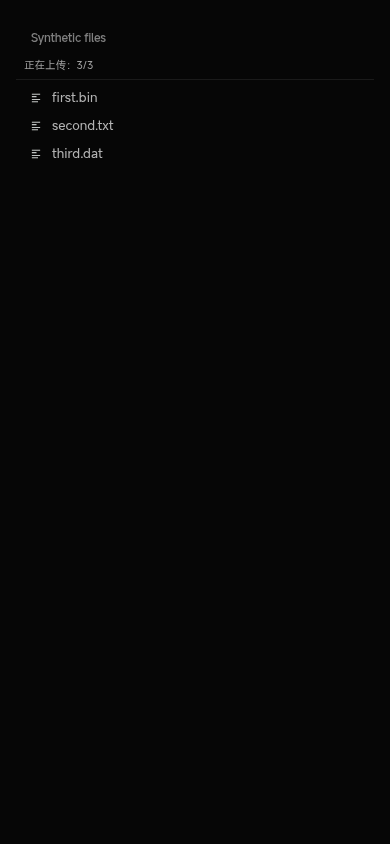

# Harmony ordinary Files multi-selection alignment

Exact shared delta **565c0b4b3386d87d057234efe6828479d35fcee0**, direct parent **5b797fb970f4b67ab4d79d27a530f0ea540a8ccb**. Phone product parent **a72a3406d6376026d2c8d4dbfdd0cc6b1fa8a406** (the retained 1.0.24 build). The Page checklist was read at sequence101: its F04 entry still described the earlier reproduction, not this completed upstream checkpoint. [GitHub integration readback](upstream-ci.json) independently confirms six completed successful pull-request workflows for the exact 565 head; this is upstream CI, not a claim that this new phone source head has remote CI.

## Exact scope

Only `apps/web/src/components/sidebar/files-pane.vue` changes in the generated product. Its existing ordinary file input gains `multiple`, the handler consumes every selected File, and it reuses the existing concurrency-four batch. Busy selections are ignored and queued work keeps the Bot captured at batch start; post-completion navigation is guarded against switching Bots. No new UI, upload API, service, configuration, receipt policy, permission or transport is introduced. Folder/drop batching remains the same implementation.

The direct 5b parent also has a separate listDirectory active/Bot-read guard absent from the older phone composition. That unrelated parent change is deliberately not imported. The JSON overlay records both the exact full upstream file SHA and the actual composed baseline/output SHA; this task does not claim whole-tree identity with5b/565. Existing native save logic and the phone's other adapters are retained.

[Generated comparison against the actual 1.0.24 context](generated-diff.json) proves exactly two generated-file differences: the one component and its exact upstream `files-pane.upload.test.ts`. Only the files-pane adapter hash changes; all44 other reviewed entries and both existing test adaptations remain byte-identical. [Source inventory / empty configuration / exact45+2 guard](source-guard.log) passes172 entries and181 source/support files. The SDK and all native inputs are unchanged. Historical19 unidentified source changes remain unverified.

## Checks actually run

- **Red:** on the old phone component, the exact new upstream suite produced4 intended failures/1 pass: missing multiple, only one of three items dispatched, partial-failure flow and concurrency/original-Bot gate. [Original log](red-phone-context.log).
- **Green:** the same unchanged upstream suite passes **5/5**, including read-only/empty selection, partial failure, busy gate and a six-file batch that retains its original Bot after switching. [Log](green-phone-context.log).
- Complete generated Web [typecheck](types.log) and affected [ESLint](lint.log) pass with zero errors/warnings. The existing generated-source guard passes; no rule/assertion was weakened. Unrelated previous attachment/paused voice failures were not rerun or relabeled as passed.
- Chromium at `http://127.0.0.1:18953/review-files.html` uses the real generated FilesPane and generated SDK multipart serialization. Its real browser FileList selects three synthetic files. A receiver inside the temporary Vite fixture checks actual HTTP request bodies, original Bot, destination path, file length and SHA256, and writes those synthetic bytes locally. It received **262,149 / 5,643 / 545 bytes**, each matching its source, with zero duplicates/page errors. [Result](browser-result.json), [receiver digests](http-received.json).

The screenshot was opened and inspected: all three filenames are visible and the existing progress line reads3/3. This is isolated component/SDK/HTTP verification, not a complete Server/PG flow, NAS acceptance or physical ArkWeb device validation. The initial browser harness tried to inspect binary multipart through Playwright request metadata, which omitted file contents; the harness was corrected to inspect the actual HTTP body. No product change was made for that measurement limitation. The initial log remains in the private evidence directory.

## Existing Harmony seams

- `SharedChat.ets`416–436 already handles official `FileSelectorMode.FileOpenMultipleMode` with the existing maximum20 and passes the complete returned URI list to `handleFileList`; it does not truncate to the first URI. Existing active/generation checks cancel obsolete chooser results.
- `NativePhotoSelection.ets`19–43 forwards that maximum to the existing Document/Photo picker and iterates all returned URIs. Existing image conversion behavior is unchanged; the byte-exact browser samples here are ordinary non-image files.
- The retained official SDK26.0.0.105 declares `FileOpenMultipleMode = 1` in `ets/component/web.d.ts`1348. No SDK download/build or platform modification is needed for this source alignment.
- The generated FilesPane still calls its existing `saveWorkspaceFile` seam for saves. That function retains original Bot/path, revision/size and SHA256 checks; existing media originals remain on their scoped original path. [Unchanged native/save-source hashes](native-seams.json).

These are source/SDK findings, not a claim that the phone system picker or phone/NAS transfer was exercised. Ordinary Files multipart behavior is not a proof of cross-process media receipt recovery, all-client pagination or the complete formal NAS transfer acceptance.

## Next package boundary

A **new HAP is necessary to deliver this product resource change**: the signed/distributed1.0.24 cannot acquire it from a server update. This round does not bump versions, build another HAP, sign, upload an artifact, operate Windows/NAS or change the download index. Old1.0.24, identity/permissions, login, minimal Bot/Agent UI, private configuration slot, attachments and history are untouched.

For the next single build, freeze a unified compatible candidate containing565, consume this exact phone source, verify the next unused incremented version/code and reuse the retained SDK/pipeline once. There is no new backend endpoint, SDK field, credential or configuration prerequisite for this delta. The existing Windows injection/signing owner and single onsite writer keep their roles. Real phone picker/transfer acceptance remains open; no voice feature is included.

To reproduce the isolated browser check, prepare the standard generated context and reuse installed dependencies. Set `HARMONY_GENERATED_CONTEXT` to that checkout, run `node component-server.mjs` here, then `python3 browser-check.py`. This uses only local synthetic fixtures and a temporary in-process HTTP receiver; stop it after verification. Never point it at production.
