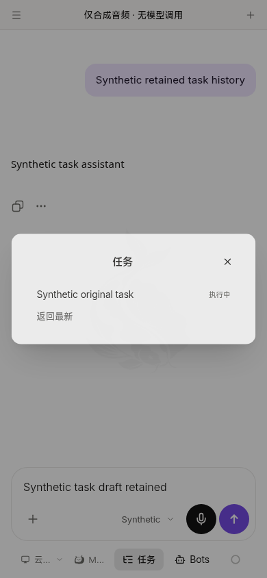
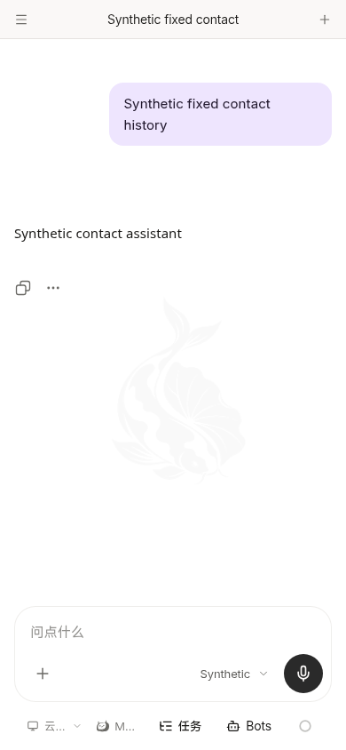

# Harmony source-only Home/task admission alignment

Parent **3eaf394d1c1bd09a90bf63b5d701e2a06c11d52d**. Exact shared **5a42d013e801cb6229ee029113e3a63782bc3e13**, tree **3ca90fd7838979049f5889516836d55654a87811**, was fetched from the original Git remote. All15 entries in `docs/testing/unified-home-admission-final/source-consumer-map.json` match their authoritative SHA256. [Actual generated mapping](mapping.json) distinguishes whole-file identity from retained native adaptations.

## Current allowed scope only

This follows a separately denied build/public-artifact action. None of that action was executed or retried here. No HAP build, new version selection, artifact upload, signing, NAS/Windows operation, SDK download or TLS/service-address/official Agent-core change occurred. The existing version stays1.0.27. The old26 and27 HAPs retain exact original byte hashes; current source is newer and is not falsely attributed to those packages. Build/handoff authorization remains pending with the parent task.

The existing guarded-source mechanism now consumes the shared Home/Dockview admission chain, original task history/run/turn resolution, contact presentation and read-aloud visibility gate. Home, ChatWorkspace, panel-chat, visibility injection key and useChatReadAloud are taken together. Original task metadata is rechecked; unavailable/mismatched anchors never substitute latest runs. `destination.turn_id` is the sole generated SDK field addition, in the existing directory type overlay. No endpoint, account permission or new transport protocol was added.

The new source input contains8 existing guarded file deltas and12 new/overridden shared source/test files, plus the three directory-locale updates. Literal source checks remain. The raw archived Web base remains9bb with prior checked overlays; the effective new layer is5a42, not a claim of complete Web-tree equality. Native upload/journal exclusions, the original single composer button and other phone adaptations are retained rather than overwritten with whole shared files.

## Local evidence

- [Complete generated types](types.log.txt): pass.
- [30 affected cases](delta-tests.log.txt): Home read-aloud admission, task speech anchors, run-anchor lifecycle, original-history links and directory navigation pass. Unchanged full matrices and official SDK compilation were not repeated.
- [Source/adapter checks](source.log.txt):176 text inputs,7 approved PNG inputs,192 mobile files;45+2 reviewed adapters retained. Seven hash entries change only for composer/message/home/workspace and three locales;38 remain unchanged. No guard is relaxed.
- [Affected logic lint](lint.log.txt): zero errors/warnings.
- [390px controlled browser](result.json): generated SDK uses existing account auth and original directory record. Exact run/turn/record reaches the Dockview task anchor and original task history is visible. Modal Back precedes route Back; fixed contact and original task draft/tab/login survive. No page errors. All API/WebSocket/native traffic is synthetic; only existing contact resolution is a synthetic POST, no real model or task execution.

The last browser assertion explicitly verifies Dockview's original run/turn/record, rather than merely accepting a visible composer. Unit Home/audio evidence and this controlled browser do not establish ArkWeb gesture/audio, NAS authority, device upgrade/login or physical files. Screenshots were opened/inspected. No native package was generated or published for this source.

The [retained input hashes](mapping.json) prove no changes to identity/version/permissions, approved15-file whale/koi/background resource set, login/service-origin handling, native attachment owners or Back consumer. No legacy history or old package was removed. This is a local source checkpoint awaiting the separately scoped construction/handoff confirmation.
