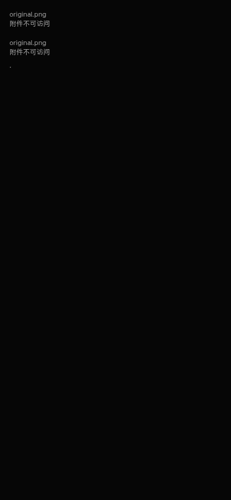
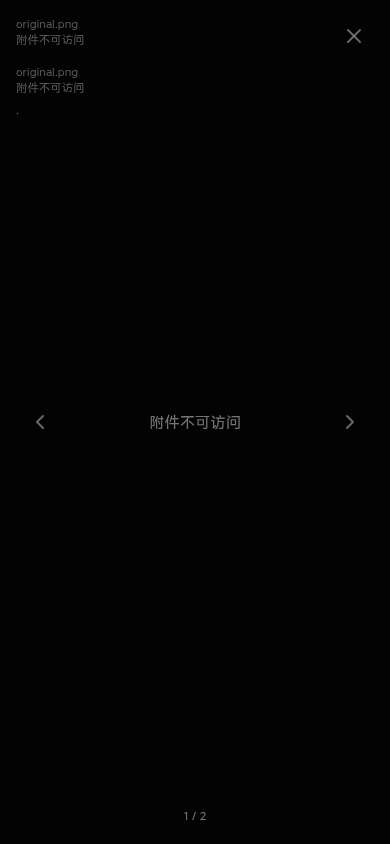

# Harmony inaccessible attachment presentation

Source-only follow-up to the signed 1.0.23 handoff. Exact shared delta: `dfd68e8058b2f982c877be0e36e402c7f2d0c163`, parent `45788bed060e73a6e5f9e183e927e4898689766f`. Phone source parent: `258c13ae129aa8f5fab5286191f1f2cabaa362b4`.

The official Library helper materialized `libfile_1283114bc3d48191ab09d4615df796f2` in this consumer. The ZIP was 18,961 bytes, SHA256 `bd0a5ecdb6efa45c87f5a45cf6ff9c3cf64d93a71048a20d51931bfd38ad38b1`; CRC, all ten manifest entries and all eleven archive members passed. Its Git bundle verified exactly one commit and the exact 457 prerequisite. The source bundle was read locally; no remote existence or CI is inferred from that read.

## Product mapping

Only these five generated product files change:

- `attachment-block.vue`: inaccessible status replaces failed content/thumbnail previews.
- `chat-attachment-card.vue`: emits the failed media URL to its existing parent.
- `media-gallery-lightbox.vue`: keeps the failed identity inaccessible across navigation/reopen.
- `en.json` and `zh.json`: only `chat.attachmentUnavailable` is added.

[Exact source hashes and composition mapping](shared-mapping.json) and [generated-tree difference](generated-diff.json) retain the upstream identities. The existing phone attachment baseline predates the shared Web-only durable-save implementation; only the presentation deltas are applied to it. The phone continues using authenticated `originalBlob`, integrity verification, Blob rendering and the existing native save bridge. The guarded builder rejects source/fragment/hash drift.

Native adaptations handle failures before an `` exists: a rejected original reader or predecode becomes the same inaccessible state. DOM decode failures map the Blob URL back to its scoped original identity. Failure state is component-local, retained only for that mounted lifetime; no automatic retry or wider authorization fallback is added. Aborted obsolete readers do not mark their replacement inaccessible. Gallery close/back/focus and normal preview behavior remain in the existing component.

The generated context changes exactly five product files and adds two tests: the original shared gallery failure regression and phone verified-reader regressions. Forty of forty-five reviewed adapter entries are unchanged; the five changed entries are precisely the three components and the two locale files. Both pre-existing attachment test adaptations remain unchanged. Source inventory: 171 entries / 180 source and support files. Historical nineteen unverified changes remain unverified.

## Actual verification

- [17 tests / three suites passed](final-tests.log): nine phone reader/decode/abort/healthy cases, the exact shared gallery failure case and seven scoped delegation cases.
- [Complete generated Web typecheck passed](final-types.log).
- [Affected lint passed](final-lint.log): zero errors, fifteen warnings retained without suppressions.
- [Source manifest, empty public configuration, archive hash and exact 45+2 adapter guard passed](source-guard.log).
- Chromium exercised the current generated Vue components at `http://127.0.0.1:18952/review-inaccessible.html`, with the real phone authenticated original-reader/hash/Blob implementation and synthetic scoped HTTP responses. Two mounted variants each made one denied read; explicitly opening the gallery made its first denied read. Previous/next and close/reopen added zero denied reads. Healthy images decoded. No broader Bot/hash request, write, reference mutation or page error occurred. [Numeric result](browser-result.json).

The two fixture rows above exercise the content and attachment variants independently; they are not two statuses for one product instance.

[Desktop capture](desktop-inaccessible.png). Screenshots were opened and inspected. The initial temporary preview omitted the existing `#` UI alias; its second setup omitted the real cached dependency path from Vite's serving list and waited for global network idle. These local harness failures were corrected without product changes; initial logs remain in the private evidence directory.

### Inherited test limitations

The broader initial run also executed two old browser-oriented suites: `attachment-block.test.ts` and `useMediaGallery.test.ts`. They fail the same three assertions on the untouched 1.0.23 components: two anchor-download assertions conflict with the existing native-save bridge, and a gallery equality assertion omits the existing `original` reader function. The old mock also omits `toast`, producing two unhandled rejections. [Original baseline log](inherited-baseline-tests.log), [initial candidate log](phone-tests-initial.log). No assertion was weakened or product behavior changed to hide these failures. These two inherited suites are not reported as passed.

The complete generated-context [UI guard](ui-contract-generated.log) also retains four violations in the two unchanged voice adapters (`HarmonyVoiceInput.vue` loader and `HarmonyVoicePlayer.vue` alpha utility, two reports each). Those files are byte-identical to 1.0.23 in the generated-tree comparison. No new violation names an affected attachment component; no baseline or rule was relaxed. Voice/TTS/video are outside this task, so the full generated UI guard is not reported as passed. The source-repository guard alone passes and is a different scope.

## Reproduce the isolated component check

Prepare the normal generated source context with `python3 scripts/check-harmony-source.py`, then reuse the project's declared, already-installed dependencies. No SDK, package install or HAP build is needed. Set `HARMONY_GENERATED_CONTEXT` to that checkout and run `node component-server.mjs`, then `python3 browser-check.py` from this evidence directory. The fixture uses the actual three generated components, current style tokens and real Chinese/English messages; only the surrounding chat-store/keyboard ports and HTTP responses are isolated. Close the temporary server when done. The helper copies its two review entry files into the generated checkout, outside product `src`.

## Delivery boundary

No HAP build, version bump, signing, artifact upload, release, deployment, history write or authorization change occurred. The published/signed 1.0.23 artifact remains the original `258c13ae` build and does not contain this follow-up. Original HAP SHA256 remains `4723b725ddd3fb9def762ef6405dfdd4534e883ff4f2fa07043649a6bc7bb0f5`.

This is isolated cloud source verification, not a complete Server/PG application flow, actual ArkWeb/phone acceptance or restored access to historical denied attachments. Backend size change `71bcb4d` is excluded. Once the unified candidate is fixed, these changed product resources require one new incremented-version build and the original Windows injection/signing handoff; this round deliberately performs neither.
