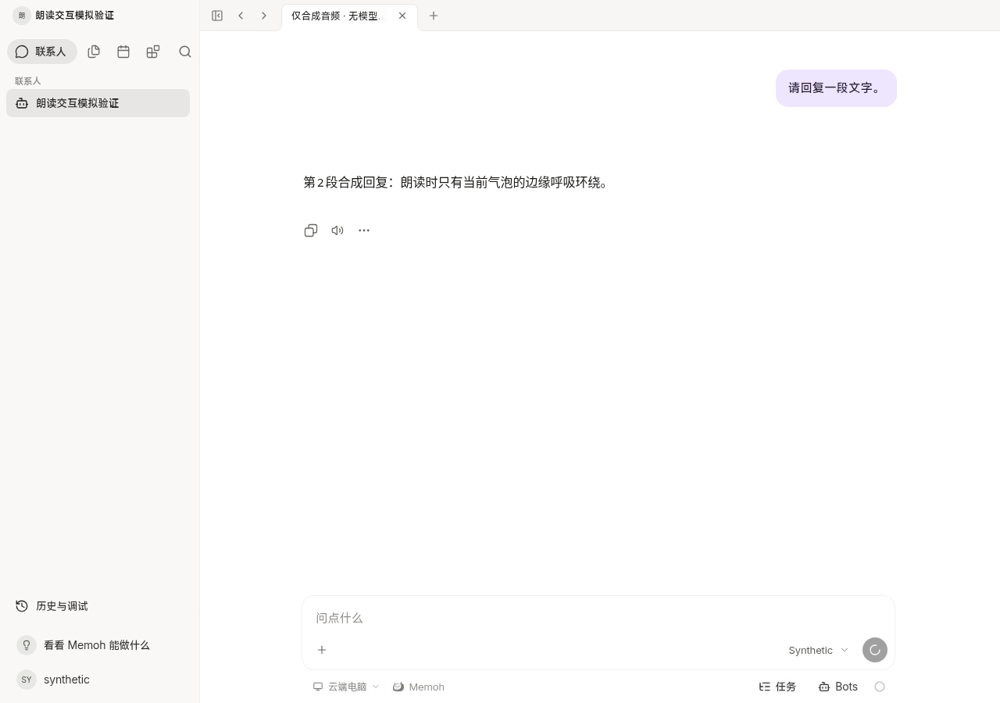
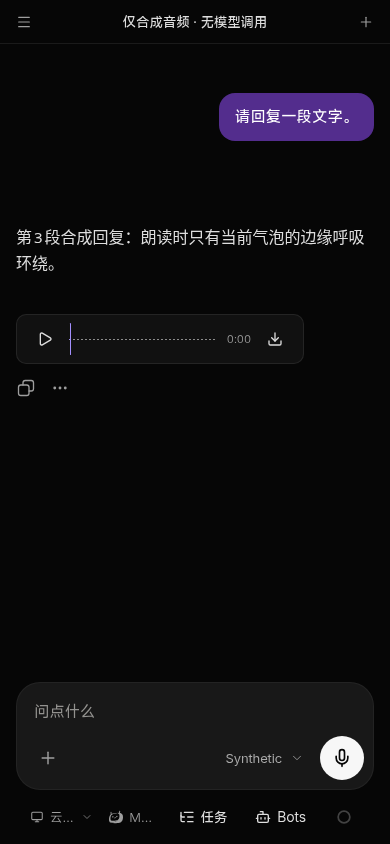

# Harmony final source follow-up: voice rules and cancellation

Source-only continuation of `aed6e4259c3102af18134cbc14cd8034d15d0ffc`. No version bump, HAP build, signing, artifact upload, provider call, field change or icon resource is included. The rejected icon drafts are not consumed.

## Four rule reports, two concrete style sites

| Original source / report | Existing user flow | Exact correction |
| --- | --- | --- |
| `HarmonyVoiceInput.vue:205`, hand-spun loader + count1/baseline0 | The retained record-to-text busy state alongside read-aloud/input interruption | Replace `LoaderCircle`/literal `animate-spin` with existing UI `Spinner`; keep busy/disabled, size and reduced-motion behavior. No extra indicator/control or recording logic. |
| `HarmonyVoicePlayer.vue:99`, raw alpha + count1/baseline0 | Retained explicit audio attachment controls; not a new automatic-read-aloud player | Replace `bg-muted/30` with existing `bg-muted-soft`; keep all play/pause/seek/save behavior. Existing soft token is40%, rather than the former hand-written30%; inspected both current light/narrow dark contexts. No new color/token. |

These were not four independent functional failures. Nevertheless both live controls are corrected rather than grandfathered or waived. The [complete UI guard](ui-contract.log) now passes with zero violations. Its three unrelated warnings remain in Sidebar, SidebarInset and MCP detail; no new requirement or product change is created for them. [Affected lint](lint.log) has zero errors/75 existing formatting warnings across the two compact voice templates and the status files.

The requested automatic reply narration, click/input interruption, replay, one-bubble motion and retained explicit audio continue to use the same controller/components from `9c361d6`. Prior exact source/UI evidence remains in the [original handoff](../harmony-shared-navigation-read-aloud/README.md); the present changes do not replace them with extra controls or a broader UI acceptance program.

## Cancellation: expected abort, unhandled completion bug

The [preserved initial runtime stack](original-runtime-stack.log) locates the exception at `turn-end-invalidation.ts:19`, via real installed Pinia Colada0.21.2 `invalidateQueries` → `invalidate` → `cancel`. That function returns `Promise.all` over refetches. The existing turn-end watcher starts one detached refetch and a1500ms follow-up; replacement cancels a pending fetch. Cancelling it is expected, but leaving the returned Promise without a rejection handler creates an unhandled exception. It was not the read-aloud controller's abort path and is not dismissed because two later runs happened to pass.

The [real-Colada red run](cancel-red-colada.log) deterministically reproduced one unhandled AbortError and two unhandled real-error completions. All ordinary state assertions passed while the runner correctly failed on these three rejections. The minimal correction attaches a completion handler to this detached invalidation only. Colada still owns the genuine query error and last data; no error is converted to success, no query state is cleared, no retry or UI is added, and the existing immediate/follow-up refresh schedule remains intact.

[Portable shared source patch](turn-end-invalidation.patch) applies cleanly against the final upstream source. It contains the production completion handler, fixes the old fake cache to return a Promise like the real API, and adds two real-cache integration cases. It is also consumed through the existing guarded phone source overlay. The shared owner can take this patch; no backend/official Agent change is needed.

[Green tests](tests-green.log):10/10 across the two new real-Colada cases, four existing invalidation cases and four phone SDK seam cases. They prove the replacing fetch succeeds without an unhandled abort, and a genuine failure remains in `query.error` with the last data retained and only the original two refreshes. [Complete generated types](types.log) pass.

## Exact final mapping, without a false full-tree equivalence claim

The consumer materialized Library `libfile_b1031a095ac8819198dcd4ab165c2a95` version1 via the current official helper, verified ZIP CRC plus all seven manifest members, and checked all16 consumer hashes against Git source `a0a821a4cdaa32121a945d04e80c76bba4b6f2b4`, tree `5a8807ea25a14047295982f8fb4b6d15e1a0627b`. ZIP SHA256 is `aadb790c9d9a2f42ce640268fe2f3d38576188970b8b298e266c980ed1eb8c08`.

The13 read-aloud/UI/SDK inputs match the already consumed9c source byte-for-byte upstream; three navigation inputs match the consumed2b3 source. Thus no additional final shared product delta was missing. The [16-file mapping](source-mapping.json) records both upstream and actual generated phone hashes: exact mirrors are distinguished from retained phone adapters and append-only SDK additions. The local status completion correction is explicitly additional to a0, not falsely attributed to it. Existing45+2 phone adaptations and empty configuration remain unchanged; the [complete source/adapter guard](source-final.log) passes (173 entries/182 files).

The final upstream includes the reviewed playback account-JWT correction; this source-only task does not independently establish deployment readiness on NAS. There is no old synthesize endpoint fallback or swallowed404. Backend release readiness and actual ArkWeb/provider playback remain separate facts rather than new UI requirements.

## Targeted current browser evidence

The current generated phone context ran at `http://127.0.0.1:18954/#/bot/10000000-0000-4000-8000-000000000001`. All APIs/WebSockets/native commands use synthetic fixtures; quiet PCM audio only, no provider calls, TLS bypass or permission change. [Result](browser/result.json): one deliberately delayed status refetch was actually aborted, with zero page errors; mic begin/cancel stops reply audio; original photo selection remains; actual record-to-text conversion shows one Spinner with disabled/aria-busy, and reduced motion stops its rotation; explicit audio still plays/pauses/saves through the original bridge without synthesizing its caption.

Both screenshots were opened and inspected. Initial additional browser fixture attempts selected an absent handle attribute, a defs-only SVG path with no screen bounds, then a still-closing gesture; these were harness failures and did not cause product edits. The qualified run waits for the existing control and locates its real release action using the existing geometry function. Original temporary logs remain in private evidence; the original product failure and its strict red run are preserved above. This is controlled Chromium/bridge evidence, not ArkWeb, physical recording, real file bytes, provider speech or device acceptance.
