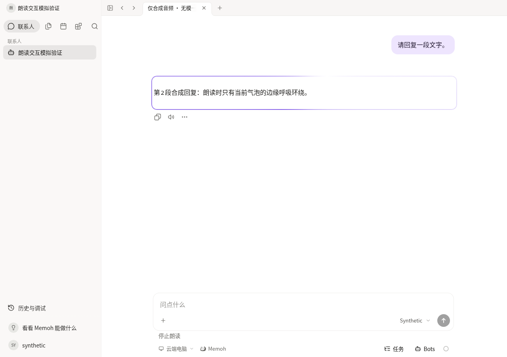
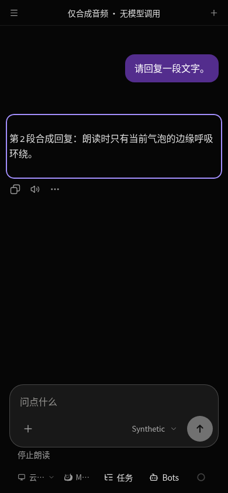
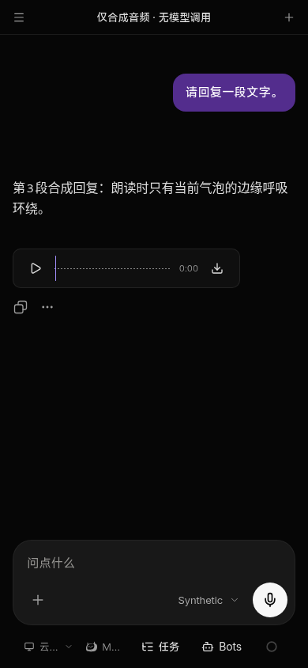

# Harmony current-context navigation and read-aloud source handoff

Current follow-up: [final source mapping, UI-rule corrections and reproduced cancellation fix](../harmony-readaloud-final-source-followup/README.md). This page and its locks retain the original `aed6e425` evidence; its open cancellation/UI findings are resolved by that follow-up.

Source-only follow-up to the qualified1.0.26 source `87477f610a68cf99d383bc505266c322d242d747`. No version bump, HAP build, signing, package/release publication, field operation or real provider request is performed. The icon owner remains separate; no icon resource is guessed or included here.

## Exact shared inputs and actual generated context

- Navigation source **2b3ffb40fe615426a01bff8720111eef22e6e0e3**, handoff **ee4cf1663c18397a4057164105314e19102e521b**. Its replacement patch matched all five current mirror inputs and then all five source outputs byte-for-byte. Trigger source/test, relation reader source/test and row source are consumed together, including five SHA/sourceCommit lock updates. The superseded0c0b filter patch is not stacked. Real-shaped tasks remain visible; only a verified recorded Agent association becomes navigable. No new task API/permission is added.
- Read-aloud source **9c361d60371703c157d344dcebfd439acc6d78de**, parent565. Guarded deltas are applied to the **actual current pre-phone source**, captured at the existing builder's pre-adapter boundary. They cover chat-pane, message-item/actions, read-aloud controller/composable and tests, style and three languages. The historical d213 anchor-count comparison is not used as current-context validation.
- New generated `POST /bots/{bot_id}/tts/playback` declarations/types/exports/Colada mutation are appended to the four current SDK files. Their prior bytes, including profile/transfer/recovery declarations, remain intact. No old SDK is substituted and no synthesize fallback is added.

[Exact paths/hashes and native-input checks](handoff-locks.json), [generated-tree comparison](generated-diff.json). Compared with the actual1.0.26 context there are exactly22 changed/added generated files, including six test files. Six reviewed adapter entries change: chat-pane, message-item, style and three locales;39 remain unchanged and the two existing attachment-test adaptations are retained. Source guard:173 entries/182 source/support files. The public configuration remains empty. Historical19 unidentified source changes remain unverified.

## Minimal native-specific correction

The unchanged native microphone consumes pointerdown. Actual-pointer Chromium verification reproduced an active reply audio frame after the existing `voice.start` command. The initial fake DOM pointer did not establish browser pointer capture and is a harness failure, not this regression.

Only the current composer ancestor gains a capture listener that checks `.harmony-voice-mic` and stops read-aloud before the native handler begins. There is no wrapper/extra UI, changed voice API, permission or recording implementation. Both subsequent native integration runs pass the original strict assertions. Native VoiceInput/VoicePlayer, recording, original save/download, resumable intake, service configuration, TLS URL validation, ArkTS Web policy and app identity/version inputs are byte-identical to1.0.26; hashes are included above.

## Verification actually performed

The upstream **68 navigation / 15 read-aloud** source cases are reused through exact file identities, not rerun or claimed as new phone results. New phone adaptation checks are:

- [Four generated-SDK seam tests](phone-adapter-qualified.log): configured HTTPS `/api` and header auth, silent history, binary response;403/404 remain explicit failures without retry or legacy endpoint; interruption aborts the real Request signal and late audio cannot start playback.
- Complete generated Web [typecheck](types-qualified.log) passes. A new test fixture initially spread a broadly typed ChatMessage union; it was narrowed to the actual assistant variant, without product changes or weaker checking. [Original type diagnostic](types-final.log).
- [Affected lint](lint-final.log): zero errors/26 warnings in existing mobile composition indentation. [Exact45+2/source guard](source-qualified.log) passes. No baseline/checking rule is relaxed.
- The complete generated [UI guard](ui-contract.log) still reports the same four violations in the unchanged VoiceInput/VoicePlayer (loader/alpha utility, two reports each), plus its three existing warnings. This is not reported as a full UI-guard pass; the new speech styles/navigation add no reported violation.

Vite served the **current generated phone context**, including its hash router and existing configuration bootstrap, at `http://127.0.0.1:18954/#/bot/10000000-0000-4000-8000-000000000001`. All API/WebSocket responses are intercepted, the configured HTTPS host is synthetic and no real provider is contacted. A quiet PCM WAV exercises real browser media events. No TLS-ignore flag, remote-debug permission or product policy change is used.

[Core browser result](core/result.json): actual time advancement; single playing bubble frame; pause/resume; message-click and input interruption; no restart on clearing input; late-response cancellation; touch long-press replay; reduced-motion stationary frame; no automatic media controls or page errors. This controlled Chromium permitted autoplay; field ArkWeb autoplay is unknown. The unchanged upstream blocked/gesture-resume test remains prior evidence.

[Long-press replay screenshot](core/long-press.png). All copied screenshots were captured from current source and opened/inspected.

[Native integration pass1](native-pass1/result.json) and [pass2](native-pass2/result.json): synthetic bridge begins/cancels recording through the old commands, new reply audio stops before recording, photos still reach `upload.select` with photos=true, and explicit audio retains its original play/pause/save controls and download.fetch/save/release handoff. Explicit audio captions are not synthesized twice. This validates JS/bridge contracts, not physical recording, file persistence or original-byte transfer inside ArkTS.

### Preserved non-green evidence

[Original microphone conflict](native-browser-pointer.log) failed with one playing frame instead of zero before the capture fix. The first post-fix native run passed its functional checks but captured one `signal is aborted without reason` page exception, alongside an aborted session-status request; [original log](native-browser-green.log) is retained. Two subsequent runs with stack capture passed with zero page errors, without relaxing assertions. The exception's origin was not proven and it is not dismissed as harmless or definitively attributed to old code. It remains a field/runtime follow-up if cancellation recurs.

Initial ordinary-Web history navigation failed the phone configuration bootstrap because deployment config is resolved relative to its hash-routed document. The harness was corrected to the existing phone hash route; configuration validation and stored login were not bypassed. A Vite fixture serving path for the already-cached fonts was also corrected. Initial logs remain in the private evidence directory. No full healthy Server/PG/TTS stack or physical ArkWeb device is claimed.

## Release prerequisites remain open

Backend Playback authentication P1 is owned separately. The client currently matches9c's text-only playback request and fails closed on missing/denied responses; it does not weaken authorization, use old endpoints or swallow404. Do not build or hand out a new HAP until the final shared/backend contract is frozen, its auth correction is verified and the new endpoint is actually ready on NAS. Reconcile any changed SDK/body fields then, and combine the designated icon resource only after its exact handoff arrives. Existing1.0.26 artifacts and signatures remain unchanged.
