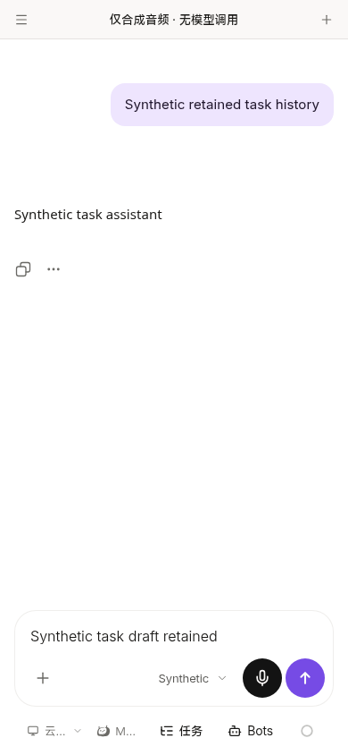
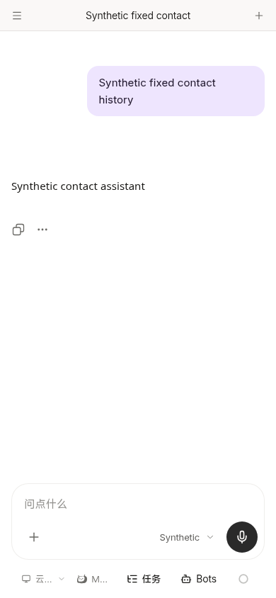

# Harmony Back from an explicit task link

Source-only phone consumer correction on `e27f100b096f7d8ec3195500be9866b30038d32c` (product baseline1155614). No server/shared Bot implementation, directory permission workaround, version, HAP, signing, icon, endpoint, login store or platform permission is changed.

## Minimal behavior

The existing `harmony-back.ts` retains modal/lightbox/service-cancel and page-owned Back priority. After those, a valid route named `bot` with explicit nonempty `query.session` and `params.botName` is below that Bot's primary contact. It consumes Back and performs **one** `router.replace({name:'bot',params:{botName}})`. No task/session/model query is carried into primary contact. The Bot comes from the existing URL, never a stale selected Bot or fabricated source/task association.

The handler does not call `selectBot`, open/close any tab, merge/adopt history, modify tokens, change origin or use WebView document history. The shared route owner opens the server-owned contact. The original execution tab and draft remain with their original identity. A plain Bot/contact root remains unhandled so the unchanged native shell can perform its ordinary background action. A modal is still handled before the task-route branch.

## Shared dependency is explicit

The phone product change is only seven lines in the existing Back module, plus its provenance hash and existing test file. It must be composed with the separately owned fixed-contact shared navigation `9f3dc3a288dd472aa039b8098b9f0d6808a2a46a` (or its verified final equivalent). The unupdated1155614 home page skips a same-Bot primary selection; changing the URL alone on that old shared tree is not a claim that the visible contact is fixed.

For browser validation only, the four contact product deltas were applied cleanly to the private generated phone checkout. They preserve its title/file-reference adaptations. They are not added to this consumer commit or substituted into its source locks. [Exact validation identities](handoff.json) distinguish the private combination from the unchanged shared inputs. No new task-directory code or pendingP2 change was consumed. The temporary four validation files were restored after checking; the final unified owner owns their integration.

## Differential and existing checks

- [Red on old adapter](red.log): two new explicit-task/one-route cases fail because Back returns false;13 other cases pass. Failure is preserved.
- [Green](green.log):15/15, including existing settings/layer roots, explicit task return, modal priority, plain-contact root and one route write with an actual Pinia selection store holding a different Bot/task. That store is not written by the adapter. No selection-first/history-back call is introduced; login survives.
- [Generated consumer context types](types.log), [affected lint](lint.log), [source/45+2 adaptation guard](source.log) pass. Existing officialSDK compilation is reused; no SDK download, build or weakened assertion.
- [Unchanged native method seam](native-seam-qualified.log):9 scenarios pass, including pending dispatch coalescing, stale-page suppression and normal root backgrounding. Its first local invocation lacked the CI-layout TypeScript cache path; the existing installed TypeScript was linked into that ignored cache, without changing SDK/test assertions or downloading a dependency. The initial failure log remains in private evidence.

## Actual controlled narrow UI

The current generated phone app ran at `http://127.0.0.1:18954/#/bot/{bot}?session={original-task}` with the fixed-contact shared validation dependency above, Chromium390x844 and all API/WebSocket/native requests intercepted. No real account or model was used. Synthetic task/contact sessions, runs and messages have distinct identities; history reads use the actual `session_id` API query parameter.

[Result](result.json) and [browser harness](browser.mjs): actual task dialog closes first; the next native callback writes one plain-Bot route **before** the shared contact selection; the original task panel and separate contact panel both remain; login is retained; the visible contact shows its own history rather than the old task; reopening the original explicit task link restores its draft. Returning again from the real contact root yields false. The only synthetic POST is the existing contact resolver; no bind, task submission or model request occurs. No page error is recorded.

Screenshots were opened and inspected. An earlier reused fixture reported the task history under the contact because it reused message identities and selected history by path instead of the API query. That run is excluded from acceptance; the fixture was corrected and the strict positive-contact/negative-task assertion above passes. No product change was made to accommodate the fixture. Temporary initial logs/images remain private.

This is browser/bridge and native-method-seam evidence, not actual ArkWeb Back gesture, device upgrade/login, NAS or signed-package acceptance. Package/build/signing remain unperformed as instructed. No extra UI, confirmation or recovery protocol is added.
