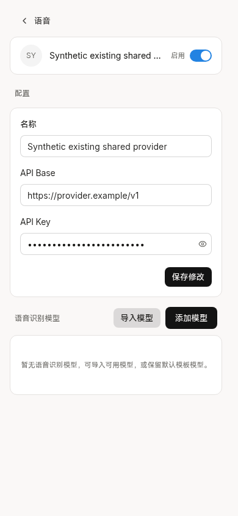

# Harmony source alignment to 9bb6fc3

The complete shared source now pins
`9bb6fc3d84387012b4e2f5daffcc95d81ece5db4`, replacing
`52609f7db4e59d7e528c2c5f8aa0330aa3ebbbe3`. The only Web difference is the
eight-line metadata mapping in `pages/transcription/provider-setting.vue`:
existing `openai-completions` and `openai-responses` providers select the native
`openai-transcription` parameter schema. Their existing provider identity and
configuration are reused. SDK Git trees are identical.

No phone component or builder change was needed. All 43 existing adaptation
results, plus the two attachment test adapters, remain identical. The lock,
its provenance hash and the generated-context baseline are the only non-evidence
changes. The fixed archive matched all 6,475 Git blobs; the cached UI gitlink and
dependency lock are unchanged. See [alignment](alignment.json) and
[archive verification](source-archive-verification.json).

## Acceptance material and scope

The fixed source's `docs/testing/b05-unified-combination/README.md` and
`docs/testing/shared-provider-transcription/README.md` were read, including their
B05/B06 remaining acceptance and same-provider configuration instructions.
They require a confirmed authorized ASR model and compatible native multipart
endpoint before real execution. This task neither supplies a real model ID nor
asserts that synthetic UI data proves transcription or same-session audio return.

The separately referenced latest project-wide acceptance checklist was not
located in readable source evidence or the targeted Library search; prior-task
context retrieval was unavailable. This document does not claim to have read
that missing checklist or to close overall project acceptance. The independently
verifiable fixed-source difference was still completed.

## Targeted checks

- Full generated Web typecheck passed; affected provider component ESLint passed
  with zero diagnostics. Existing dependencies were reused.
- The real generated phone Vite page at `http://127.0.0.1:4183`, Chromium390x844,
  was opened through the existing `/settings/providers?tab=voice` route.
  Two isolated cases used the same synthetic provider UUID with each compatible
  type. Both showed the native schema's base URL/key controls, retained the
  synthetic configuration after normal reload and kept the key masked.
- All observed audio management requests were GET. No management mutation,
  discovery/import, model test or paid ASR request was sent. Authentication and
  API/native responses were synthetic; this is not live NAS or phone acceptance.
- Existing 526 task/ACK/SDK evidence was reused. The original 21 Web/4 SDK
  comparison and 153 tests were not repeated for this one-file delta. No full
  native matrix, HAP build, version increment, signing or field action occurred.
- Native/config/transfer input hashes are byte-identical to source
  `c604c7da01b7d6dfae34d788a00d561db83eca09`. HTTP-to-HTTPS legacy binding,
  login storage, Bot/Agent observation, four attachment entries and original
  receipt/hash authorization remain intact. Public configuration is empty.

[Page report](provider-ui.json), [source check](source-check.txt),
[typecheck](typecheck.txt), [lint](lint.txt), and
[reproduction script](verify_provider_ui.py) provide the narrow evidence.

Screenshots were inspected. Initial fixture attempts used `/providers` instead
of the existing `/settings/providers` route and timed out before any audio route;
the fixture route alone was corrected. Both provider-type screenshots have
identical bytes because the same synthetic name, native schema and field values
are displayed; the page report separately records both returned client types.
No product change was needed for verification. No human or device QA is asserted.

## Next owner boundary

The 1.0.12 HAP/ZIP remain untouched and do not contain this newer source pin.
Field signing/distribution remains the original writer's responsibility.
[LAN/IPv6 integration requirements](network-owner-handoff.md) identify current
phone entry points and origin-bound identity without adding a routing protocol
or claiming automatic failover is implemented.
