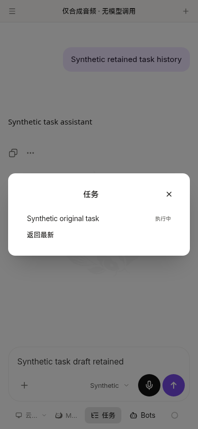
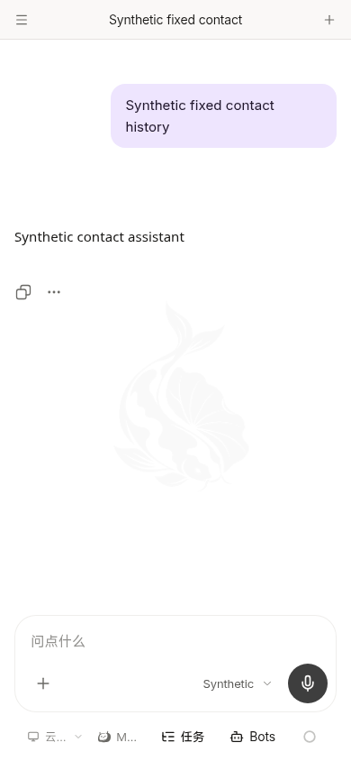

# Harmony shared contact/directory alignment to6a1fdcc1

Source parent: `afa677e031a56940a44798ac6dfc124954ebf0a5`. The consumer fetched exact shared **6a1fdcc1d61427c5cb02e0184a2b48a92645dac2** through the original Git remote and verified tree **f832a984bd2d8c1ea7844655fca7cc880f43ef42**. The optional Library package was not read or materialized. This is source/import/type alignment only: no version, production build, nativeSDK compile, HAP, signing, package upload or deployment.

## Actual shared delta

The fixed source covers route-intent-first Bot contact selection, same-Bot return, contact-pending protection for an empty/mobile dock, and the additive persisted task directory. The exact new directory component/reader, tests, locale subtrees and generated API declarations come from6a1; no temporary backend authority implementation is copied. Unknown-notification/reconciliation follow-up is not included.

One guarded source input (`shared-fixed-contact-task-directory.json`) feeds the existing builder mechanisms:8 existing source/test deltas,6 new or explicitly overridden source/test files,3 `chat.taskDirectory` subtrees and four SDK additions. The new SDK surface is two read GETs,13 generated types and four Colada query/key helpers. Prior SDK bytes remain an exact prefix; neither the SDK nor locales are replaced wholesale. Both functions exist exactly once in generated output. [Exact upstream/current mapping](source-sdk-mapping.json).

The existing detached-status cancellation code and two test files already match the final shared source byte-for-byte. They are recorded as equivalent and not applied twice. The old raw source archive pin remains9bb plus the existing checked overlay chain; the effective contact/directory/SDK pin is6a1. This is not a false claim that the full generated phone tree equals the full shared Git tree.

## Preserve the real phone seams

Only a0→6a deltas are applied to the actual current pre-phone sources. In particular, the current phone composer and workspace already differ from shared Web media recovery: whole-file copying would restore Web-only transfer imports/watchers and bypass native ownership. Those existing divergences and the approved native single-button adaptation remain. The guarded replacement inputs/outputs are hashed; no assertion is weakened.

The reviewed adapter count stays45+2. Exactly7 hashes change: composer, home index, workspace tabs, the contact-aware compatibility fixture and three locales. The other38 adapter hashes remain unchanged. The updated hashes are generated and [verified](mapping-verification.json), rather than guessed from historical anchor counts. Text source inventory175, approvedPNG inputs7, tracked mobile files191; [source checks](source.log) pass with empty public configuration.

The phone Back consumer5445 is now paired with the fixed shared contact route instead of only a temporary private combination. All15 approved artwork paths remain exactbd0 bytes. Eleven unchanged input hashes prove preservation of Back, native transfers, login/service/TLS configuration, empty public slot, application identity/version/permissions, nativeWeb policy entry and approved background. No image regeneration, recorder or official Agent-core changes occur.

## Narrow validation actually run

- [Complete generated types](types.log): pass, including actual appended SDK imports and new shared tests.
- [22 directed tests](delta-tests.log): seven directory component/reader cases plus15 retained Back cases. Prior shared contact/store/model/provider/SDK evidence is reused; no full unrelated matrix was rerun.
- [Affected directory lint](lint.log): zero errors or warnings.
- [Current390px browser](result.json): new generated directory list/detail calls use the configured `/api` and existing account Authorization; detail lookup uses original `record_id`, distinct from opaque `task_id` and session. The list row contains only its name and localized actual state. Clicking it reopens the original task through its verified session. A modal is dismissed before Back; the next Back writes the plain-Bot route once, then shared selection resolves its contact. Original task tab, draft and login remain; contact displays its own history and the contact root retains ordinary root Back behavior.

All APIs/WebSockets/native commands were intercepted with synthetic identities at `http://127.0.0.1:18954`. The only POST in the flow is the existing synthetic contact resolver; no binding, task submission, provider/model call or real data operation occurred. Zero page errors. Screenshots below were captured from current generated source and opened/inspected.

The [initial browser log](browser.log) is retained: it sampled the newly focused editor before Vue restored its draft. The qualified harness waits for the same exact retained draft and keeps the original equality assertion; it passes without a product change, retrying any real action, or weakening the result. This is controlled Chromium/bridge evidence, not physical ArkWeb, account upgrade, NAS directory authority or device-file acceptance. An old server lacking the new directory is unavailable, not a successful empty result or permission fallback. The final shared CI/deployment state is owned by the unified line and is not inferred from these local checks.
