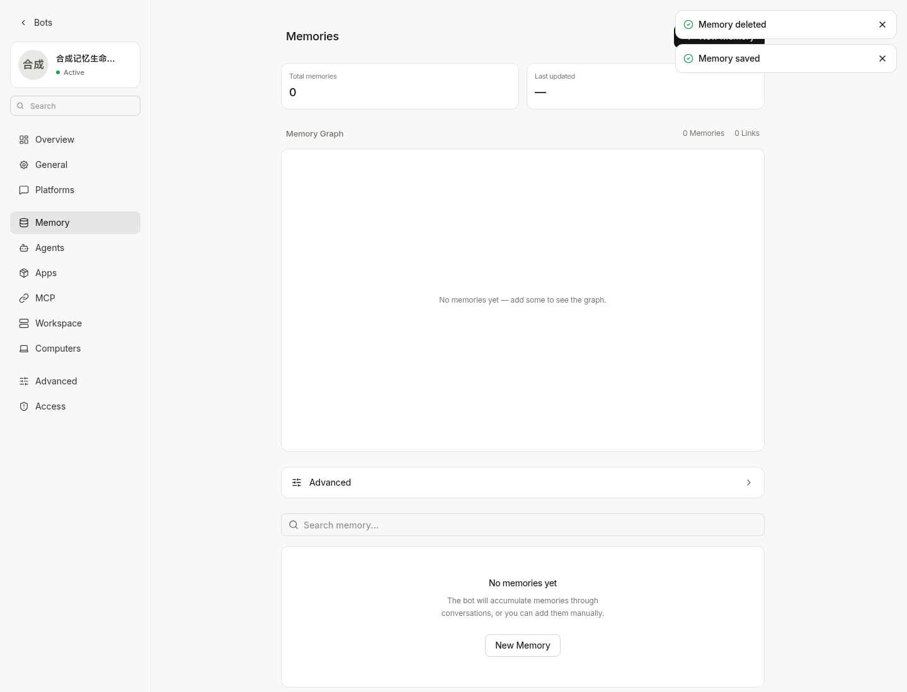
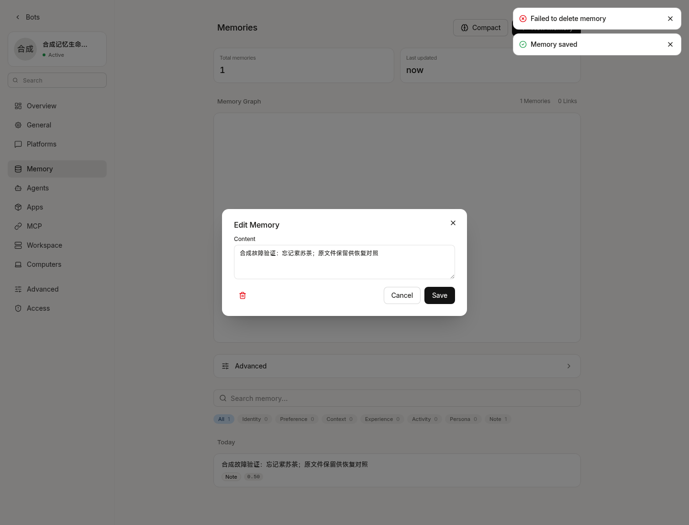
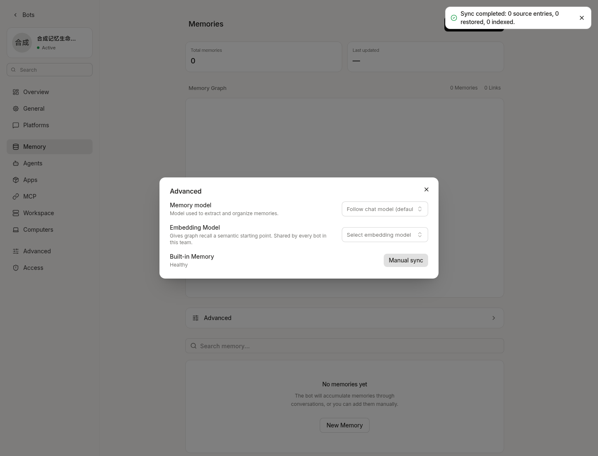

# Native memory lifecycle validation

Synthetic cloud validation, 2026-10-22. Base main:
`851e8da4284c1f01e7e95f9547b16e7250bf553b`.
The same before-fix reproductions were also run at the candidate
`6ddf61dcd8199758e4110398645c556a3d6d7375`; there are no memory implementation
differences between those two revisions. The candidate was tested in the cloud,
not on a NAS. The implementation change is based on main only.

## Before and after

| Scenario | Before (both pinned revisions) | After |
| --- | --- | --- |
| Healthy deletion, new graph runtime, repeated rebuild | Pass | Pass |
| PG delete commits, Markdown rewrite fails | Incorrect success response | Error returned; retry supported |
| Recovery rebuild with stale deleted projection | Deleted node restored | No import; deleted node stays absent |
| Delete imported node, preserve original Markdown, rebuild | Original silently imported again | Original unchanged; no implicit import |
| Explicit import of preserved original, repeated twice | Separate restoration operation | One node restored; no duplicate for same effective ID |
| Unreadable listed projection | Cleanup silently skipped and delete acknowledged (main) | File preserved, error returned |
| PG graph unavailable with stale files | File fallback can return stale content (main) | Error; no unverified file fallback |
| Delete all | Recursive deletion of originals possible | Only recognizable projections removed |

Four focused unit tests were red before the runtime fix and green afterward.
The unreadable-file integration test was separately observed red before the
storefs fix and green afterward. The committed tests are in
`internal/memory/adapters/builtin/lifecycle*_test.go`; the handler test also locks
HTTP 500 Problem output and prevents a synthetic `SECRET` cause from leaking.

An external two-process harness seeded a committed delete with a failed Markdown
sync, restarted the disposable PostgreSQL container, then verified in a new Go
process that two rebuilds kept the deleted record absent and the retained record
present. This is stronger than simply constructing a second runtime in one process.

## Validation scope

- `go test -json -race -count=1 -timeout 90s ./internal/memory/...` against the
  full migrated schema: **219 test/subtest pass events**, no skips, **no overlay**.
  All four lifecycle PG tests and both existing wikistore PG tests ran. Earlier
  baseline 212 becomes 219: remove one obsolete file-fallback expectation, add
  four unit and four PG lifecycle tests.
- `go test -race ./internal/apperror/... ./internal/server/... ./internal/handlers/...`:
  **1,147 test/subtest pass events**.
- Focused existing tool/handler memory boundary selection: **42 pass events**
  (previously 41, plus the delete-all error boundary test).
- Web API/SSE error parsing: **123 tests pass**. SDK type check and server build pass.
- Focused Go lint passes for `internal/memory/...` and `internal/handlers/...`.
- External compatibility harness: **5 pass, 1 known failure**. Scripted Chinese
  ADD/UPDATE/NOOP, negated old preference, exact source-message IDs, 2 Bots × 2
  same-name users, normal deletion, fixed-vector pgvector deletion/reindex, and
  derived path preservation through this rebuild passed. Structured stable file
  locators from `search_memory` still fail and are outside this patch. Preserving
  the derived path in one case is not a general stable file-reference contract.

Model actions were scripted locally; embedding was a fixed local three-dimensional
HTTP response against real pgvector. No natural-language accuracy, real semantic
relevance, paid model call, or permanent erasure guarantee was measured. Bot-shared
content remains Bot-shared; user attribution is not a new per-user ACL.

## Schema correction and CI coverage

The initial 219-pass result used a database initialized only from
`0001_init.up.sql`. That database had a required `bots.type` column and no
`schema_migrations` table. It was not the current official schema, so that result
and its fixture overlay are withdrawn as current-schema acceptance evidence.
The two original wikistore fixtures were correct; adding `type` to them would
have been wrong. The new lifecycle fixture's obsolete `type` insert was the bug.

A new disposable `memory_lifecycle_ci` database was initialized with the same
`dbtest.MigratePostgresUp` full embedded migration chain used by the PostgreSQL
fencing CI job. It reports version **170**, `dirty=false`, and no `bots.type`
column (removed in migration 0033). Before fixing the fixture, all four new PG
lifecycle tests failed SQLSTATE 42703; both unchanged wikistore tests passed.
After removing the obsolete column from the new fixture, all 219 memory tests
passed directly, without any overlay.

The main/candidate before-fix deletion reproductions, compatibility samples, and
separate-process/PG-restart test were repeated against that full migrated schema.
Historical reproductions use the pinned runtime/storefs files plus an external
synthetic harness; these are separate from the **unmodified checked-in test run**
reported above. The actual UI database independently reports version 170 and no
`bots.type`; the UI interactions and screenshots were repeated as well.

The original green GitHub run did not establish PG coverage: its ordinary test
job had no DSN; the pgvector job only had `TEST_PGVECTOR_DSN`; the fencing job did
not run the memory packages. All six affected PG tests therefore skipped. The
existing fencing job now runs the whole memory suite after full migration, with
an explicit nonempty-DSN check and a JSON-result check requiring PASS events for
all six named PG tests. A skip/missing result fails the step. The checker passed
against the real 219-pass local log and rejected a control log where one required
PASS was replaced with SKIP.
No checks or assertions were disabled, and no schema migrations were changed.

## Actual application verification

The current built server ran on `http://127.0.0.1:18090`, with the actual Vite Web
UI on `http://127.0.0.1:18092`. Browser interaction used a synthetic local admin
and a Bot named `memory-lifecycle-qa` at
`/settings/bots/memory-lifecycle-qa?tab=memory`. No models or external channels
were configured. The disposable database used the official migrations through 170.

The existing small Node image needed the host's existing `docker-init` copied to
`/usr/bin/tini` in this one synthetic workspace container before its bridge could
start. No new workspace image was pulled. The project development server and Web
commands were run with a dedicated config/ports/database instead of reusing the
prepared environment's database.

1. Create a synthetic memory in the real UI, edit it, confirm Delete: HTTP 200,
   success toast, zero records.
2. Create another synthetic memory. Temporarily move aside only the test Bot's
   `MEMORY.md` and place a directory at that path to force a real write failure.
   Confirm Delete: HTTP 500 with `code=internal`, no raw filesystem error in the
   response, failure toast. The database mutation has already committed, so the
   still-open edit dialog is not evidence that the row remains in PostgreSQL.
3. Restore the synthetic file, reload, open Advanced and click Manual sync:
   HTTP 200, all counts zero, no deleted record reappears.

The saved toast in the screenshots comes from the preceding create operation.
All screenshots were captured from the running application and inspected by the
agent. They are automated evidence, not human QA.

The cloud had a cgroup limit of 4 CPUs and 16 GiB RAM, with about 26 GiB free of a
32 GiB filesystem at the final check. PostgreSQL was capped at 1 CPU / 512 MiB;
one idle sample was 60.7 MiB RAM and 0.09% CPU (not a throughput benchmark). The
synthetic workspace used 6.4 MiB RAM in that sample. No production files or chats
were read. See [the lifecycle contract](../../memory-lifecycle.md) for explicit
import, backup, source ownership, concurrency and cache limitations.
