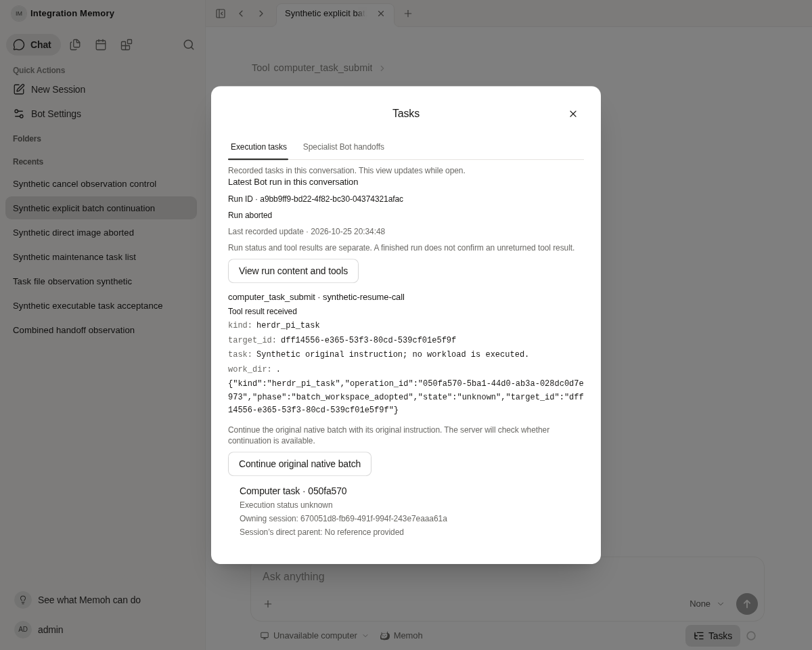

# Original-batch continuation and cancel-observation combination

Integration base: `6a7a98412c5787ee72d7ba52307be6fbe80fd19c` (HTTP/UI resume checkpoint; six remote checks passed). Source: `97fde22c1e86b90967177fac1b909eb62138749f`, received through existing branch head `9d7dd55fdf0820da573fd0a5e48c923789d01f08`; the handoff and source trees are both `a503ec51fc05fb9cfe2b2665f717b80077cbf02b`. The source fix was applied selectively, preserving the existing branch and all preceding checkpoints.

## Combined behavior

The first-send acknowledgement timeout keeps the outcome unknown without sending a cancel or another invocation. Explicit stop retains its original semantics and now carries an allowlisted client reason. Before accepting the abort control, the handler checks access to the session and the exact Bot/session/run relation. The new optional observation records a received control, not proof that it caused an old cancellation.

The existing authenticated original-operation resume POST and shared tool-card/Tasks action remain intact. They reuse the original arguments and operation, preserve ownership/current account validation, target/hash checks, admission/CAS and uncertain-prompt fences, and create no model turn. A terminal original run does not require a replacement model run. Neither an HTTP acknowledgement nor the presence of a recovery action proves that an old workspace/pane exists, is of the correct generation, or that its workload succeeded. Actual recovery still requires the existing Host/Runtime connection and authoritative original-resource verification.

The only text conflict was the generated SDK export list. SQL was regenerated with the already-available pinned sqlc1.31.1, Swagger with `go generate ./internal/handlers`, and SDK with `pnpm run generate-sdk`. `union.json` verifies all371 existing OpenAPI operations unchanged; the old invocation response gains only optional observation fields. Resume request/response definitions are preserved. Non-generated source files match the source commit, apart from the test-only layout compatibility correction described below. Official Agent/runtime/contextview and existing workflow gates are unchanged.

## Migration and rollout boundary

Migration0177 adds `session_run_abort_controls`, its deduplication key, run foreign key and forced team RLS. The canonical0001 up/down snapshot includes the same additive table. There is no configuration change and no update/backfill to original session runs, operations or history. Observation writes are best effort and cannot establish missing historical provenance.

The existing isolated database was schema176. The normal compiled Server `migrate up` completed to177/clean. Whole-row hashes of existing operations, sessions, runs and messages were identical before/after migration. The rebuilt combined Server started normally. The real PostgreSQL test verifies duplicate/cross-Bot/cross-session/cross-team writes are refused and forced RLS prevents foreign reads; the original run row remains identical.

The isolated old176 binary's normal `migrate up` entry was also checked against177: it failed because its embedded source has no177 migration; the DB remained177/clean. Therefore a deployment rollback must account for the existing Compose migration service and preserve any post-upgrade data. Do not assume changing the image alone will pass the old migration entry. Do not use generic CLI `migrate down`: it calls `m.Down()` and rolls back all migrations. No production downgrade/backup restore was executed or approved by this evidence; a concrete rollback needs a separately checked data-preserving procedure.

## Verification and limits

- Existing resume/helper/shared-run UI combination: **39 PASS** in three files.
- ACK/explicit-stop/Bot-switch/auth-reset integration selection: **4 PASS**,173 unrelated cases filtered. Deferred reason and WS replay encoding selection: **11 PASS**,18 unrelated cases filtered. Original test bodies and assertions remain unchanged. This is not a repeat of the source's full182-test result.
- Selected handler invocation/observation/resume and native-host service tests passed. Two additional real abort ownership tests passed: another user's session and a mismatched run both reach neither observation nor cancellation.
- SDK/Web typecheck, current Web build, affected Go lint and official core-boundary checks exited0. Staged size and Web-lint checks exited0; local full aggregate was not claimed passed. The build retains the existing large-chunk warning. Empty successful logs represent commands with no diagnostics.
- The combined production Server binary ran against the same isolated PG and the current Vite source on loopback. Browser used the existing authenticated WS client to send one synthetic terminal-run abort control, then read the optional observation through the real invocation route. Its already-terminal state and original intent timestamp remained unchanged. Another synthetic native-operation card retained the same original ID, arguments and recovery action; one explicit POST was refused400/no-store for the deliberately incompatible legacy target. No model/device call or new operation was made.
- Browser refresh and a controlled restart of this task's Server retained the same observation, run and native-operation card. The restart check sent zero controls and zero resume requests. Screenshots were captured from the current application and inspected by the agent; they are not human QA or native-device recovery evidence.
- Existing critical records retained identical whole-row hashes. The synthetic terminal-run row also remained byte-identical. Only one new received-control observation was added for the newly seeded synthetic fixture.

All data are synthetic. No production credentials, configuration, network, account, files or task were accessed. No model request, image generation, real Pi/Herdr execution, mobile build, image publication or NAS deployment occurred. The historical snow-image cancellation cause and original result remain unknown; the newly proven timeout defect is not evidence of that historical cause.

## Failures retained and exact corrections

The first Go invocation exited1 while temporary storage was constrained; its retained output contains only FAIL, so its internal cause is not claimed. The next invocation passed the selected handlers/computertask tests but failed to link `cmd/agent.test` with an explicit no-space error. The combined production Server subsequently built and started successfully; that is assembly verification, not a claim that the failed command's entire test selection passed. Full repository/package checks belong to the eventual precise-head remote CI. The first selected pass skipped the opt-in PG test because its DSN was unset; the later explicit real-PG invocation below is a separate, successful validation.

The first PG link also ran out of space. After reclaiming only verified stopped task-built binaries, the actual upgraded DB exposed a source fixture error: it inserted `bots.type`, which migration0033 removed. The old canonical snapshot still has that legacy column. A small test-only schema-presence branch now builds the same fixture for either layout; every RLS, deduplication and row-preservation assertion is retained. The upgraded176→177 test then passed with zero SKIP. No product column or historical migration was altered to accommodate the test.

An initial affected lint invocation failed writing the task's Go cache. With no compiler/linker/linter active, seven pre-turn regenerable archives were removed from this task's cache (933,896,860 bytes); the exact affected lint then exited0. Source, logs, Git, database and originals were retained. Only three stopped obsolete task-built binaries were removed across the separately recorded reclamations. No global prune was used. An attempted protected `/proc` executable-link read failed before any stop; it was not retried. Ordinary process ownership and exact command identity were checked before stopping only this task's Server. The migration had already succeeded; no production process was involved.

The first browser assertion expected literal `applied:false`, while the existing WS encoding omits false. It had already received the matching control acknowledgement and the observation had persisted. The test continued by reading that observation rather than resending the control. Current state/intent, observation, resume action and restart checks then passed. That test-script correction changed no product protocol or behavior. See the retained first failure and later proof files.

Selected commands:

```sh
/tmp/computer-admission/tools/sqlc generate # version1.31.1
go generate ./internal/handlers
pnpm run generate-sdk
# selected existing UI recovery tests; selected ACK/cancel cases (logs list names)
go test -p=1 -ldflags='-s -w' -count=1 -v -timeout=3m ./internal/handlers ./internal/computertask ./cmd/agent -run 'AbortObservation|AbortRun|SessionInvocation|SessionTaskResumeHTTP|ResumeNativeHost'
MEMOH_TEST_POSTGRES_DSN=<existing-isolated-DSN> go test -p=1 -ldflags='-s -w' -count=1 -v -timeout=90s ./internal/handlers -run '^TestPostgresAbortObservationPreservesRunAndScope$'
go test -p=1 -ldflags='-s -w' -count=1 -v -timeout=90s ./internal/handlers -run '^TestWSAbort(OtherUsersSession|MismatchedRun)'
golangci-lint run --concurrency=2 ./internal/handlers ./cmd/agent ./internal/db/postgres/sqlc ./internal/db/store
pnpm --filter @memohai/sdk typecheck
pnpm --filter @memohai/web typecheck
pnpm --filter @memohai/web build
bash scripts/check-agent-core-boundary.sh
```

The first combined Go command above has the documented partial-pass/link-failure boundary; it is not presented as a full PASS. The DSN is supplied privately from the existing loopback test configuration and never logged. Selected raw outputs are adjacent; `files.json` records their exact hashes/bytes. The eventual new commit's CI is assessed independently of the passed6a7 checkpoint.



## Precise-head CI follow-up

The first combined head `7499b9c705bca462001e504eea5bc567fb6ceb17` failed the ESLint workflow's task-observation Test job (run40235542035/job121296201641); Lint itself passed. The remote step ran295 tests:294 passed and one failed. `chat/realtime.test.ts` still expected a three-argument socket abort call, while the newly optional reason is forwarded as the fourth argument (`undefined` for old callers). This was locally reproduced before correction.

Only the test fixture changed: its mock now uses `ChatWebSocket['abort']`; the existing matching-Bot assertion covers both an absent reason and explicit `user_stop`, and verifies a wrong Bot causes zero downstream calls. Product behavior, rules and existing assertions were preserved. The complete affected realtime file then passed16 tests and targeted ESLint exited0. No model, browser, Go build or previously passed standalone suite was rerun for this test-only correction. The previous remote failure remains visible; the final follow-up commit's CI must pass independently.

The public CI excerpt retains the exact decoded lines containing the failure and summary. The full decoded log is retained privately; its SHA256/byte count and excerpt line interval are recorded separately. It is not represented as the raw HTTP archive or complete public job log.
