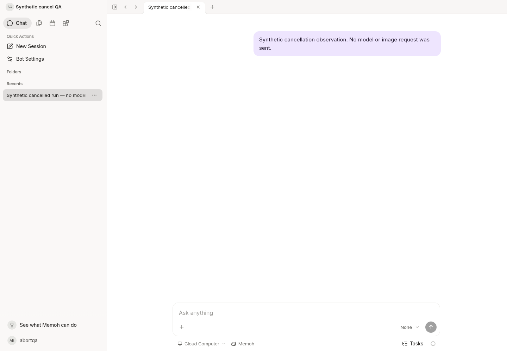
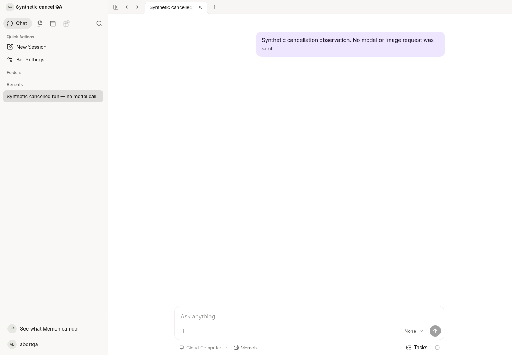

# Cancel control observation and lost-acknowledgement validation

Base: `58e39866057bf798b0789053d3215ddf4600c612`.

The first-send confirmation timer previously scheduled an abort after 30 seconds even when the server might have admitted the request. A late admission acknowledgement then sent that abort. Two store-level regressions fail on the base and pass on this change. Timeout now retains an unknown outcome without cancelling or submitting another invocation. An explicit user stop still cancels, including when acknowledgement is late.

The existing WebSocket abort control accepts an optional allowlisted `abort_reason`. The server checks session access and the exact Bot/session/run scope before forwarding cancellation. A small append-only table associates incoming controls with the existing run, using a hash of the control ID for deduplication. It does not create execution records, change the runtime state machine, or retry tools. The existing invocation GET adds `abort_requested_at` and optional `abort_control` (`received_at`, `source`, `client_reason`).

`abort_control` is the earliest observed request, not proof that this request caused cancellation. `client_reason` is a client declaration, not an authenticated actor or a server determination. Observation writes run asynchronously with a bounded timeout; a process crash or database failure may leave them absent. Optional observation-read failure does not hide the authoritative run result. Existing history is never backfilled.

## Automated evidence

- Base regression: two lost-acknowledgement cases fail; explicit-stop control passes.
- Four affected Web suites: 182 tests pass. They cover late acknowledgement, unknown outcome, explicit stop, Bot switch, auth reset, wire/reconnect reasons and no duplicate message submission.
- Native Web and SDK typechecks pass.
- Generated SQL, Swagger and SDK were regenerated from their source contracts.
- PostgreSQL 17: fresh schema and migration 0177 down/up/repeated-up pass. Real generated-query tests under forced team RLS preserve the original run row; reject cross-Bot, cross-session and cross-team writes; deduplicate controls; and do not invent old provenance.
- Handler race tests pass, including slow/failed observation storage, authorization rejection and optional-read failure.

The local SQL generator task could not install its declared toolchain in the inode-exhausted workspace. The exact pinned sqlc v1.31.1 release binary, verified against the release asset SHA-256, was used to execute the same generation command. No generated code was edited manually. UI dependencies use the exact recorded submodule commit; no dependency versions or production build configuration changed.

## Boundaries

This is synthetic validation with a newly created isolated database, account and history fixture. It does not establish real model execution, image completion or recovery of a previous failed request. No model/provider, device or production configuration is used. No image is generated or replayed. Historical cancellation intent without retained source remains unattributable.

Official Agent core, tool execution, task list UI and image protocol are unchanged.

## Running application verification

The current Server binary and Vite source ran against a new loopback PostgreSQL 17 instance. The browser logged in normally, opened a newly seeded synthetic terminal run, used the existing authenticated WebSocket client to submit one cancel control, and read the invocation through the generated SDK. The response retained the original terminal state and intent timestamp and added only the new control observation. Browser refresh preserved the same run and observation. The already-terminal control was not reported as an applied execution cancellation.

The history fixture has no workspace and no provider/model. The unrelated workspace filesystem request returns 503 as expected; no workspace-ready or model-execution acceptance is claimed. Fixture creation and onboarding metadata were SQL test setup, not UI Bot-creation acceptance.



This screenshot demonstrates the live authenticated session and unchanged synthetic history; the invocation assertions and database tests establish the metadata behavior. It is agent verification, not human QA.

The same isolated Server was stopped and restarted with the same synthetic database and configuration. A new browser login and read-only invocation lookup returned the same run, state, original intent time and observation; refresh did not resend the control or create a message. This verifies persistence of an already-terminal observation, not recovery of an interrupted model request.



Commands used for the affected checks:

```sh
(cd apps/web && pnpm exec vitest run src/store/chat-list.test.ts src/store/chat/assistant-streams.test.ts src/store/chat/runtime-integration.test.ts src/composables/api/useChat.ws.test.ts)
pnpm --filter @memohai/web typecheck
pnpm --filter @memohai/sdk typecheck
go test -race -p=2 -count=1 ./internal/handlers -run 'Abort|Invocation'
go test -p=2 -count=1 ./internal/handlers ./cmd/agent ./internal/db/store ./internal/db/postgres/sqlc
node .husky/checks.mjs
```

The first complete affected-package run failed only `TestMediaHTTPUploadConfiguredAbove200MiB` with HTTP 500 while temporary storage was constrained. After removing this task's unused Vite cache, the unchanged test passed in isolation. This resource correlation is not proof of the initial 500's internal cause. No test was removed, disabled or weakened. The first Go lint run found S1016 in the new PostgreSQL fixture; that conversion was corrected. An initial aggregate run also failed the large-upload acceptance/limit cases while temporary space fell to about 325 MiB. After removing only obsolete task build and Vite caches, the unchanged final aggregate passed (exit 0): staged Web lint, Go lint and all affected package tests. Full remote CI has not run.
