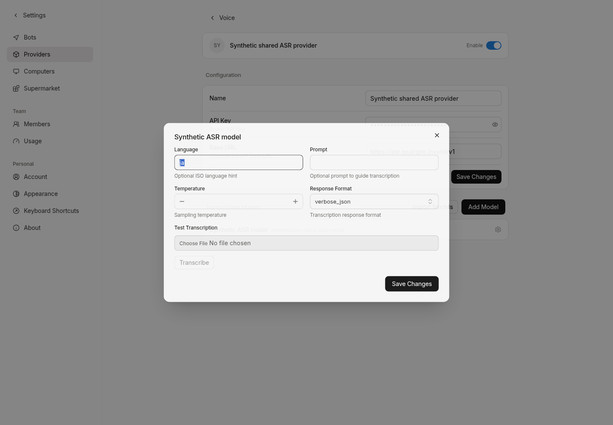

# Native transcription on an existing OpenAI-compatible provider

Base: `9d7dd55fdf0820da573fd0a5e48c923789d01f08` (the verified cancellation product tree plus the preserved original media branch history).

An existing `openai-completions` or `openai-responses` provider could not be used by native transcription: the audio registry rejected its type, the transcription-provider query omitted it, and the native transcription form could not resolve its parameter schema. Creating a second provider or changing the chat provider type was not necessary at the protocol layer.

The transcription-only resolver now reuses the existing OpenAI Transcription factory. The provider query includes the same existing compatible records, and the transcription form reuses the existing native schema. Configuration remains the existing provider record, a deliberately configured model with `type=transcription`, and the Bot's `transcription_model_id` pointing to that model record UUID. No new provider protocol field or credential store is introduced. A chat model, an ordinary catalog entry or an ID's spelling does not establish ASR support.

This resolver is separate from the registry's registered definitions. It does not seed guessed ASR model IDs, create providers, or make chat providers eligible for synthesis. Unsupported protocols return the existing `request.field_invalid` error with `field=client_type`; the diagnostic cause stays private. Video is unchanged. The native transcription management route groups reuse the existing account/session guard so chat-route tokens cannot use this newly shared provider path; internal tool/inbound service calls remain separate from management HTTP.

## Configuration after a real authorized ASR ID is confirmed

1. Settings → Providers → Voice → the existing compatible provider in the transcription section.
2. Add a model using the exact authorized upstream ID and the native transcription type. Do not copy an example/default ID or use a new provider record.
3. Set existing language, prompt, temperature and response-format fields if needed. In Bot settings → Multimedia, choose that same model record as the transcription model.
4. Real execution must be accepted separately with a single authorized synthetic-audio request, its actual transcript/error, original audio bytes and same-session result/attachment evidence. Missing or lost response does not authorize automatic resubmission.

The configured provider must actually support the native OpenAI multipart `/audio/transcriptions` contract. The adapter does not discover or grant that capability, and does not broaden the existing credentials. Native SDK discovery still has its original name filter; a missing discovery entry is not proof of absence. Manually add only a confirmed ID.

## Isolated validation

The earlier nine scenarios on `be13d5cebe9b12e96a6cede0ff8122cfe51040e8` remain historical evidence and were not rerun. This change adds two test functions: eight same-provider SDK cases across both compatible chat types, plus a registry/capability boundary test. The base failed all eight new contract cases before HTTP. The candidate passes success, 403, lost response and malformed JSON; each invocation sends exactly one synthetic POST and preserves the model ID, original audio bytes/hash and provider identity/config. Unexpected database operations fail in the fixture. These are in-process transports, not real provider calls. The synthetic payload is not claimed to be playable audio.

The boundary test checks native model parameter capability lookup, rejects unsupported types, and ensures compatible chat types do not enter the registry/bootstrap or synthesis definitions. No claim of persistent cross-call deduplication or exactly-once execution is made.

Actual isolated PostgreSQL/Server/Web/Chromium verification uses one newly seeded synthetic chat provider and its transcription model. The native Voice list/detail and generated SDK list responses preserve the same provider UUID and type. The model parameter dialog displays the existing schema, including configured language and response format, and browser refresh preserves the same model. No import, transcription test or model request is submitted. SQL fixture setup is not provider creation through the UI or real ASR acceptance.

The development binary was built with `-buildvcs=false` after Go's worktree VCS probe attempted the parent temporary directory and failed; the source base/diff and build result are retained separately. An initial dependency-link error and a resource-killed Web typecheck are preserved in local evidence; neither is counted as passed. Final checks are reported in the handoff.

## B05 / B06 acceptance boundary

B05: this repairs and isolates the configuration/registry seam. A real authorized ASR model ID is still unconfirmed. Real recognition quality, native microphone input, media ingestion and return to the original conversation remain unverified. Synthetic text is not a real transcription receipt.

B06: existing read-only catalog evidence already includes `X-Magpie-Videomakers: 1`; zero visible candidates leaves capability/authorization unknown. The verified Magpie version's video job/content contract is not equivalent to the native OpenRouter/Ark adapter, and same-provider video registry wiring remains absent. No video execution adapter is added here. That Magpie version's TTS endpoint remains unsupported. Transcription, speech output, video understanding and video generation must be accepted separately.

No official Agent core, SDK core, image generation, cancellation recovery, task manager or production configuration changes are included.

The added management regression covers all ten transcription routes with chat-route (including account-shaped user ID), anonymous, revoked and expired identities, in both header and query authentication forms: denial before any fixture query/write or upstream request. A validated account can still read native metadata. The first fixture setup used a nil logger and failed before exercising a route; its log is retained, and only that fixture setup was corrected.

Final local checks: new-difference Go tests exit 0 (audio 0.008s, handlers 0.051s); native Web typecheck exit 0; current development build exit 0; repository `checks.mjs sizes`, `web` and `go` (lint-only) modes exit 0; current real-application UI/refresh verification exit 0. Initial test-format/cleanup-return lint failures and a later link failure with explicit `no space left on device` remain in local evidence. Only obsolete task-owned artifacts/caches were removed; no product/test restriction was weakened. Full aggregate and remote CI are not claimed: the task explicitly limits execution to the new differences, so unrelated cancellation regression tests were not rerun. Human QA and real ASR acceptance remain outstanding.
