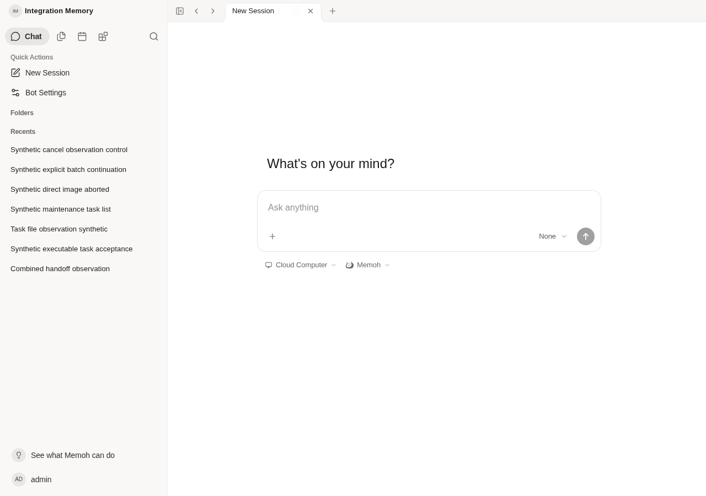

# Same-authority network and recovery contract

Baseline: `9bb6fc3d84387012b4e2f5daffcc95d81ece5db4`, already deployed separately. This increment adds only five SDK boundary regressions and evidence. It changes no product code, generated SDK, API, configuration format, storage, credentials or installer. It does not implement or claim all-end LAN selection. Acceptance items F01/F02/F05/F06/F08 remain open to their stated extent.

## Contract consumers can use now

| Owner / existing input | Consumer and required behavior |
| --- | --- |
| NAS `config.toml` `[files].originals_root` | Existing Media/storage/upload store share the resolved original root. A route change cannot move originals or expose a server filesystem path to clients. Clients own their existing private snapshot/journal roots separately. |
| NAS `[server].public_url`; shared `setupApiClient({baseUrl})` / VITE_API_URL or `/api` | Keep one canonical HTTPS authority and exact API prefix. `public_url` is not an existing automatic distribution mechanism for the Windows or phone settings. Do not invent that implication. The browser SDK resolves the active configured API base, not a LAN URL list. |
| Windows existing `transfer.json` `version:1, origin, source_root` | Same original HTTPS origin/API prefix and source root. Its raw bytes bind the existing queue. Preserve the original config/state directory pair and original job binding. Do not rewrite this file to change a TCP route. |
| Windows existing optional private `transfer-network.json` | Existing shape `{version:1,lan_addresses:[explicit IP literals in order]}`. Only the existing paired config directory is used. `OpenHostConfig` validates it; configured upload/download constructors both apply it. Changing this hint file preserves the original queue binding. No policy means previous behavior; invalid policy fails closed. |
| Harmony existing `apiOrigin` | The authoritative persisted value, shared SDK setup and native `client.configure` must agree, including `/api`. `MEMOH_ORIGIN` is only an in-memory copy. Do not reuse signed legacy endpoint migration as arbitrary network rebinding. `hapDownloadUrl` is not an API target. |
| Harmony upload journal | Original API origin + freshly authenticated user + Bot + session/draft; preserve upload ID/offset/expiry/size/hash and local source. Unknown response is not permission to create another upload. GET404 retains the original receipt/snapshot. |
| Harmony download journal | Original API origin + user + Bot + exact ordinary/delegation path + hash/size. Recheck scoped access; do not replace a denied delegation with a broad Bot/hash read. |
| Shared Web recovery owner | Use existing SDK media routes and its own durable receipt implementation. This increment does not modify useComposerUpload, upload-with-progress, gallery/download code or the file owner's in-progress persistence work. SDK behavior alone is not that UI's recovery acceptance. |

All three ends retain the same authenticated NAS authority when a lower network path changes. TLS hostname/SNI, certificate verification, HTTP Host, API path and caller authentication remain the original ones. No new origin, alias, domain, credential, approval or storage service is introduced by this contract. A syntactically valid IP or a matching file hash is not independent proof of the same NAS/account.

### Connection selection and unknown results

1. On an existing Windows producer's new connection, try its explicitly configured LAN IPs in order at the original port. Only a TCP connection failure permits original-authority IPv6 fallback. Healthy pooled connections remain valid; the next connection selects again. IP family alone does not classify LAN.
2. Once TCP connects, TLS or HTTP failure does not select another destination. Existing wrong-host/403 regression evidence proves zero alternative HTTP requests. Do not disable a configured proxy to force direct routing.
3. A generic browser Fetch TypeError does not prove that no request reached the server. Do not use it as a safe-to-replay TCP failure signal. No lost Create/Complete/Commit response may cause an automatic alternate-origin or new-ID submission.
4. If a receipt was already durably recorded, reconcile it with the existing GET for that same original Bot/upload ID (or existing task-bound Resolve). Preserve unknown when no original receipt exists. Reconnection is not a new business execution or permission to generate a replacement receipt.
5. Ordinary account auth and existing PC file-device auth remain separate. Runtime credentials are not transfer credentials. Preserve token/auth-generation checks; do not migrate credentials or adopt journals merely because another URL responds.

No new HTTP response fields or wire schema are defined here. In particular, current `GET /bots/{bot_id}/media/limits` contains only `max_upload_bytes`, `resumable_enabled`, `chunk_max_bytes`; it does not advertise or distribute a LAN policy. Returning or reading these limits does not prove route preference.

## Exact capability gap; no unused configuration API

Only the Windows producer currently consumes the explicit TCP policy. [Harmony's fixed owner handoff](https://github.com/particleflow/Memoh/blob/36dcb0b2a38841ebc5b3bd802eaec2775f2990e4/docs/testing/harmony-unified-9bb6fc3/network-owner-handoff.md) confirms no LAN-first implementation and identifies the existing boot, configuration and journal seams above. Its ready-state reconfiguration is refused and trusted-frame lifecycle checks must remain intact.

Ordinary shared browser Fetch has no application TCP dial override. The user agent owns resolution/connections, and Host is a forbidden request header ([Fetch standard: request headers](https://fetch.spec.whatwg.org/#forbidden-request-header), [connections](https://fetch.spec.whatwg.org/#concept-connection)). Replacing the URL with an IP changes the authority/TLS identity; adding a Host header cannot turn it into the Windows dialer. This is a platform/API constraint, not a need for a new protocol or a reason to loosen TLS.

The configuration-first deployment path is to retain that canonical HTTPS hostname in the existing per-end setup and use the existing network/resolver configuration for its permitted addresses. Such configuration can preserve the journal identities without product changes, but DNS/platform routing alone is **not proof of deterministic LAN-first order** or a measured IPv6 handover. No DNS, router, proxy, trust or production setting was changed here. A strict all-end TCP order still needs a supported native transport hook or verified existing network configuration; this task does not invent an unverified Harmony option or browser bridge.

There is no existing NAS API distributing the Windows private IP policy to these other consumers. Adding an unused DTO or client URL failover would not close that gap. Before implementing any cross-end policy delivery, the native owner must identify the actual supported platform hook; the browser portion must explicitly remain platform-routed. NAS deployment/config ownership then applies one authority/address plan using the existing layout, without writing secrets or server storage paths into a public response. Field address selection is outside this cloud task and no manual per-file step is added.

## Evidence reused, not rerun

The current `host_network.go`, `host_network_test.go` and `network_policy_test.go` are byte-identical to `393e90871b01e23027301f0670df9743ec014b07`. [Existing LAN contract and raw logs](../transfer-lan-preference.md) already prove Linux real TCP/TLS LAN order, refusal-to-original-IPv6, LAN recovery, same task/attempt/receipt/hash, Create1/PATCH4/Complete1, and no TLS/403 fallback. These were not rerun or relabelled as Windows/phone/production acceptance.

The older [cross-end audit](https://github.com/particleflow/Memoh/blob/12f9ca5cd2ec3cc082becca933db393d27eb3ac3/docs/testing/transfer-cross-end-acceptance.md) remains historical evidence. The new fixed Harmony36d handoff supersedes its older phone source descriptions; no phone code was copied here. Windows source `20de6fd533e640ace672f991a07cf1e33cab5984` still reports the same optional networkPolicyFile in endpoint status, rather than centrally writing it. Neither fact proves field routing.

## New executed verification

- `pnpm exec vitest run apps/web/src/lib/api-client.test.ts`: exit0, **22/22**, 491ms. Five new cases use the real generated SDK and shared API setup with an in-process Fetch substitute: lost Create and Complete each invoke Fetch once; 403/503 do not submit to another origin; a caller with an already persisted upload ID uses GET of that same identity. No fake ID is created to recover a lost Create response. These prove the SDK seam, not browser TCP/TLS, durable Web storage or all-end transfer.
- `pnpm --filter @memohai/web typecheck`: exit0. `pnpm exec eslint apps/web/src/lib/api-client.test.ts`: exit0. No production/bundle source changed, so the already verified9bb build was not repeated. No Go/source matrix was rerun.
- Actual existing isolated Server/PG/current Web at loopback18400/18402: open the known synthetic Bot chat, read its real media policy via the configured shared API URL, put Chromium offline, observe read failure, reconnect and read the same policy/Bot/authority with the same login. **200 before/after, zero writes, zero device calls, zero page errors**. Its actual policy keys confirm the absent network-policy field. This does not upload a file, prove durable receipt recovery or validate LAN/IPv6/TLS selection. Screenshot was inspected and shows the real synthetic Bot page after reconnection.
- Initial browser helper used a nonexistent generic Settings button and compared the Bot's internal name with its displayed title. It failed after rendering the correct page. Only the selector was corrected to the existing Bot Settings control; the first log is retained, no product fix was inferred. No private config/token/fixture-ID file or server log is published.

No candidate publication, NAS deployment, installer build, field browser, real model/PC invocation, permission or persistent credential change occurred. This evidence supports SDK/identity handoff and leaves F01/F02/F05/F06/F08's remaining product/field acceptance explicit.
