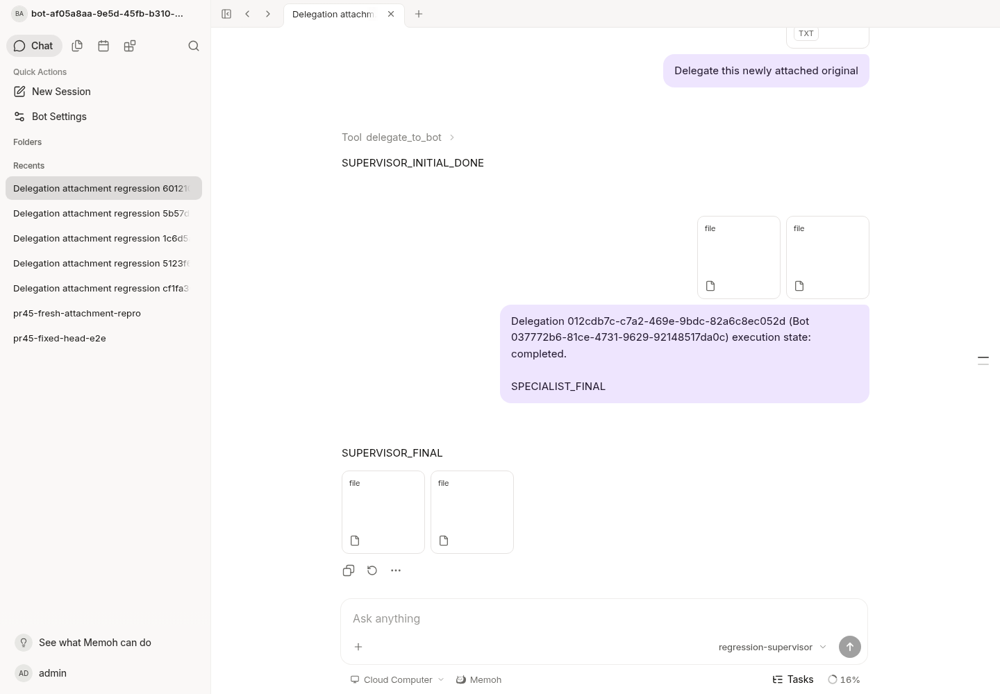
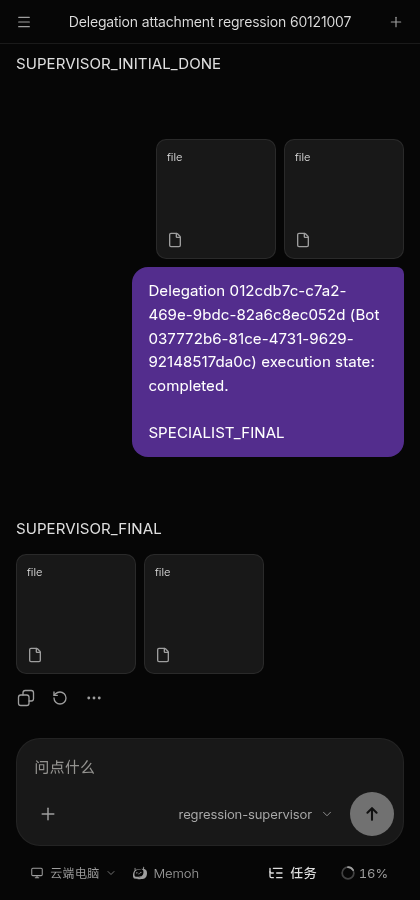

# Delegation attachment regression evidence

Base: PR #45 at `096295d2e42dc79dfdb915a34da2bf9c2a00f7d3`.
Only isolated synthetic fixtures were used. No production computer, NAS,
OAuth credential, or paid model was contacted.

## Reproduced failures

1. A new WebSocket user attachment could not be delegated in that same turn:
   `delegate_to_bot` returned `session.not_found`. User history and its asset
   links are committed with the first complete model/tool step. WebSocket
   admission stores an attachment digest, not a list of asset references.
2. A specialist's valid `send` was missing from the delegation result and the
   supervisor's final assistant attachments. The host lacked a reply target and
   did not normalize raw attachment stream events. Returning an original input
   hash through the generic send path incorrectly looked under the specialist.
3. Once backend references were fixed, the file preview discarded the scoped
   delegation URL and rebuilt a supervisor-owned media URL. The original input
   downloaded, but the specialist output did not. The mounted preview regression
   failed before that wiring was fixed.

The fix keeps input hashes in the existing host-authored, fenced run context;
retains original owners; uses the existing media pipeline for new send outputs;
and restores result references from the live-authorized delegation ledger. The
preview persists only a validated scope path and resolves fresh credentials on
render. No storage alias, new task platform, or Agent runtime change is involved.

## Executed checks

- Native WebSocket ingress, real application dispatch, local OpenAI-compatible
  synthetic SSE model, PostgreSQL 18, RedisBackend with AOF-enabled Valkey 8,
  real media storage and real workspace bridge. The supervisor completes and
  disconnects before the synthetic specialist is released.
- Both new output and original input reach the final assistant in the original
  supervisor session exactly once. Before native tool execution, the current
  run has matching owner/fence and zero history asset links.
- An owned upload outside the current session/admitted input is rejected.
  Anonymous attachment requests return 401; owner-separated media reads return
  200/404 as expected; original media Range reads return 206.
- After completing the task, an isolated DB fault changes only the delivery
  acknowledgement to unknown. Restarting the actual server and Valkey, then
  issuing 16 concurrent HTTP delivery retries, preserves delegation and run IDs
  and does not call the synthetic model again. Re-submitting the same request
  returns the same task. Both attachment byte streams remain intact.
- A separate temporary fixture uses real StartTurn, Manager, PostgreSQL fencing
  and Redis queues, substituting only the business stream. Busy follow-up queue
  identity and once-only consumption survive a real Valkey restart.
- Related Go package tests, targeted race tests, real PostgreSQL delegation
  integration, Go vet/lint, 121 relevant Web tests, Web typecheck, ESLint and
  UI contract guard passed. Repository-wide ESLint has existing warnings;
  modified files have no lint findings.
- Existing PC/NAS permission tests pass using synthetic registrations and
  permission fixtures. They do not represent testing on physical computers.
- Chromium logged into the current Vite app, opened the completed supervisor
  session, refreshed, opened each final file card, refreshed its desktop
  preview, and downloaded the original bytes. Downloads are 31 and 40 bytes:
  `05e4f2914ef7e12643fcd5580fe102355109e43aa43c50f83d0dfdb410afeb16`
  and `ea9ec1e51bc42608d72cdcd025166e0fa03b96672de0b09cf1318d41202701c9`.
  Dark/narrow Chinese rendering was also inspected.

Native model messages and file contents are synthetic. Authorization, dispatch,
ledger, queues, persistence, media and browser routing are real. Production,
physical PC/NAS, external messaging channels, mobile hardware and paid providers
were not exercised. Human QA is pending.

## Reproduction

Use two ready fixture Bots in an isolated local server with its own PostgreSQL
database and persistent Redis-compatible backend. The opt-in runner changes
only those Bots' model settings and creates tiny synthetic files and sessions:

```sh
python scripts/acceptance/bot_delegation.py --help
python scripts/acceptance/bot_delegation.py \
  --base-url "$LOCAL_API" --source-bot "$SUPERVISOR" --target-bot "$SPECIALIST" \
  --token-file "$PRIVATE_TOKEN_FILE" --pg-container "$LOCAL_PG_CONTAINER" \
  --pg-user "$LOCAL_PG_USER" --database "$ISOLATED_DB" --evidence "$EVIDENCE_DIR" \
  --allow-isolated-fixture-writes
```

Optional `--restart-helper` names an executable that restarts only that isolated
server and queue. The runner records failures before trying any independent
output-chain control, so an HTTP control cannot hide a native-submit failure.

The complete native regression output is [native-regression.txt](native-regression.txt).

## Browser evidence

The current supervisor session after refresh, showing the two final attachments:



The same synthetic flow at narrow width with dark theme and Chinese UI:



Screenshots establish rendered state only; byte/hash and execution-once claims
come from the runtime checks described above.
