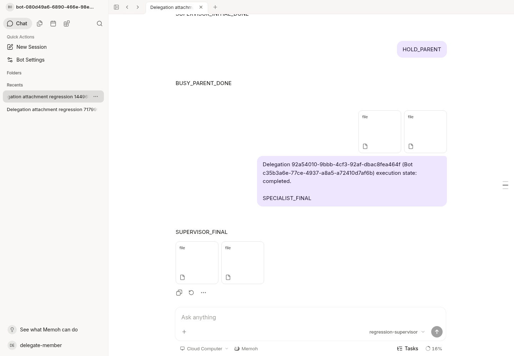
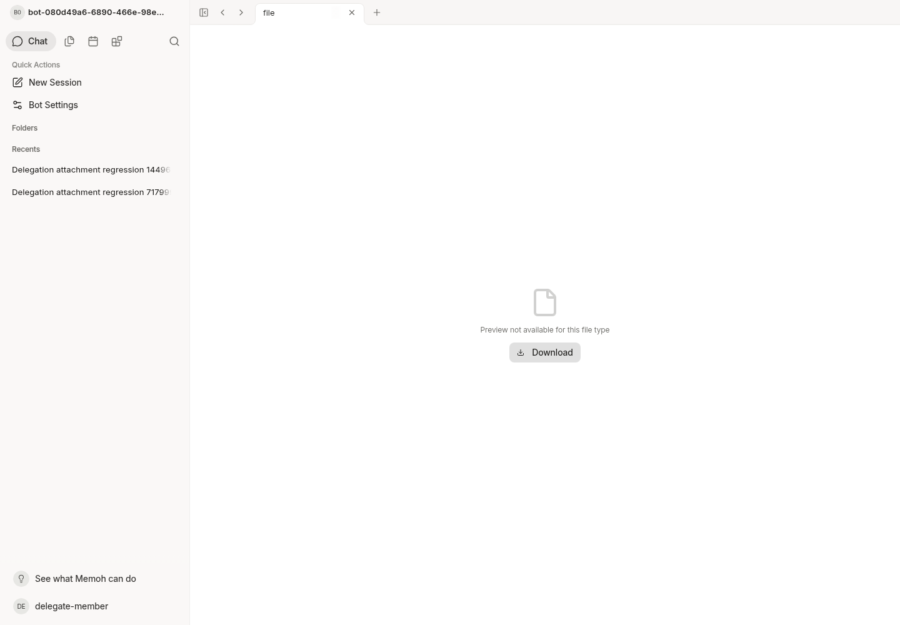

# Scoped attachment and recovery acceptance

This follow-up to `a68a237d7530acbdc5cc538cc2e151ef320f8b5f` fixes the
scoped download route's missing Range support and strengthens its acceptance
proof. It retains PR #45's `096295d2` authorization and Agent boundaries.

## Change and regression

The scoped route previously used `c.Stream(200)`, so a byte-range request returned
the entire original. It now opens the original through `media.OpenSeekable` and
shares the existing owner-media `http.ServeContent` adapter. Delegation authority
is checked on every read and seek. No file copy, owner alias, fallback URL,
global ACL grant, new storage service or Agent runtime edit is introduced.
The no-store header is reasserted before headers commit because Go's
`ServeContent` clears cache headers on error responses, including 416.

[The original failing test output](range-before.log) is preserved. For the real
HTTP comparison, the exact a68 source was exported with `git archive` and built
with `go build -buildvcs=false -p 3 ./cmd/agent`. Both binaries served the same PG
record, scoped URL, member token and original bytes:

| Version | Request | Status | Content-Range | Returned bytes |
| --- | --- | --- | --- | --- |
| a68 | `bytes=2-6` | 200 | absent | whole 31-byte file |
| current fix | `bytes=2-6` | 206 | `bytes 2-6/31` | exact `legat` bytes |

See [raw same-PG comparison](range-same-pg-before-after.log). This is a real HTTP
regression, independent of the handler test's fixture reader.

## Independently reproducible fixture

Prerequisites: the Go version in `go.mod`, Docker with `docker-init` on PATH,
Python 3.12+ and the pinned WebSocket dependency. Existing images/dependencies
are reused. Only PostgreSQL 18, Valkey 8 Alpine and a tiny workspace based on
Node 25 slim are used; there is no full production workspace rebuild.

```sh
python -m pip install -r scripts/acceptance/requirements.txt
python scripts/acceptance/delegation_fixture.py run --root /tmp/memoh-delegation-proof
# Repeat into a new check-* evidence directory without overwriting old results:
python scripts/acceptance/delegation_fixture.py check --root /tmp/memoh-delegation-proof
# Stop only the recorded fixture server and labelled PG/Valkey containers:
python scripts/acceptance/delegation_fixture.py stop --root /tmp/memoh-delegation-proof
```

`run` requires a nonexistent root, creates random local credentials with private
file permissions, starts fresh labelled PG and AOF Valkey containers, uses fixed
loopback ports across restarts, builds the actual server/bridge, and executes
**all official migrations**. It creates two ready Bots, a regular member with
explicit grants, and two local synthetic provider configurations. Original files
use the existing persistent media store under the fixture root; upload size is
capped at 1 MiB. Actual test attachments are only 31 and 40 bytes. Ambient Memoh
and telemetry overrides are excluded. No production credentials or paid model
are used. The process ID, command, UID and start time are checked before stopping
a server; container labels are checked before restarts.

Allow at least 4 GiB free space with toolchains/images cached. Each completed
fixture uses about 200 MiB of files plus a small PG volume; Go build/race/lint
caches may need additional space. No global prune or automatic data deletion is
performed. Resources and failed attempts remain for inspection. `stop` retains
workspace containers and their data; remove only your fixture's resources when
you no longer need the evidence. Private config, tokens and server logs must not
be published.

## Executed proof

The [original Go output](pg-go-raw.log) and [Go JSON events](pg-go-events.jsonl)
show `TestBotDelegationPostgresClaimIsolationAndDescendantAssets` executed once,
with **zero skips**, on a separately created database using `freshMigratedDB`.
The formal migration chain reached version **173**, `dirty=false`.
[Migration proof](migration-proof.json) also records the fresh server database.

- [Idle raw output](idle-raw.log), [structured proof](idle-results.json): the
  supervisor completes and disconnects before the specialist is released. The
  real server process and AOF Valkey restart after completion. A lost delivery
  acknowledgement is injected into the real PG ledger, followed by 16 concurrent
  HTTP delivery retries and the same request reopened. The original task, run
  IDs and model-call counts remain unchanged.
- [Busy raw output](busy-raw.log), [structured proof](busy-results.json): a second
  real supervisor turn is blocked inside the local model. Specialist completion
  creates exactly one pending follow-up. **Only Valkey restarts in this case**;
  its AOF preserves that exact pending queue item. After changing the delivery
  acknowledgement to unknown, 16 concurrent retries retain one queue item and
  one specialist execution. Releasing the parent produces one follow-up. This
  is not a test of restarting an actively running server process.
- Both cases assert current-run owner/fence/input hashes and zero history asset
  links before the initial model tool call. The ledger has exactly two unique
  references, and one final assistant message has exactly two attachment links.
  Specialist model calls are exactly three; supervisor calls are three for idle
  and four for busy. Each case observes stable terminal runs and empty source
  and target queues for five seconds before and after retries/reopen. These are
  bounded scheduler observations, not a claim about unlimited future time.
- Both originals pass exact full-byte/hash and owner-separation checks. The
  **scoped route itself** passes exact bytes and Content-Range for regular and
  suffix ranges, 416 for an unsatisfiable range, matching/mismatching If-Range,
  HEAD, anonymous 401, and no-store on all statuses. Deleting the regular member's
  specialist grant through the actual API makes both scoped ranges return 404;
  restoring the explicit grant restores access. No admin bypass is used for
  delegation or downloads.
- Related Go packages, session runtime tests, targeted Range race tests, SDK
  generation/typecheck and Go lint passed. Existing synthetic PC/NAS scope and
  permission regressions passed; they exercise scope mapping, fail-closed
  admission and connector access without contacting physical computers.

The full Web typecheck is **failed**, not green: the current tree and an a68
archive (including its exact UI submodule) both produce the identical **153**
diagnostic headers under the same cached dependencies. No diagnostic was added
by this follow-up. See [comparison](web-typecheck-comparison.json),
[current output](web-typecheck.log) and [baseline output](web-typecheck-a68-complete.log).
The backend/SDK fix does not repair those existing Web diagnostics.

Initial harness failures (read-only Docker buildx HOME and Docker's ephemeral
port changing after restart) were diagnosed and corrected in the harness. Those
attempts were not counted as successful restarts. The original acceptance and
first attachment-fix failures remain preserved outside this new evidence set.

## Current browser verification

Chromium exercised the current Vite application using the regular fixture
member's real authenticated session. Both final attachment panels survive a
reload and download the expected 31/40-byte originals. The panels use the generic
file view with a Download action. A browser fetch through the same UI proxy also
verified scoped 206, exact `legat` bytes, Content-Range and no-store.
[Browser assertions](ui-results.json) and [raw result](ui-raw.log) accompany these
fresh, inspected screenshots:




Only provider responses and attachment content are synthetic. Application
admission, dispatch, permission checks, ledger, PG transactions, RedisBackend,
queue recovery, media reads and browser routing are real. Physical PC/NAS,
external messaging channels, mobile hardware, production deployment and paid
providers are **unrun**. Human QA is pending. Screenshots do not establish the
backend assertions; the raw/structured runtime evidence does.
