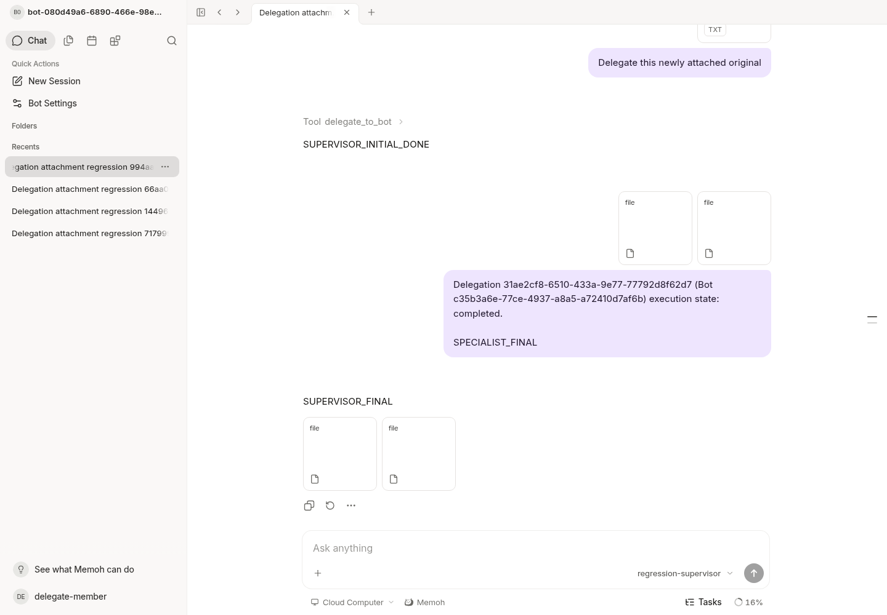

# Busy supervisor process-restart acceptance

Both cases below executed the **unchanged product at
`4a5f6cd45edffa2c8839d6a0c54b8d5e0a2c0d21`**. The server binary's embedded VCS
revision is that commit with `vcs.modified=false`; see [binary proof](candidate-binary.json).
This follow-up adds only acceptance harness code and synthetic evidence.
The [original 4a5 report](../hardening/README.md) and its results remain intact.

## Results and mechanism boundaries

| Scenario | Original busy parent | Reconstructed parent | Specialist business | Final result |
| --- | --- | --- | --- | --- |
| SIGTERM, then actual Valkey AOF and service restart | `lost / session_runtime.interrupted` | One `resume:<original-run>` completes | Original one run, three model calls | Original queue identity produces one follow-up; two attachments on one final assistant message |
| SIGKILL of service; Valkey stays running | `lost / runtime_owner_lease_expired` after real lease expiry | None | Original one run, three model calls | Original queue identity produces one follow-up; two attachments on one final assistant message |

The SIGTERM case has four source runs: initial completed, interrupted parent
lost, reconstructed parent completed, follow-up completed. Its model calls are
initial supervisor **2**, original/reconstructed held parent **2**, specialist
**3**, and follow-up **1** (total **8**).

The SIGKILL case has three source runs: initial completed, killed parent lost,
and follow-up completed. Its model calls are initial supervisor **2**, held
parent **1**, specialist **3**, and follow-up **1** (total **7**). The killed parent
is not reported as completed or automatically replayed. This is process-crash
recovery, not a physical power-loss test.

Both cases begin with a real busy supervisor turn and a completed specialist's
one accepted pending follow-up. Recovery is observed before any delivery retry.
After recovery, a lost delivery acknowledgement is injected and 16 concurrent
HTTP delivery retries plus reopening the same request preserve task/run identity.
Two five-second observations assert terminal runs and empty source/target queues.
Exactly two ledger references and exactly two attachment links on one final
assistant message are asserted. Original owner/hash, exact bytes, scoped Range,
Content-Range, 416, no-store, anonymous denial and actual grant revocation/restore
also pass again. The original lost parent remains visible in the evidence.

### SIGKILL lease observation

The fixture verifies PID, UID, full command and process start time, then sends
**SIGKILL**, without calling the graceful stop helper. It keeps Valkey running
and samples its real `TIME` and `PTTL`; no clock or lease values are changed.
Before the signal the owner lease has **1574 ms** remaining. Offline observations
show **1132 → 594 → 45 → -2 ms**, where `-2` means the original lease key expired.
PG still reports the original parent as `running` throughout those offline
samples, proving graceful durable release did not run. The queued payload digest
and Valkey generation digest remain identical. The new process starts only after
that real expiry observation, within the fixture's eight-second lease deadline.

The replacement server's existing reaper marks the parent
`lost / runtime_owner_lease_expired`; the ordinary terminal observer then drains
the session-bound follow-up. Existing code explains the distinction:

- `internal/agent/runtime/session/reaper.go` reads expired lease candidates,
  applies the fenced lost transition, and publishes the terminal observation.
- `internal/agent/application/turn_admission.go` connects that observation to
  `startFollowUpAfterTerminal`; session-bound follow-ups survive lost parents.
- `db/postgres/queries/session_runs.sql` selects only
  `lost / session_runtime.interrupted` for graceful automatic parent resumption.

The SIGKILL scenario therefore preserves the unknown interrupted work boundary
while delivering the already completed specialist's result. No product change
or replay of an unknown external side effect was needed.

## Reproduce using the committed fixture

Requirements and the fresh PG/full-migration setup are described in the
[base harness guide](../hardening/README.md). Use a new fixture directory:

```sh
python scripts/acceptance/delegation_fixture.py run \
  --root /tmp/memoh-process-restarts --modes busy-service busy-crash
```

For an existing labelled synthetic fixture, `check` keeps old evidence and
writes a new `check-*` directory:

```sh
python scripts/acceptance/delegation_fixture.py check \
  --root "$OWNED_FIXTURE_ROOT" --modes busy-service busy-crash
```

The default modes remain `idle busy`. `busy-service` restarts the busy service
with SIGTERM and restarts AOF Valkey. `busy-crash` kills only the busy service,
waits for its real owner lease to expire, and starts a new service process.
The only substituted component is the local synthetic model; the actual
WebSocket/application/PG/RedisBackend/media/permission paths are exercised.
Attachments total 71 bytes. Production NAS/PC, paid providers and external side
effects are outside these cases.

The cases were first executed through temporary copies of the committed base
fixture, then incorporated into the shared runner. The published SIGKILL helper
is AST-identical to the one executed. [Packaging diff](runner-packaging.diff)
shows that runner integration only relocates that helper and adds the reusable
post-run verifier. That verifier was executed against both original result files:

```sh
python scripts/acceptance/delegation_fixture.py verify \
  --root docs/validation/bot-delegation-attachments/process-restarts/sigterm
python scripts/acceptance/delegation_fixture.py verify \
  --root docs/validation/bot-delegation-attachments/process-restarts/sigkill
```

## Original evidence

- SIGTERM: [raw output](sigterm/raw.log), [all observations](sigterm/results.json),
  [verified identities/counts](sigterm/verification.json),
  [PG run timestamps](sigterm/source-run-timing.json). Service PID **116926 → 117403**;
  Valkey's recorded start time changes. The original queued item remains accepted
  through 21 samples while the reconstructed parent request is gated.
- SIGKILL: [raw output](sigkill/raw.log), [all observations](sigkill/results.json),
  [verified identities/counts](sigkill/verification.json),
  [real lease samples](sigkill/crash-lease-proof.json). Service PID **117403 → 136440**;
  Valkey's recorded start time and generation remain unchanged.
- Current real Chromium: [assertions](sigkill/ui-results.json),
  [raw result](sigkill/ui-raw.log). After the SIGKILL case, both final attachment
  panels reload and download matching hashes; browser scoped Range returns exact
  bytes, Content-Range and no-store. Screenshot below was captured and inspected
  from the actual current application. It shows result delivery, not completion
  of the lost parent; parent status comes from the PG evidence above.



No product code changed, so the earlier full Web typecheck result remains the
**153 diagnostics compared only against a68 under the same cached dependencies**.
It is not an all-green Web or CI claim. No physical power-loss, other crash matrix,
production deployment, paid model, or human QA is claimed. Private fixture state,
credentials and server logs are deliberately excluded from this evidence set.
