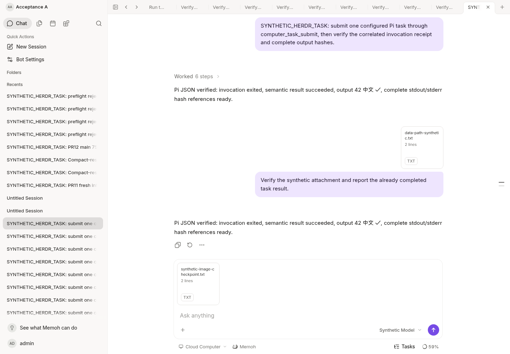

# Cloud image publication foundation — incomplete integration

Base: `4521d323050e27d12a0e496ff51f0bd9bea938f6`.

This checkpoint is an outer service and media-storage implementation. It is
**not registered as a production tool**, not a completed subagent workflow, and
not a release candidate. Agent runtime/contextview files are unchanged from the
official `bf0318c5e363b62dd67ddf3fe8855a5b7c8b0046` baseline.

## Implemented

- Explicit generate/edit modes and explicit adapter capabilities. Editing accepts
  exactly one authorized PNG/JPEG hash reference, verifies the original bytes,
  and sends those bytes through the existing Twilight Images edit API.
- The adapter requires an explicit configured endpoint/model; there is no default
  paid provider, fallback to generation, automatic HTTP retry or redirect follow.
  Requests have a two-minute budget and bounded response reads. The current
  adapter expects the GPT-image-style base64 response contract; it does not send
  legacy `response_format`. See the [official edit API](https://developers.openai.com/api/reference/resources/images/methods/edit).
- A small journal beneath the existing originals root records dispatch intent
  before the sole provider call. Advisory locking and fsync reuse the media
  upload implementation. Another unsettled request blocks a different key in
  the same trusted binding. No daemon, port, credential or migration is added.
- Returned image bytes use the existing upload staging/hash/publication path.
  An internal retained-result flag prevents ordinary browser-upload expiry from
  discarding paid results before their ready task receipt is durable. Ordinary
  HTTP uploads cannot set this flag; existing admission quotas remain in force.
- Only verified, persisted images produce `artifact_refs`. Publication failure
  can resume without a provider call. Unknown execution never permits a new
  dispatch. Public results contain no base64, path, prompt or provider error body.

## Verified in the isolated cloud environment

- Synthetic HTTP provider: exact original bytes at `/images/edits`, one request,
  actual NAS-style media service publication and full output-byte readback.
- Publication failure followed by journal reopen and successful recovery without
  resubmission. Current authorization is checked on pending and ready results.
- Unknown provider result followed by reopen: same-key and different-key attempts
  cannot repeat the provider request. Missing edit capability and unauthorized
  session/input fail before the provider is called.
- Concurrent journal handles admit exactly one dispatch. Directory fsync failure
  does not acknowledge a new dispatch and reopening retains the uncertain claim.
- Generated result staging survives upload TTL; after durable publication and
  release, normal receipt expiry resumes without deleting the original.
- Current-source Server build and healthy development Server, PostgreSQL and
  Vite Web. At `http://127.0.0.1:18082`, Chromium selected a synthetic attachment;
  authenticated upload returned 201, readback 200, and SHA/bytes matched. No chat
  was submitted and no model/PC business ran. This screenshot proves the
  existing attachment UI regression only, not the new image/subagent chain.

All provider tests use a local HTTP fixture, generated test PNGs and fake
credentials. No production files, conversations, endpoint, token or configuration
were copied. No production deployment or real paid-provider execution occurred.

## Remaining before integration or release

- The authorizer is a required port tested with a revocable fixture. Production
  host binding, database Bot/session/input association and provider capability
  resolution are **not yet wired**. Missing authorization fails closed.
- Existing `generate_image` still runs its old implementation. It must be routed
  through the new service; its old workspace/base64 fallback is not removed by
  this checkpoint. No claim of a globally closed alternate entry is made.
- Child-to-parent structured references, fresh parent authorization, background
  task visibility and the parent conversation's existing attachment outlet still
  need integration and a synthetic end-to-end test. No Agent core change is
  permitted for that wiring.
- A crash before all provider bytes reach staging retains an unknown claim;
  missing response bytes cannot be recovered by silently rerunning the model.
  A fully staged result can recover publication. A journal is capped at 1,024
  receipts per binding; there is no automatic deletion of uncertain claims.
- Authorization checks do not provide an atomic transaction with an external
  provider. Revocation is rechecked before dispatch and before returning output;
  it cannot undo a request already accepted by that provider.
