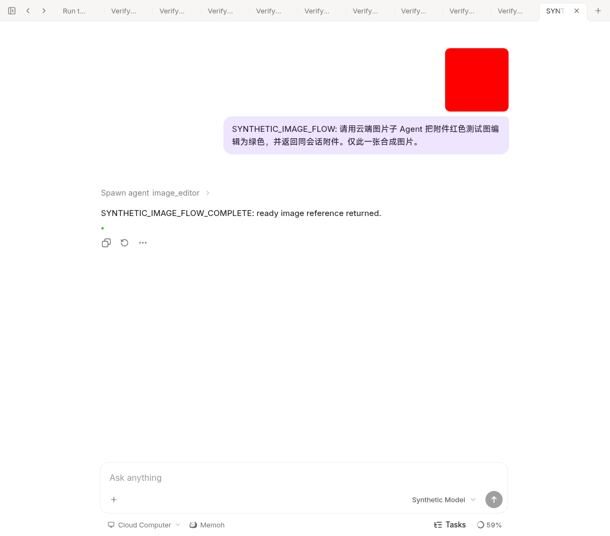

# Background image results and first-turn browser acceptance

This increment follows the frozen `b256a290acd13059c6b5c60213c2cfb07644cab6`
checkpoint. It changes outer host/tool/media adapters only. It does not modify
an Agent runtime, create a task service, issue credentials, or deploy anything.

## Queue identity correction

The existing background manager discarded a queued request's context and used
its predecessor's context on promotion. Two root turns using the same child
could therefore share the first turn's image billing identity. A regression
failed before the fix (`TestQueuedAgentTaskRetainsSubmittingContext`).

Queued tasks now retain their submitting host context. Promotion detaches
transient cancellation while retaining that request's values and explicit
execution deadline. The preceding task's context is not used. Killed queues
release the retained context. The existing queue remains in memory; this is not
a new durable scheduler or a claim of restart recovery for background tasks.

The PostgreSQL integration test uses two persisted root runs/turns, the actual
outer submit/queue/promotion code, registered image tools, and a synthetic child
runtime plus HTTP image provider. It checks separate image task IDs, one charge
per admitted turn, same-turn replay through a replacement child, and unknown
recovery without another provider call. A completed child conversation is not
treated as proof that its image task is ready.

## Background result contract

The existing background task stores only image receipt IDs collected from the
image service. `get_background_status` checks the existing Bot/session task
scope, then rebinds the caller through current DB account, Bot, ancestor and
source-file checks. It returns typed `image_tasks` with their individual state,
code and `automatic_retry: false`. Only ready results produce `artifact_refs`.

The observation does not call a model or emit duplicate chat attachments. The
parent can use the existing `send` tool with the ready `content_hash`. The image
publication journal remains durable; the background manager is not. After a
server restart, a known image receipt can still be read through `generate_image`
with `mode=result` under the existing conversation checks. This increment does
not promise automatic attachment delivery retry or a persistent background list.

## Browser failure and correction

Development hook failures had two environmental causes: the host `/data` was
read-only, and the old bridge binary needed a glibc loader absent in the cached
Alpine fixture image. A current-source static bridge was run in an isolated
container with only the existing development socket and synthetic data mounts.
No host filesystem permission, production configuration, or bridge code changed.

Once hooks ran, the browser exposed a real first-turn authorization timing gap.
The inbound attachment was already resolved into media, but its user-message
asset link commits only after the first complete model step. A child invoked
inside that step could not find the association in history yet.

The authenticated host now snapshots the resolved current request's input
hashes into its immutable root Origin. The image authority checks account/Bot
access, parent-child ownership and the persisted root run before accepting an
exact current-input hash. Model tool arguments cannot add to this set. History
asset links remain the source for earlier attachments. The integration test
covers a not-yet-linked current attachment and rejects a known same-Bot hash
without either source. No per-task grant or extra user approval is introduced.

## Observed browser result

- Current-source server and Web development app, actual Chromium browser.
- One synthetic red PNG uploaded through the chat file control.
- Real parent and child runtime calls, with a deterministic local synthetic
  chat provider. The child calls the configured synthetic HTTP edit adapter.
- The successful flow makes four chat-provider requests and one image edit
  request. Earlier failed flows made no image request; they were not silently
  counted as successes. This is not autonomous real-model acceptance.
- Exact input multipart bytes matched. The edited green PNG was published to
  the existing media store, delivered to the parent, and read back byte-for-byte
  through authenticated media HTTP (200). The parent attachment link is durable.
- A fresh browser load renders both originals and result from history, without
  another edit request. No browser script errors. These tiny fixture images are
  4 by 4 pixels; the output therefore renders as a small green point.

The screenshot is automated browser evidence, not human QA. It contains only
synthetic fixture content; auth state, URLs containing tokens and raw logs are
not included.

## Test status and boundaries

Passed: imagejob/media/background race suites; real-PostgreSQL image queue and
parent-result integration; targeted image, queued-child, background and host
workspace regressions; server build; selected-package golangci-lint.

The complete tool-package race run still fails these seven network-image tests:

- `TestGenerateDashScopeImageUsesAsyncSDKProviderAndDownloadsImage`
- `TestGenerateDashScopeQwenImageUsesProviderDefaultSizeWhenUnspecified`
- `TestGenerateOpenAIImagesImageUsesImagesEndpointAndDownloadsURL`
- `TestImageResultToGeneratedImageRejectsNonImageURL`
- `TestImageResultToGeneratedImageRejectsSpoofedImageContentType`
- `TestFetchGeneratedImageRejectsEmptyBody`
- `TestFetchGeneratedImageTruncatesLargeErrorBody`

All seven were rerun at fixed foundation commit
`e146c540e4154b4755411b5489afc58a639677c9` and fail in the same way: the environment
HTTP proxy resolves to a restricted address rejected by existing SSRF checks.
Their test/helper files have no diff between base
`4521d323050e27d12a0e496ff51f0bd9bea938f6` and e146. Proxy settings and SSRF checks
were not changed. This is a failed full suite with a verified baseline cause,
not a claim that all local tests pass.

`internal/agent/runtime` and `internal/contextview` remain zero-diff against
`bf0318c5e363b62dd67ddf3fe8855a5b7c8b0046`. No paid model, production file, new
credential, production deployment or actual NAS was used. The image permission
surface remains owned chat roots and their children; general shared/channel
policy and final production model/provider acceptance remain outside this test.
