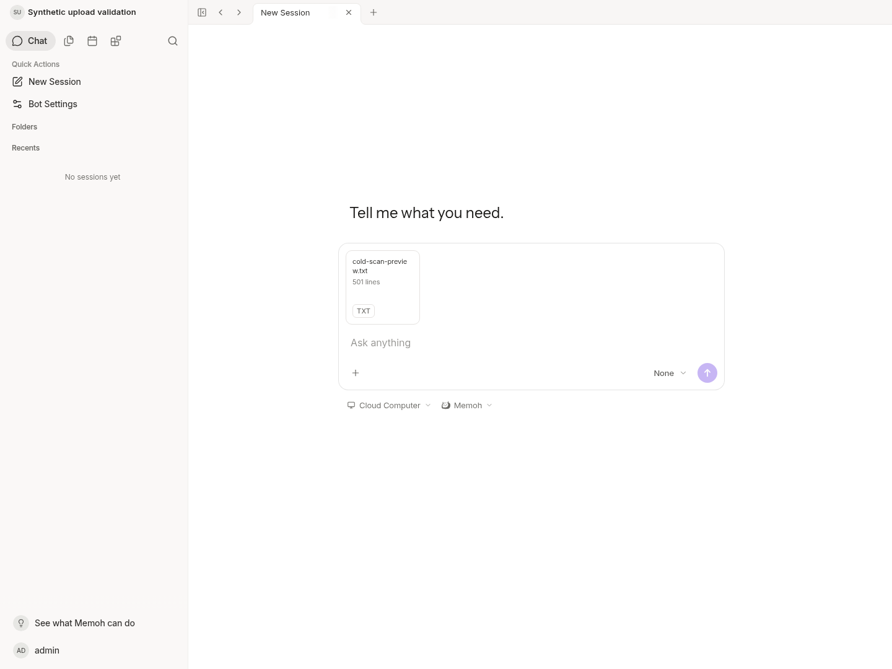

# Bounded cold-scan continuation validation

This is a separate increment on frozen PR #21 commit
`8b5db5a744f4bad8dbdf7c2af4e99c3a24d93e51`. Only the existing local file
verification cache changes in production code. No new service, registry, storage
format, migration, timeout, upload limit, mount setting or background scan is
introduced. Agent/runtime/contextview, task execution and transfer-client code
are unchanged. The [design](../../verified-media-ranges.md#incremental-cold-scan-continuation)
states the trust and resource boundaries.

## Reproduction and progress

[Baseline](baseline.txt): a real short deadline expires after one completed
1 MiB file read. Twelve requests on #21 all read offset 0: 12,582,912 bytes and
no verified reader. This failure is intentional evidence of the reported issue.

[Fixed fault/race run](final-fault-race.txt): the same one-block-per-request
schedule visits offsets 0, 1,048,576, 2,097,152 and 3,145,728. Request five
completes verification and the test reads one verified block. Total read bytes
are 4,568,576 (the fixture plus one response block). Every canceled call returns
no reader, and retained entries have no readable index. The baseline used a
5 ms deadline; the final harness uses 50 ms to leave more scheduling headroom
before the first I/O. Both force each completed read to wait for that deadline;
these logs compare scan progress, not latency or a literal two-minute NAS run.

[Large-file read counts](large-volume.txt) use actual file ReadAt byte counts,
with cancellation every 64 MiB of scan work:

| Original | Requests until verified response | Scan plus 64 KiB response read bytes |
| --- | ---: | ---: |
| 200 MiB | 4 | 210,763,776 |
| 512 MiB | 9 | 537,919,488 |

Each total is one full original scan plus one 1 MiB verified response block.
No whole-original buffer is used. This is synthetic local cloud I/O, including
page-cache hits; it is not physical disk traffic, NAS throughput or Windows
performance. These fixtures finish inside twelve requests; arbitrary files or
caller budgets may still exceed the client's finite retry budget.

Reproduce the opt-in volume test:

```sh
MEMOH_COLD_SCAN_VOLUME=1 go test ./internal/storage/providers/localfs -run '^TestColdScanLargeResumeReadVolume$' -count=1 -v
```

## Integrity, isolation and resources

The final race run covers paused-prefix mutation with restored mtime, inode/root
replacement, mode change, hardlinks, mutation during cancellation, read errors,
read-time bit flips and full-SHA mismatch. Failed scans discard partial state.
New provider instances start from zero; another Bot cannot take over progress.
Eight concurrent waiters share one scan and only one mutable owner at a time.
Canceled waiters leave the existing progress intact. Paused work closes its
descriptor. Partial and complete entries share the existing 128-entry/16 MiB
cache budget; eviction falls back to complete verification. Budget fixtures use
synthetic digest arrays, not claims of huge real-file tests.

[Related race run](race.txt) passed storage/media/server/core, but its handler
build hit a test-file rename while compilation was active. The filename was
fixed before the [successful handler rerun](handlers-race.txt), which includes
the real NewServer/JWT paused-scan HTTP test: anonymous 401, revoked 403 and
cross-Bot 404 cannot reach the verifier; renewed authorization can resume, and
revocation after completion still denies the next request. The latest localfs
test refinements are covered by the final fault/race log above.

Targeted golangci-lint 2.10.1 completed without diagnostics after replacing the
test's hex formatting with hex.EncodeToString. Windows amd64 and Darwin arm64
[test binaries](cross-compile.txt) compiled; they were not executed.
[Official Agent boundary](core-boundary.txt) passed, along with git diff --check.

## Running application

The current native Server binary was rebuilt and restarted with the existing
isolated PostgreSQL/Vite environment at loopback 18080/18082. Direct/proxy login,
readiness and authentication boundaries passed. The owned start script lacks an
executable bit; direct execution failed before startup and normal invocation via
bash succeeded. No privilege or production configuration was changed.

[Actual HTTP observations](http-runtime.jsonl): before reading headers, close
one request after 50 ms, then request cold/warm ranges and disconnect/reassemble
the complete download. Both synthetic 200/512 MiB files reconstructed to their
expected SHA. Server scan progress was not instrumented, so this runtime check
does not assert the exact interrupted scan position. The earlier cloud denial
of Server /proc/<pid>/io remains respected; no fresh attempt or escalation was
made. Runtime RSS values are samples, not global peak/concurrency guarantees.

[Chromium observations](ui.txt): real login, a synthetic text attachment showing
501 lines, and authenticated cross-block Range returning exact bytes with 206.
No page errors, chat send or model invocation. The fresh screenshot was inspected:



No production NAS/Windows activity, destructive injection or physical power-loss
test was performed. Restart/eviction still loses in-memory progress. Existing
client retry scheduling, exhausted transfer budgets and HTTP 499 classification
remain separate work; no new automatic business-task dispatch is introduced.
