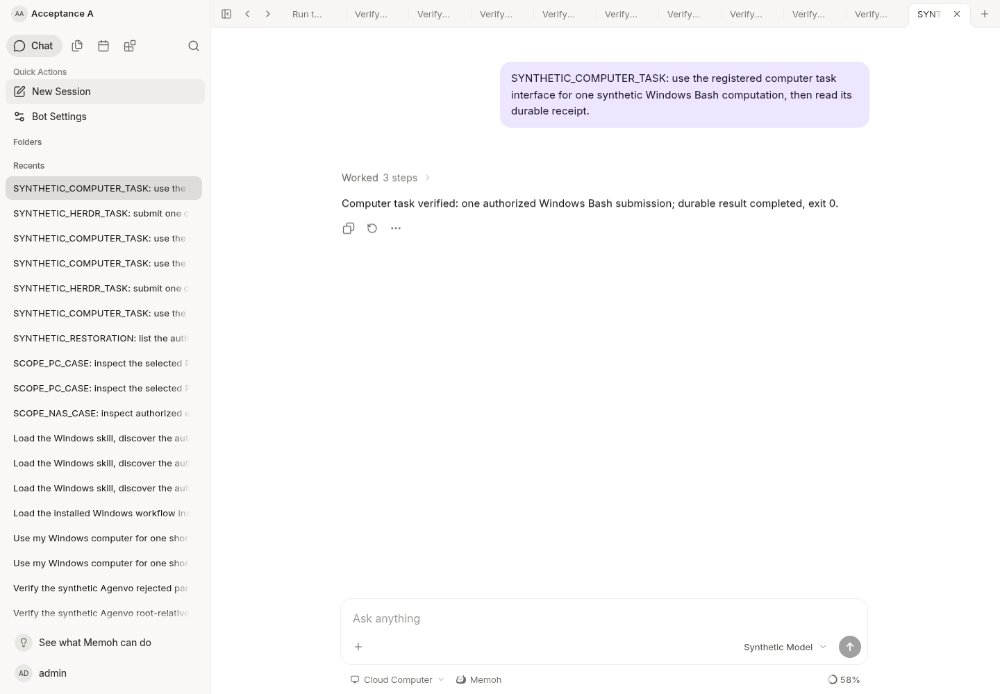
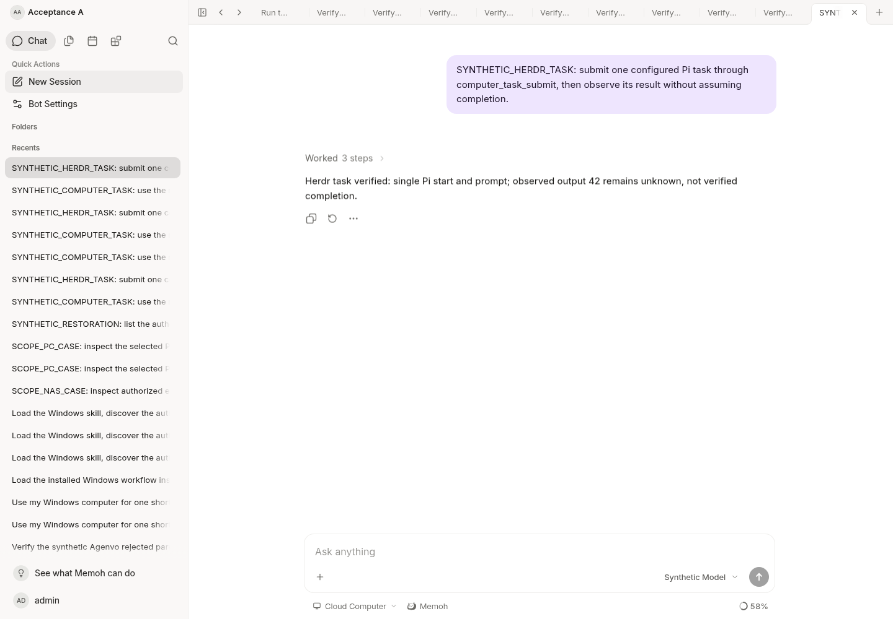

# Computer task service: cloud development checkpoint

This is synthetic development evidence, not production deployment, human QA,
real Windows acceptance or a real model's autonomous routing result. The
runtime and contextview directories match official baseline
`bf0318c5e363b62dd67ddf3fe8855a5b7c8b0046`; the boundary script passed.

## Running application and browser

The cloud development server was rebuilt from this change and served at
`http://127.0.0.1:18080`; the actual Vue application ran at
`http://127.0.0.1:18082/bot/acceptance-a`. PostgreSQL 18 reported migration 170
clean. A synthetic model and Agenvo transport supplied controlled responses;
no production credentials, PC, NAS or external provider were contacted.

Chromium opened the authenticated Web application and created fresh chat
sessions with the default Cloud Computer selection. The affected tool path
ran through the real application, native runtime, shared MCP source, service,
existing relay transport and PostgreSQL receipt store. The fixture selected
tools deterministically: these tests do not prove natural-language reasoning.
Both browser runs had zero page errors. The captured screenshots were opened
and visually inspected.

- Foreground: `computer_targets` → `computer_task_submit` →
  `computer_task_get`; one Bash submission returned a nonce-validated
  synthetic frame, persisted `completed`, exit 0.
- Agent: the owner API updated the existing synthetic Bash registration's
  non-secret Pi profile without credentials or grants. Then
  `computer_targets` → `computer_task_submit` → `computer_task_result`
  performed fixed workspace/tab/start/get/prompt/read operations. The relay
  recorded exactly one Agent start, one prompt and zero closes. The database
  recorded `unknown`, phase `prompt_submitted`, `task_success_verified=false`,
  even though the synthetic native state said done. The UI explicitly reported
  unverified completion. No search, raw method choice or retry was needed.

The initial profile check selected a historical fixture missing its Bash
path and correctly received 400 before dispatch. The script was corrected to
select the existing valid Bash registration; validation was not relaxed.

## Review-fix checkpoint

After review of `9fe76e91`, this revision adds these regressions:

- The actual application child admission and unchanged native SpawnAdapter
  receive a child-session binding after checking the stored parent; PC-B and
  NAS remain denied. An unrelated child record is rejected.
- The unchanged Claude Code and Codex drivers run their real `Prompt` path
  through bridge/container checks to a synthetic launcher boundary, twice.
  Their host is native while task scope stays PC-A. This does not exercise a
  live vendor process or an already-running Codex app-server.
- Standard MCP rejects malformed/native-error prompt receipts without claiming
  submission. Proven pre-input rejection and unknown remain distinct; a second
  submit does not repeat either operation. Different tasks return an explicit
  blocked-operation conflict. Foreground location/request/cleanup evidence is
  persisted. Registration changes after claim cannot dispatch elsewhere.
- An unknown standard-MCP task followed by the old ordinary `exec` path is
  rejected without a second relay submission. Root-relative workdirs are now
  tested through the durable standard-MCP path; NAS native exec remains.
- Endpoint normalization, credential identity, revoked aliases, per-request
  redirect checks and propagation through federation listing/calls are tested.
  The isolated PostgreSQL migration test includes semantic/credential aliases.
  Unknown independently authenticated proxy aliases are not claimed detected.

The final rebuilt server/browser pair used fresh synthetic sessions. Deltas
were one foreground submission, one Agent start, one prompt and zero closes;
PostgreSQL retained `completed`/`foreground_completed` and
`unknown`/`prompt_submitted` with `prompt_submitted=true` and
`task_success_verified=false`. Both screenshots above were recaptured and
inspected, and both browser runs reported zero page errors.

An earlier rerun reached a still-running old fixture with a malformed prompt
receipt. The server correctly recorded `unknown`/`submitting_prompt`, with
`prompt_submitted=false`. That row was retained. The synthetic relay was
replaced with the strict official response shape and a new session was used;
no existing uncertain operation was repeated or cleared.

Two build attempts exhausted temporary disk; only obsolete derived caches and
stopped development binaries were cleaned. The subsequent build succeeded.

## Automated checks

| Check | Observed result |
| --- | --- |
| Official Go MCP SDK over Streamable HTTP | Authorized PC task and full configured Pi procedure passed without special system instructions; PC-A cannot list/use PC-B or NAS. |
| Trusted binding | Public/forged headers, missing host binding, foreign identity and canceled owning run rejected. NAS ambiguity rejected before dispatch. |
| Durable receipts | Unknown, lost response and persistence-failure receipts prevent redispatch; cancellation records intent without killing. Invalid paths fail before reservation/dispatch. |
| Media snapshots | Only opened, byte/hash-verified terminal snapshots return ready references; missing storage and revoked grants rejected. This is not general PC file transfer. |
| Authorization and raw routes | Read/write/exec and target approval matrix passed; raw registered Agenvo connections, same-URL aliases, cached routes and revoked registrations rejected. PC Connect-It catalog and stale calls rejected; NAS unrelated connectors preserved. |
| PostgreSQL 18 schema 170 | Fresh migration, isolated 170→169→170, eight concurrent claims, stale revision, reconstructed-store retry, identity isolation and non-superuser RLS passed. Canonical schema, composite keys, schema guard and RLS guard passed. |
| Go packages | computertask, agenvo, toolcontext, mcp, federation, workspace, workdir, application, core and userruntime passed. Focused computer/capability/workdir tool tests passed. |
| Build and generated interfaces | Server build, Swagger generation, OpenAPI SDK generation and SDK TypeScript check passed. |
| Static checks | Affected-package golangci-lint completed; its sole new core test style issue was corrected and that package passed again. Initial build-cache space exhaustion was recovered before the completed run. |

The complete repository test suite and Web type suite were not rerun. Existing
unrelated Web type and image-proxy failures are not reclassified as passed.
The full affected-package lint run covers handlers and generated-store users.
The review revision corrected an error-string style finding and reran the
affected packages. Usage assertions now check the required durable task path.

## Remaining acceptance boundaries

Actual Claude Code/Codex executables and Windows/Pi were not run in this
checkpoint. The standard client tests use the official SDK and a synthetic
trusted host binding; Memoh's existing original-Agent mounts are the intended
production configuration path. A standalone external client requires an
authorized restricted host connection, not forged session headers. No new
production credential was created.

There is no verified Pi task completion correlation, safe automatic stop/close,
unknown-slot administrative resolution or pending-approval continuation.
Agent observations remain unknown, and an unsettled slot blocks another task
on that conversation/target. GUI control, general PC file transfer, cloud image
editing and a management dashboard are not implemented here. Preserve schema
170 receipts during any application rollback; never erase unknown work merely
to retry it. See the [service contract](../../computer-task-mcp.md).
