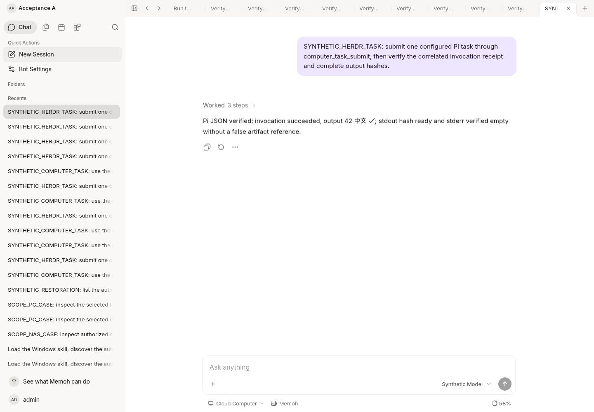
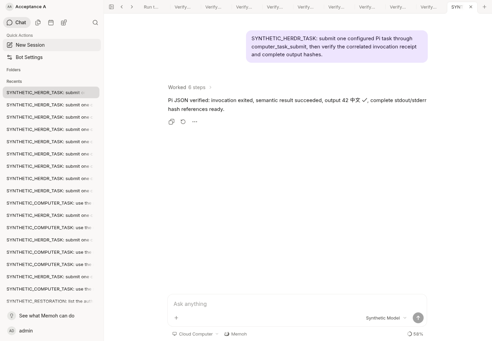

# Pi JSON cloud validation

This is a separate candidate after PR #6, not a production or vendor-binary
acceptance. No Windows/NAS process, provider credential or real user task was
used. Runtime and contextview remain byte-for-byte at official
`bf0318c5e363b62dd67ddf3fe8855a5b7c8b0046`.

## Completed locally

- `go test -race -p 1 ./internal/agenvo ./internal/computertask -count=1` passed.
  Standard Go MCP SDK over Streamable HTTP covers the trusted binding, PC-A
  isolation, single submission, receipt recovery after terminal-frame eviction,
  more than 64 KiB of output imported in pages, hash-ready refs, revocation,
  cancellation, lost dispatch response, no redispatch, unrelated receipt,
  control-pane identity change, corrupt content, storage failure without private
  cause leakage, oversize preflight and output-limit semantics.
- The generated Bash envelope ran against synthetic local utilities: stdin
  injection vectors stayed data, real process exit 7 and ordinary stderr were
  retained, receipt rename and hashes matched, duplicate attempts did not run,
  and a stale exact-session lock was not stolen. This was Linux Bash with
  synthetic host/path commands, not Windows Git Bash or real Pi.
- JSONL fixtures cover exit-0 semantic errors, abort/length/nonzero, early error
  followed by retry success, missing lifecycle/final records, wrong session or
  provider, partial LF framing, Unicode separators and bounded previews.
- Affected-package golangci-lint, server build, regenerated Swagger/SDK, SDK
  TypeScript check, core boundary script and diff whitespace checks passed.
- The first race attempt exhausted the temporary filesystem during compilation;
  only old derived Go cache entries were removed, and the subsequent full race
  command passed. The environment's global pnpm attempted an unnecessary install
  into a read-only home; the repository's already-installed `openapi-ts` generator
  and TypeScript compiler were used directly, successfully. No dependencies or
  permissions were changed.

## Actual application and browser

Cloud development server `http://127.0.0.1:18080` was rebuilt from this change;
HEAD `/health` returned 200. Existing Vue development UI at
`http://127.0.0.1:18082/bot/acceptance-a` and isolated PostgreSQL schema170 were
reused. The registered synthetic target was configured through the existing owner
API with `execution_mode=pi-json-v1`, without creating a credential or grant.

A new session was opened through the real UI, a synthetic Pi task submitted,
and the runtime called `computer_targets`, `computer_task_submit`, then
`computer_task_result`. The final source rerun produced one batch submission,
eight fixed chunk reads, zero close operations, and no browser page errors.
The prior browser run used a separate synthetic session before the metadata
field cleanup; it was not replayed. Each run submitted once.

The final persisted result was `completed`, `pi_succeeded`, exit 0,
`process_stopped=true`, with the synthetic `42 中文 ✓` output and verified refs:

- stdout: `a1bf19db79e1942dbf25bc9ea0e1cc2f3a2537471a44e41f732eaf32e79d0026`
- stderr: `e14a185c9a2dc66b90cc4b320afb150b83045718b702c15b873b7d4605632376`

The screenshot was captured and visually inspected after the final server
rebuild. The provider/relay deliberately return synthetic records; this proves
application wiring and evidence handling, not natural-language routing by GLM,
real Pi/Magpie interoperability or independent completion of a user's task.

### Empty-output correction after the initial checkpoint

Source review found that the actual media spool rejects zero-byte assets. The
initial synthetic asset fake did not expose this. The correction verifies the
receipt's empty SHA-256/size and returns explicit empty-output flags without
inventing a media ref. A new standard MCP test uses the real `media.Service`
with `localfs.NewOriginals` and required persistence. Empty stderr succeeds,
empty stdout is invalid protocol, and a never-started invocation is not_started.
The affected-package race suite and lint passed again.

The rebuilt server was exercised through another new Web session with the real
media service and synthetic relay/provider. It returned `pi_succeeded`, exit 0,
`stderr_empty=true`, no stderr ref, and ready stdout hash
`9e5f6eee1e86379988ad897b211908ab8ada8a275a8af995b9f4d4b012429908`.
No browser errors occurred. No media code or migration was changed.

### Historical rendered-row correction (superseded)

Official Herdr 0.9.5
[terminal reads](https://github.com/herdrdev/herdr/blob/v0.9.5/src/pane/terminal.rs#L2770-L2815)
count rendered rows even for `recent-unwrapped`. Fixed four-row reads could
omit the start of a long base64 page. That candidate grew only the read
snapshot (4 through at most 1000 rows; this exceeded the Agenvo schema and
was invalidated by subsequent Windows acceptance) until a complete frame fits, without
repeating pane.run. The standard MCP regression and browser relay now simulate
80-column soft wrapping. Race, lint and build passed; the rebuilt Web completed
another fresh synthetic large-output task with no browser errors. `web.png`
was refreshed and inspected from that run. Narrow-terminal or relay-size
failures remain unknown/pending rather than relaxing nonce/frame/hash checks.

The envelope also writes a correlated `not_started` receipt when the requested
directory is absent, Pi is not on the configured PATH, or the session lock is
already held, provided its result directory and basic shell utilities remain
available. The actual Bash regression covers the absent-directory and held-lock
cases. Race/lint/build and a fresh browser large-output flow passed after this
preflight correction; `web.png` was refreshed again. Failure to write any receipt
still remains unknown and must not be retried as a business task.

## Agenvo read-limit correction after Windows rejection

Windows acceptance invalidated the `940e1655` reader: it requested 512 rows,
while Agenvo 0.2.0 allows at most 500. The already submitted invocation had a
correlated exit receipt and files; the read error did not establish no-start.
No real operation IDs, host paths, outputs or credentials are included here.

The regression fixture now loads JSON Schema generated directly from the
fixed official v0.2.0 `herdr.ts` Zod `pane.read` declaration. Its 500 boundary is
accepted; 501/512/1000 and invented fields are rejected. The original reader
failed that fixture at `lines=512` before the correction.

The corrected reader uses 2 KiB data pages and a separate 4 KiB complete-receipt
budget. Delayed current frames do not expand snapshots into old frames. Only
this read's exact nonce end marker permits expansion, always capped at 500;
a vendor `result_too_large` narrows the observation without repeating input.
An observation's `invalid_params/not_started` remains an unknown observation,
with the submitted task receipt and slot intact. Only its own valid invocation
receipt may establish that Pi did not start.

The affected-package race suite and lint passed. Standard MCP regressions cover
16/43/44/80/240-column snapshots, accumulated old 16 KiB frames, command echo,
delayed current responses, oversized wide history, long-ID receipt recovery,
and a fresh service reading legacy 16 KiB chunks from the saved byte offset.
The task attempt, old chunk refs and offset are preserved. Later read recovery
completes the same operation without another Pi dispatch. Core boundary and
server build passed.

The initial Web restart used an incorrect configuration environment name and
failed before task submission; corrected `CONFIG_PATH` restored health 200.
The first strict cloud relay flow completed output ingestion and Pi semantics,
but its synthetic provider's message-count fixture looped on completed results.
The fixture was corrected to use typed tool results and unique tool-call IDs;
it does not modify the Agent core. A subsequent discovery-only fixture failure
submitted no task. The final fresh browser session passed: one batch submission,
54 fixed page reads, zero close operations, no browser errors, `pi_succeeded`,
and complete ready stdout/stderr refs. The strict relay used a 43-column terminal,
accumulated old frames, delayed responses, lines <=500 and the connector response
size bound. The screenshot below was captured and visually inspected from the
corrected running service. This remains synthetic vendor/provider acceptance.

## Remaining acceptance

The corrected reader still requires independent review, GitHub CI and controlled Windows Git Bash + unchanged Pi
1.2.0 + existing Magpie acceptance are still required before release. No new
migration is introduced: operation details and media refs reuse schema170.
See [the protocol contract](../../computer-task-pi-json.md) for control-channel
restart/ID-reuse limitations, non-sandbox trust boundaries, output limits and
honest cancellation semantics. The prior `940e1655` candidate was published and exposed the read-limit defect
in controlled Windows acceptance; it must not be merged/promoted as accepted.
The correction has not been published. No NAS deployment was performed by this task.
