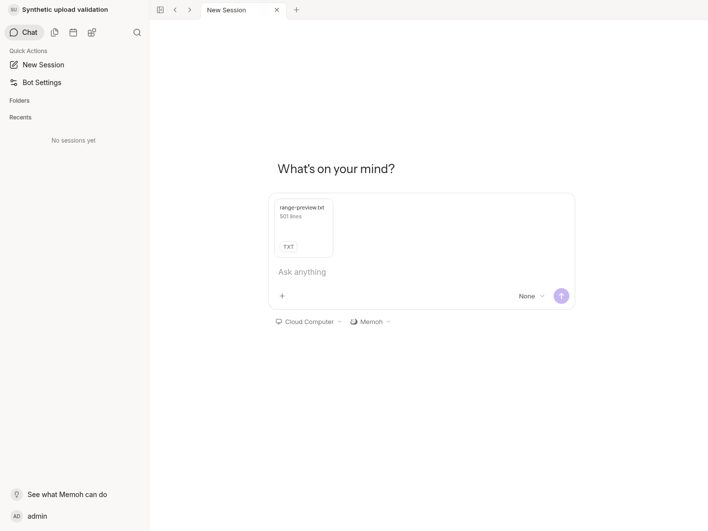

# Media range validation

Synthetic cloud validation on main baseline
`75a70fe961808ed5ec2284767cb92ea85f30890f`. No NAS/Windows deployment or private
data was used. The implementation and remaining limits are described in
[verified media ranges](../../verified-media-ranges.md).

| Evidence | Scope |
| --- | --- |
| [baseline-io.txt](baseline-io.txt) | Actual Linux read syscall bytes on the original implementation; 200/512 MiB, 64 KiB response |
| [optimized-io.txt](optimized-io.txt) | Same fixture with guarded block verification |
| [optimized-io-assertions.txt](optimized-io-assertions.txt) | Independent rerun with explicit cold/warm read-volume bounds |
| [race.txt](race.txt) | Related storage/media/handler/server/core race regressions |
| [final-range-race.txt](final-range-race.txt) | Subsequent range/fault/HTTP regressions after buffer and private-error hardening |
| [http-before-restart.jsonl](http-before-restart.jsonl) | Real Server Range, client disconnect and complete resumed SHA checks |
| [http-after-restart.jsonl](http-after-restart.jsonl) | Final rebuilt Server: cold/warm Range and complete resumed SHA after process restart |
| [ui.txt](ui.txt) | Chromium login/attachment selection and authenticated cross-block Range |
| [cross-compile.txt](cross-compile.txt) | Linux 386, Windows amd64 and Darwin arm64 test binaries; compilation only |
| [core-boundary.txt](core-boundary.txt) | Official Agent runtime/contextview boundary |

Targeted golangci-lint 2.10.1 passed without diagnostics. No OpenAPI/client schema
was changed. No migration, persistent index or new configuration was introduced.

The isolated process probe reads `/proc/self/io`. The separate runtime Server's
`/proc/<pid>/io` was unavailable due to cloud permissions, so its logs explicitly
omit byte counts. No escalation or alternate access was used. Runtime RSS is a
sample, not a process peak; elapsed times are cloud observations, not NAS or
Windows throughput promises. Warm reads verify requested blocks rather than
performing a new scrub of untouched bytes. Restarts/evictions still require one
complete SHA pass, which can remain expensive on large or slow storage.

The screenshot was captured and inspected against the running application. It
shows the synthetic pending attachment, not a chat send or successful model turn.

