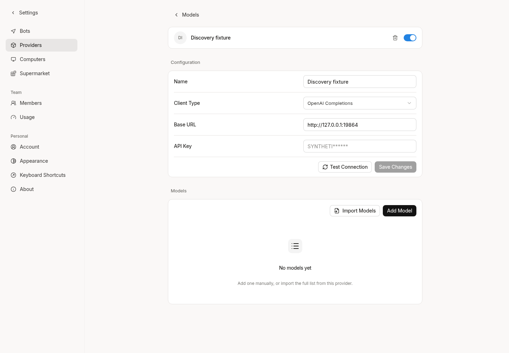

# Read-only provider model discovery

Base: `813d50ff97f22f613e0967fac2528b5c2fb5400e`. This is an independent change;
it does not include the later Web type/error-state fixes in PRs #33/#35.

## Contract

`GET /providers/{id}/model-discovery` (Web proxy: `/api/providers/{id}/model-discovery`)
uses an existing provider ID. Authentication is the existing active account JWT;
chat-route tokens are rejected. Providers in this OSS deployment are team-shared,
not per-user-owned. `GetProviderByID` retains its existing team predicate and RLS.
The request has no credential, endpoint, default-capability or import parameters.

The response contains only:

- `models[].id` and `name`, obtained from the live SDK model list (ID is the name
  fallback). Only returned IDs are included, not extra catalog entries.
- Six capability facts: `vision`, `tool-call`, `image-output`, `image-edit`,
  `reasoning`, `file-input`. A positive exact-ID declaration in the attached
  provider-template catalog is `declared` / `provider_template`; otherwise that
  individual fact is `unknown` / `unknown`. This is metadata evidence, not a
  successful inference test. Undeclared does not mean unsupported.
- `adapter.type`, `images_generation`, `images_edit`, and source `memoh_adapter`.
  These booleans describe Memoh's existing **OpenAI Images API adapters**, not a
  model's capabilities, endpoint availability, access entitlement, or every
  possible image-producing chat protocol. They must never auto-enable a model.
- `completeness: unknown`: the existing SDK list method is not guaranteed to
  exhaust upstream pagination. This endpoint must not reconcile/delete local
  model rows from an incomplete listing.

No model capability is inferred from its name, SDK default chat type, or client
protocol. Unrecognized upstream extension fields are discarded. This first
endpoint does not add speculative vendor capability parsers; an OpenAI-shaped
catalog containing only IDs correctly leaves capabilities unknown. Legacy preset
names and manually configured model rows are not relabeled as upstream evidence.

Supported metadata transports: static-key OpenAI Completions/Responses,
Anthropic Messages, Google Generative AI, and OpenCode Go. OAuth Codex/Copilot and
non-LLM adapters return 501 before network/token access; this GET does not refresh
or exchange credentials. Missing/disabled/out-of-team providers return 404;
invalid IDs return 400; upstream failures return a fixed 502. No raw errors,
responses, provider configuration, URLs, keys or headers are exposed or logged
by discovery. All responses, including JWT failures, carry `Cache-Control: no-store`.

The extracted `listModelMetadata` is also used by import. Import retains its
existing enrichment/probe/write behavior; discovery never calls that pipeline.
Discovery's HTTP transport permits only GET `/models`, refuses redirects, limits
the body to 8 MiB, and requires a model-list array. The call has a 60-second
deadline, limits returned models to 10,000 and identifiers/names to 1,024 bytes.
No automatic retry, model inference or database mutation is introduced.

The configured endpoint is a trusted administrator configuration and may be
self-hosted/private-network. This change is not a general SSRF filter. Checking
for direct credential reflection in model strings is defense in depth, not a
guarantee against every possible encoded secret in adversarial metadata.

## Verification

- `go test -race ./internal/providers ./internal/handlers -run
  'TestDiscoverModels|TestProviderDiscovery|TestFetchRemoteModelsViaSDK' -count=1`:
  passed. Real mock upstream HTTP covers all five transports, Google embedding
  metadata without an embedding probe, exact-ID declarations, unknown names,
  missing lists/malformed/oversized/error responses, redirects, secret reflection,
  disabled/missing providers and OAuth rejection. Test query implementations
  permit only reads; any write or OAuth query panics.
- The real Server middleware chain covers anonymous/invalid/expired/revoked
  account sessions, chat tokens, unavailable provider IDs, successful unknown
  capabilities, fixed upstream failures, response/log secrecy and no-store.
- `go test -tags=integration ./internal/db -run
  '^TestProviderDiscoveryReadOnlyTeamIsolation$' -count=1 -v`: passed with real
  PostgreSQL, an isolated migrated database and a non-superuser/non-BYPASSRLS
  role. Cross-team IDs are rejected before HTTP. Same-team discovery succeeds
  in a PostgreSQL-enforced READ ONLY transaction and commits without writes.
- Swagger and SDK regenerated. Current backend built successfully. The official
  runtime/contextview boundary script passes against `bf0318c5`.
- Full `internal/providers` package tests, scoped golangci-lint with
  `--new-from-rev=813d50ff`, and SDK `tsc --noEmit -p packages/sdk/tsconfig.json`
  passed. Generated SDK files are excluded by repository ESLint rules; that
  ignored-file invocation is not counted as lint coverage.
- Real Chromium at `http://127.0.0.1:18082/settings/providers`, current backend
  at local port 18080: created a synthetic provider fixture, opened its detail,
  called the generated discovery SDK twice in the authenticated application,
  confirmed identical unknown metadata and zero imported model rows, then tested
  a sanitized 502 and reloaded the detail. No page errors; fixture removed.
  The upstream fixture observed three GETs (two successful lists, one rejection)
  and zero inference requests. Screenshots are the actual application, not a
  generated preview. They demonstrate unchanged local registration, not live
  provider support. The new endpoint has no new UI button in this change.

The first PostgreSQL run was blocked creating its test database by disk space;
it passed after an inactive Go scratch directory was removed. A lint retry also
encountered temporary disk exhaustion; obsolete generated binaries were removed.
Neither failure was counted as a pass. No production provider, private image,
paid API, credential refresh, import, candidate publication or deployment was used.
Human QA and production-provider discovery remain unperformed.

The first Go CI at `819575f6` caught a new field-error contract violation:
`TestBadRequestsCarryNoUserText` rejected a textual Echo 400 for an invalid
provider ID. It was reproduced locally and corrected to the existing
`apperror.FieldInvalid("id", nil)` contract. The real middleware regression now
asserts `request.field_invalid`, only the `id` field argument, no input echo,
and zero provider reads/upstream calls. This is a code correction, not a skipped
check or a retry of the failing SHA. Discovery/auth/capability behavior is unchanged.

