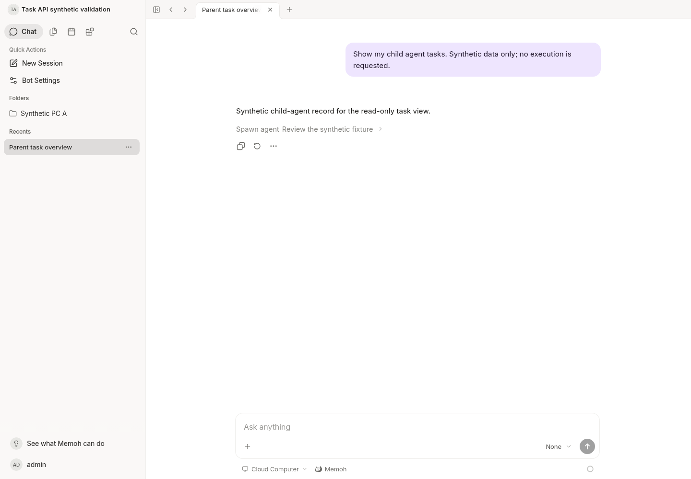
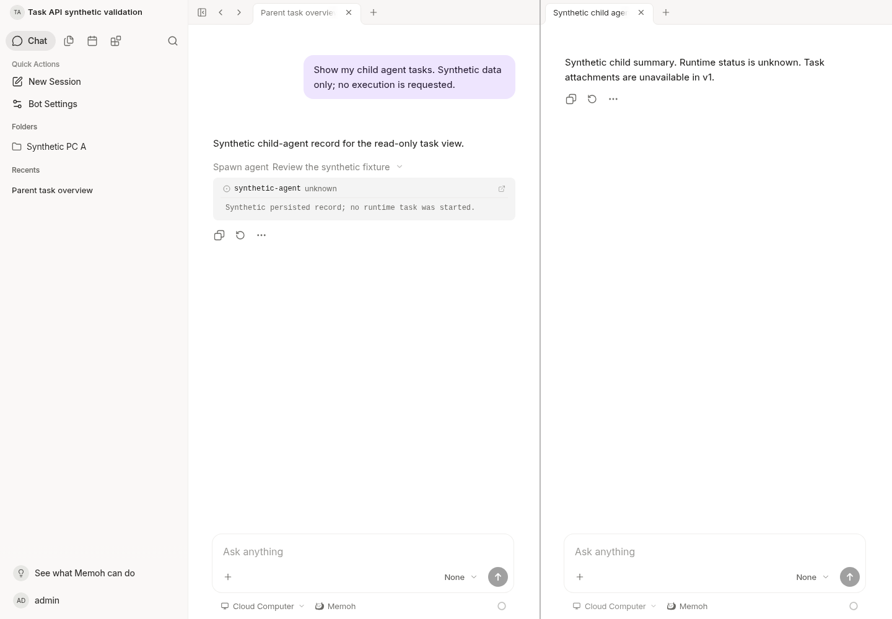

# Read-only conversation task validation

Revalidated on 2026-10-22 after integrating actual main
`a819c75ed94ae06a3a8196e9416302b18d8dd34f` (merged PR #7). The original
implementation checkpoint is `ea424d52680e9707fb6dfe3a1534db62ff740145`.
Integration adds a Pi batch projection regression and refreshes these records;
the task service and frozen mobile API behavior are unchanged.
API contract: [session-tasks-api.md](../../session-tasks-api.md).

## Environment and boundaries

- Isolated Linux cloud checkout, native current-source Go Server at
  `http://127.0.0.1:18080`, Vite Web at `http://127.0.0.1:18082`, local
  PostgreSQL 18 and pgvector development containers. Schema `170`, clean.
- Used the prepared `/workspace/.memoh-cloud/start.sh` workflow; rebuilt the
  server and restarted its owned processes after implementation changes.
  HEAD `/health`, real login and authenticated database queries passed.
- Go 1.25.7, Node 25.9.0, pnpm 10.27.0, golangci-lint 2.10.1. sqlc was generated
  with the exact repository command `go run github.com/sqlc-dev/sqlc/cmd/sqlc@v1.31.1 generate`.
  `mise run sqlc-generate` initially attempted an unrelated Rust install into
  read-only `~/.rustup`; direct execution avoided that environment change.
  The generator automatically selected Go 1.26.10 for sqlc's tool requirement.
- Only synthetic Bot/session/operation/MCP registration fixtures were used.
  The synthetic endpoint is unused. No actual device, model, submission,
  cancellation, media ingestion or task execution was requested.
- No NAS/Windows production access, new production credentials, server ports,
  migrations, control plane or Agent changes. PR #7 is now part of the main
  baseline; unmerged PR #8 code is not included.

## Automated checks

Passed again on the integrated source (not reused from the old checkpoint):

```text
go test -race -count=1 -p 3 ./internal/sessiontask ./internal/handlers ./internal/server ./internal/apperror ./internal/agenvo ./internal/computertask ./internal/db/postgres/store
go test -tags=integration -p 2 ./internal/db -run TestSessionTasksPostgres -count=1 -v
go build -p 3 -o <cloud-server> ./cmd/agent
golangci-lint run ./internal/sessiontask/... ./internal/handlers/... ./internal/db/store/... ./internal/db/postgres/store/... ./cmd/agent/...
go generate ./internal/handlers
pnpm run generate-sdk
pnpm --filter @memohai/sdk typecheck
NODE_OPTIONS=--no-experimental-webstorage pnpm exec vitest run apps/web/src/utils/api-error.test.ts apps/web/src/composables/api/sse-error.test.ts --maxWorkers=3
pnpm lint
bash scripts/check-agent-core-boundary.sh
git diff --check
```

- Frontend error tests: 2 files, 123 tests passed. ESLint: 0 errors and 18
  existing warnings. Generated SDK files are intentionally ignored by ESLint;
  a direct SDK lint invocation reported that, then normal repository lint ran.
- Authorization tests cover user/Bot/session/PC mismatch, intermediate
  ownership/deletion/cycles, inherited PC scope, target grant/source permission
  revocation, changed registration, malformed selection metadata, primary
  fallback and workdir priority. JWT HTTP tests use the actual middleware,
  Problem renderer and Agenvo grant resolver, asserting **zero relay calls**.
- Cursor tests cover equal creation times, late state updates, later inserts,
  mismatched/tampered cursors, revocation during pagination and empty filtered
  continuation pages. Revision is tested beyond JavaScript's safe integer range.
- Projection tests inject synthetic secrets/reasoning/output/artifact hashes
  into persisted data and assert none are returned. Pi result remains unknown
  even if an arbitrary extra JSON property claims success. Cancellation does
  not claim process termination; foreground exit does not claim business success.
  The added integration regression uses PR #7's nested batch receipt, files,
  chunks and parsed result shape: these stay outside the summary response,
  and list/detail leave the stored operation unchanged.
- Regenerated Swagger and SDK agree with the automatic merge. Both task path
  definitions and the `sessiontask.Task` / `sessiontask.Page` definitions are
  identical to the frozen `276c0b54` contract.
- PostgreSQL integration creates and cleans its own fresh database. It tests
  owned recursive aggregation, sibling/foreign-user/foreign-Bot/team isolation,
  deleted-ancestor filtering, type discrimination and creation-key pagination.
  Schema stays 170; no migration is added or modified.

## Real HTTP and browser checks

The rebuilt real server passed 16 HTTP checks: unauthenticated rejection,
multi-page traversal, grandchild-owned operation detail under a parent,
cross-root refusal, PC-A-only aggregation, foreign-PC refusal through a child
root, unavailable attachments, runtime revocation and restoration, persisted
unbound selection, primary-PC fallback and explicit NAS selection. Workdir
priority also remains covered by the service tests. The operation IDs, revisions, states, cancel flags and
details digests were identical before and after all GET requests.

In Chromium, authenticated through the normal login UI using the existing
local development account. Opened the
synthetic Bot and parent conversation, expanded its persisted `spawn_agent`
entry, then clicked `synthetic-agent` to open the actual child conversation in
the existing right-hand pane. Reused only the previous synthetic history and
fixtures; no conversation was executed. The first browser assertion timed out
because it matched an abbreviated sentence exactly. The actual longer child
message was already visible; correcting the test selector passed without
application changes.

In the same authenticated running page, imported the generated SDK and called
both new endpoints. List returned 200, one item and a continuation; detail
returned 200 with the actual grandchild session ID, `unknown`, cancellation
intent and both content/attachment availability flags false. No browser page
errors occurred in the final flow. Both screenshots below were recaptured and
inspected on the integrated source.





These are screenshots of the running application, not a new mobile task UI.
Live model execution, actual computer work and HarmonyOS UI integration were
**not** verified. The mobile client is separate.

## Remaining product limits

V1 provides safe summaries only, with no raw execution content or attachments.
Native runtime liveness and Pi protocol success remain unknown. No scheduler
queue is invented. A phone-only target selection not yet persisted is outside
the server's view; the existing free picker can change, while workdir-bound
targets remain fixed. Existing broad media endpoints are unchanged, and no
task hash/URL is exposed through this API. Human QA remains unchecked.

Runtime/contextview match official `bf0318c5e363b62dd67ddf3fe8855a5b7c8b0046`
exactly; all `internal/agent` paths are unchanged from this PR's main base.
Remote CI is recorded separately in the PR and is not implied by these local
results. No merge, release, candidate publish or deployment was performed.
