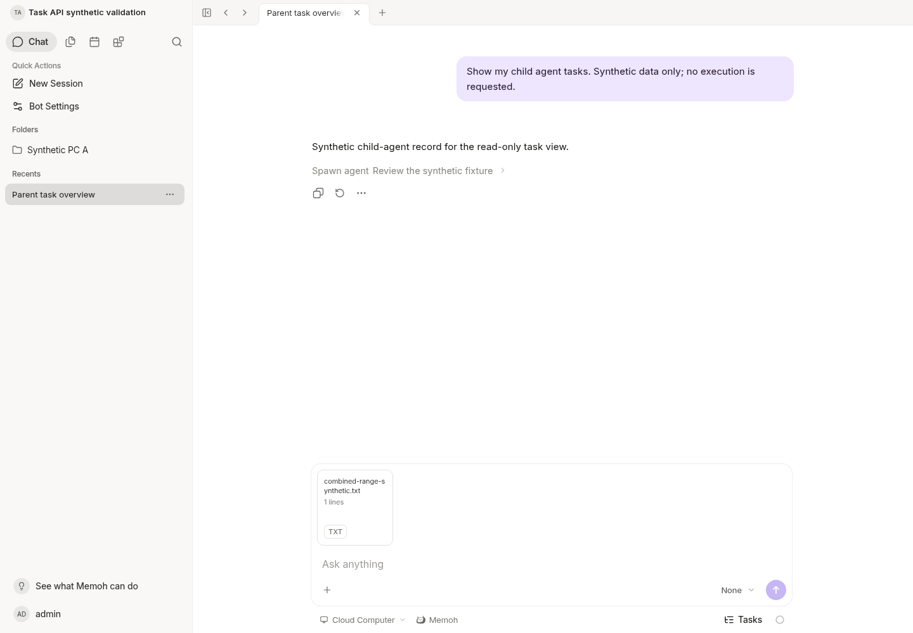

# Task-result candidate follow-up: cold-scan continuation

This integration starts from frozen candidate
`64aa794392c55001751acd857c188b72132c4b13` on the separate branch
`integrate/task-results-cold-scan`. Merge `3c131894` adds the exact #24
`3129ccc0eaf1f0c1dba69af04a9bd8d18b0b9199` without conflicts. That dependency
has exactly one commit after #21 `8b5db5a7`; its PR targets main for CI, but its
direct commit parent is #21. Storage/media implementation remains identical to
#24, with no integration-specific production edits.

The published `64aa7943` source branch, candidate tags and digests are preserved.
This is a source-only follow-up checkpoint: no new candidate dispatch, main
merge, promotion or production deployment. Production acceptance of the frozen
candidate is separate from these synthetic cloud checks.

## Incremental verification (2026-10-22 UTC)

- Race tests passed for localfs, fallback and media, plus handler tests matching
  `^TestMedia`. These include interrupted scans, changed identity/prefix,
  read errors, final-SHA mismatch, single-owner concurrent takeover, closed
  descriptors, shared cache bounds, restart/eviction and separate Bot scope.
- The real Server/JWT paused-scan test passed: anonymous 401, revoked 403 and
  cross-Bot 404 do not reach the verifier; a newly authorized request can resume
  verification, and later revocation also denies a completed cache hit.
- The opt-in 200/512 MiB test passed with cancellation after each 64 MiB:
  verification finished in 4/9 requests and read 210,763,776 / 537,919,488 bytes,
  respectively. Each total is one full scan plus one returned 1 MiB block.
  These are synthetic file ReadAt counts, not physical-disk or NAS throughput.
- Targeted golangci-lint 2.10.1 passed for localfs and handlers against
  `64aa7943`. No production hook, timeout change or relaxed assertion was added.
- Rebuilt and restarted the native Server with the existing PostgreSQL/Vite
  development environment. Direct/proxy login and readiness passed.
- Actual HTTP checks passed: 18 OAuth cache/denial checks, 8 media checks
  (cross-block/suffix Range, If-Range fallback, 416, 401, HEAD, disconnect and
  resumed complete SHA), and 33 task outcome/scope/cursor/revocation checks.
  Task responses remained no-store and operation ledger digests did not change.
  Exact interrupted scan offsets are proven by deterministic tests; this
  runtime HTTP run does not instrument or claim those offsets.
- Chromium at `http://127.0.0.1:18082` exercised actual login, the synthetic
  conversation and pending attachment selection. An authenticated cross-block
  Range through the Vite proxy returned 206 and exact bytes `[254,255,0,1,2]`.
  No page errors, chat submission or model/PC task. The fresh screenshot below
  was inspected; it proves the UI state, not storage correctness or human QA.
- Task API/docs/projection, generated OpenAPI/SDK, Web identity/late-response
  protection, OAuth handlers, operation writes and migrations have zero diff
  from `64aa7943`. The mobile 1.0.7 contract is unchanged. Official Agent
  runtime/contextview still matches `bf0318c5e363b62dd67ddf3fe8855a5b7c8b0046`.
  Unchanged frontend tests/build/typecheck were not repeated; the previous
  full Web typecheck's 442 existing errors remain disclosed.

## Limits

Unfinished SHA state is separate from a readable index. Cancellation can retain
completed work only within the same process and unchanged file identity; the
full aggregate SHA must still match before a reader is returned. Restart or
eviction loses progress. Finite retries can still be exhausted, and warm reads
verify requested blocks rather than performing a global scrub. No guarantee of
completion within twelve requests is made for arbitrary files or deadlines.

All evidence uses synthetic development data. No production configuration,
private logs, addresses or credentials were imported or published. No NAS or
Windows operation was performed.

