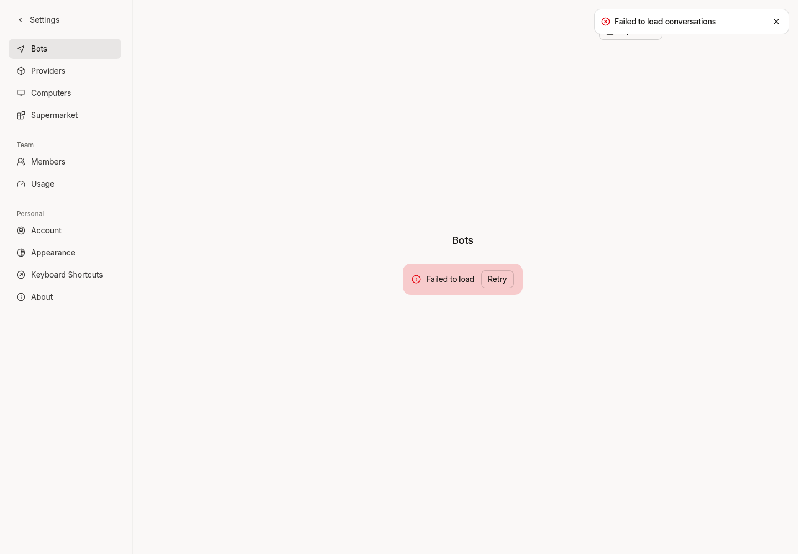
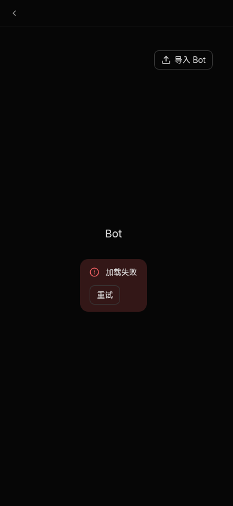
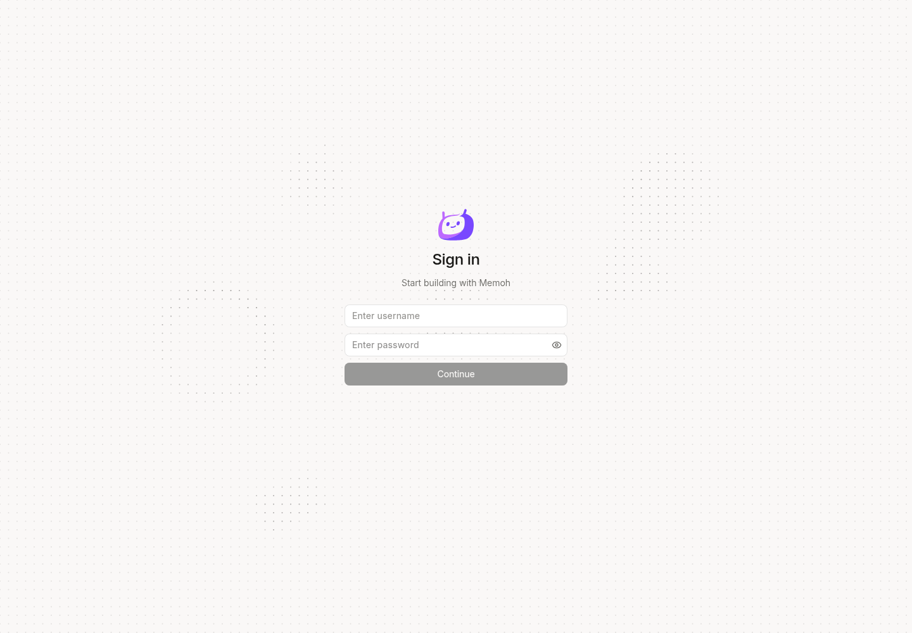
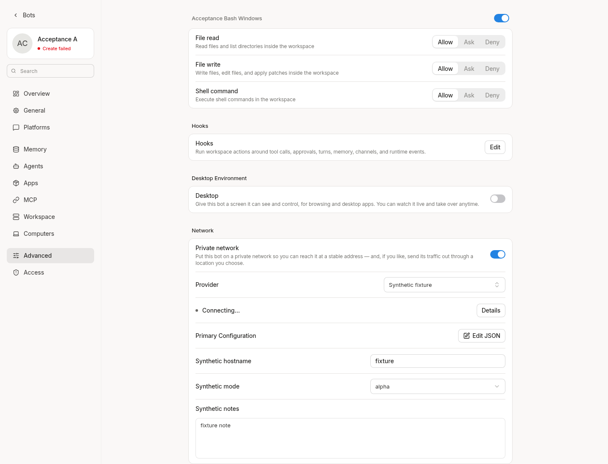
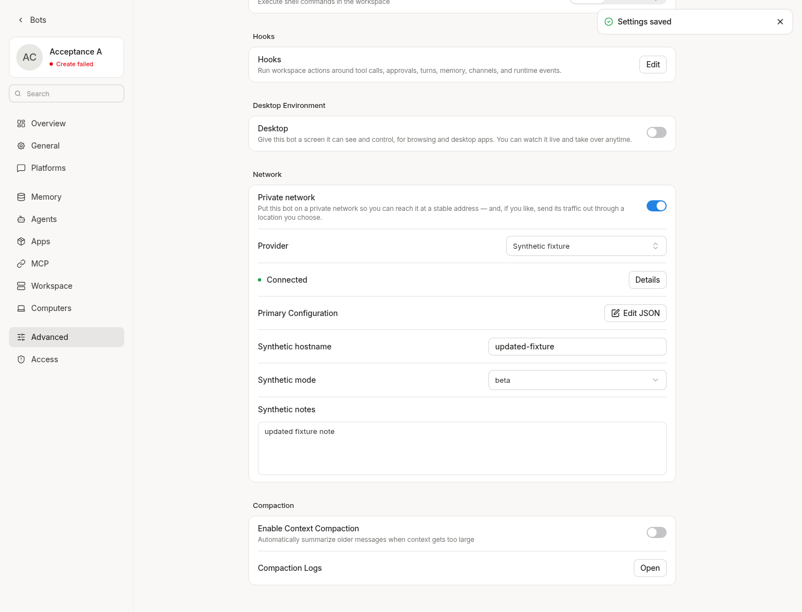

# Web query error handling

This incremental branch is based on frozen PR #33 commit
`26acd283bd4aa6c3a9b394ab10c377781ca776f9`. It does not modify that commit,
the cloud-image branch, or a release candidate.

## Bot list

The list previously showed a successful empty state and a create tile after
its first query failed. It now renders the shared error banner and a retry
button. It never renders the rejected response text. During a retry, that
button is disabled. A successful empty response still shows the creation
entry. Cached Bots remain visible with an error banner after a failed refresh.

The existing global 401 handler still clears the browser credential and
returns to login. This change does not override authentication or permission
checks. The component can handle a rejected query while the host processes
that redirect.

- Real Colada component regression: 401, 403, network failure, manual retry,
  in-flight retry suppression, and cached-data refresh failure. The three
  initial-error cases failed against the previous component.
- Bot list and existing API-client suite: 19 tests passed. The API-client
  suite also covers credential clearing and stale 401 responses.
- Changed-source lint and UI contract guard passed (three existing warnings).
- Actual current-source Web app at `http://127.0.0.1:18082`, Chromium:
  synthetic 403 and connection failures showed the safe error banner;
  clicking retry recovered to a successful empty list. Narrow Chinese dark
  mode was checked. A synthetic 401 preserved the real redirect to login.
  No business action, connection, or authorization was submitted. Responses
  were controlled HTTP fixtures, not a production outage test.
- The browser shell has a separate Bot query, so aggregate browser GET counts
  are not a one-query assertion. The component regression verifies a single
  manual retry and rejects a second click while it is pending.

These screenshots are automated evidence, not human QA.

## Network and desktop settings contracts

The network status timer used `isFetching`, which is not a Colada return field.
The real component/Colada regression reproduced an `undefined.value` exception
on its first transient-status poll. It now uses the existing `isLoading` ref,
which represents a request in flight. A pending request is not polled again;
resolved non-transient status and unmount stop the timer.

Network and desktop mutations now accept the generated `SettingsUpsertRequest`
instead of a partial read-response DTO. In particular, a nullable read setting
is not a valid write field. Input/select handlers use the owning components'
inferred event types; no event type or shared component was weakened.

- Three focused network tests passed: transient/in-flight/settled polling,
  unmount cleanup, and a minimal network write payload even when the response
  contains unrelated nullable settings. The timer case failed on the old code.
- The combined Bot-list/network/API-client suite passed 22 tests. Final changed
  source/test lint passed without suppressions. UI contract retains its three
  existing warnings. Vite production build passed with its existing chunk-size
  advisory.
- Web diagnostics decreased from 154 to 145 across 55 remaining files, with
  no new file/code/message diagnostics. Nine errors were eliminated in the two
  settings components. Full Web typecheck still exits 2.
- Actual Chromium in the same current-source Web environment: one delayed
  network-status fixture remained pending across a poll interval without a
  second request; resolution rendered Connected. The actual text, textarea,
  select and Save controls produced exactly the three network request fields.
  The desktop switch sent only `display_enabled`. All status/settings writes
  were intercepted by synthetic HTTP fixtures; no network provider, desktop,
  credentials or real workspace was changed.
- The reused development Bot still has its pre-existing workspace creation
  failure badge. These checks do not establish successful workspace creation
  or real overlay connectivity.
- Official Agent runtime/contextview remain unmodified. No dependency,
  generated API, server behavior, authorization or strictness change is needed
  for this increment.

