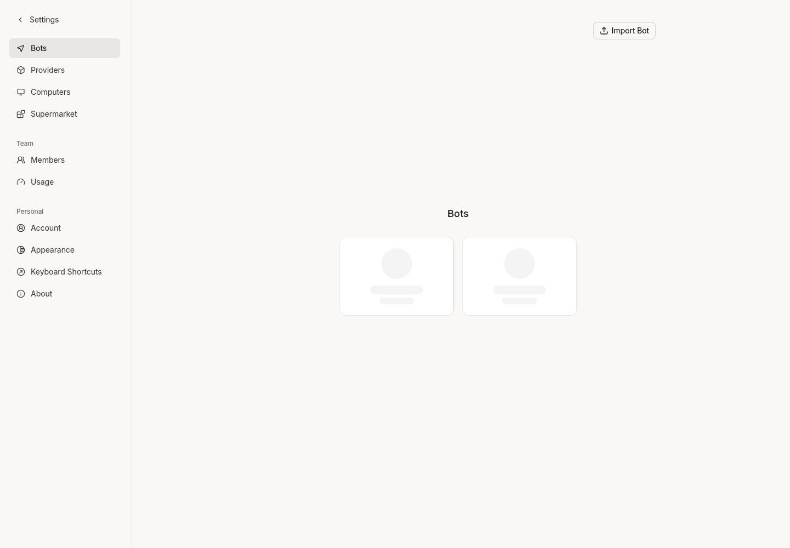
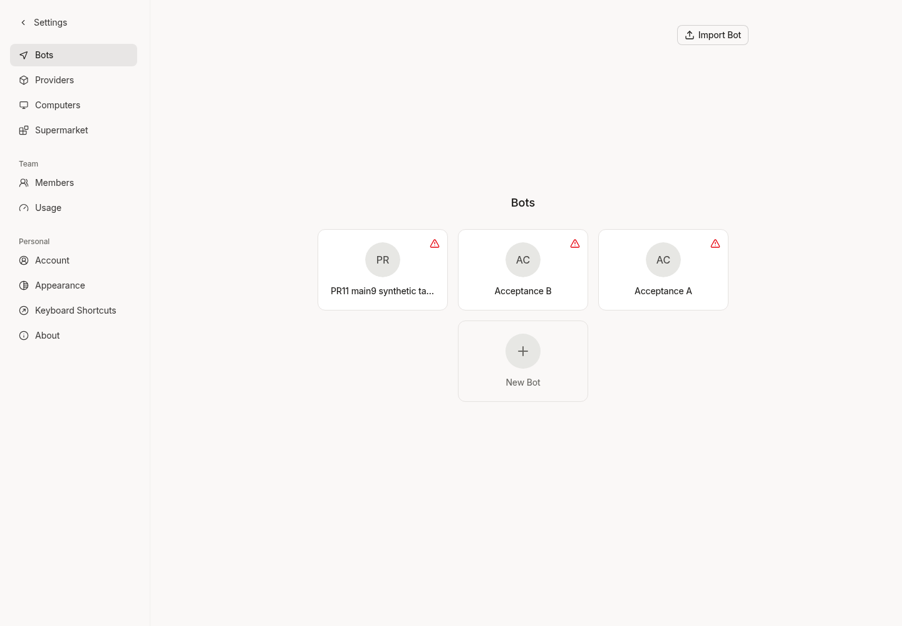
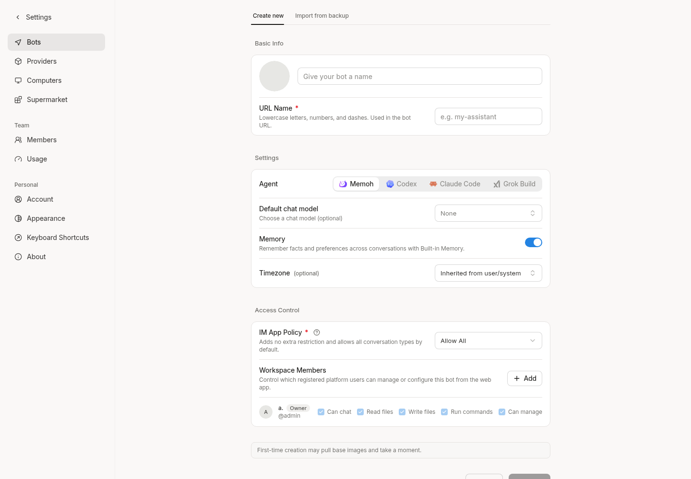
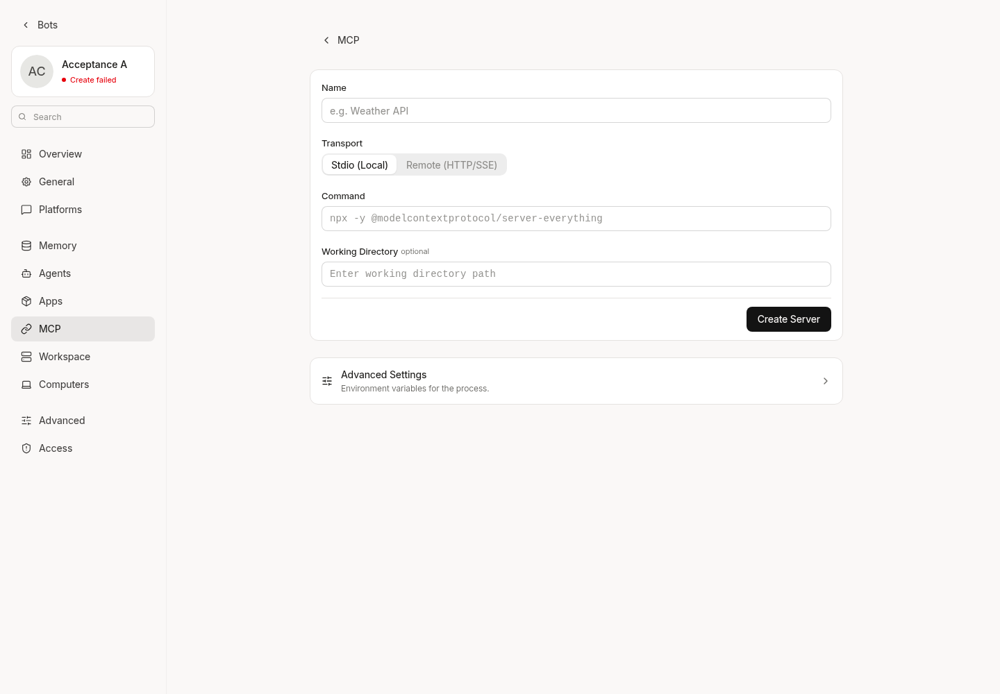
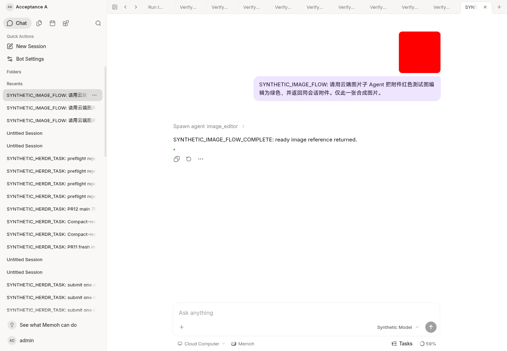
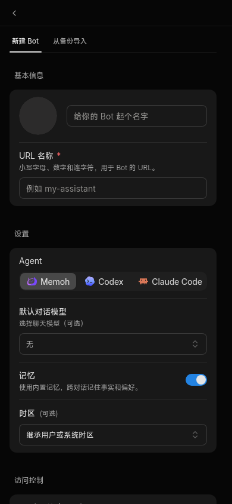

# Web type contract correction

This independent increment starts from `4521d323050e27d12a0e496ff51f0bd9bea938f6`.
It does not change the frozen cloud-image branch or any release candidate.
The repository had no open type-fix PR or matching remote branch when checked;
its Issues feature is disabled.

## Measured diagnostics

The same installed toolchain and unchanged strictness options produced:

| Stage | Web diagnostics |
| --- | ---: |
| Original source | 442 |
| Resolve the existing shared UI alias | 173 |
| Complete this increment | 154 |

There are 288 fewer diagnostics and no new diagnostics when compared by file,
code and message. Line numbers are excluded from the comparison. Type checking
still exits 2: this is an incremental correction, not a clean full typecheck.
[Counts for every affected file](errors-by-file.csv) include unchanged remaining
errors, rather than treating them as a waiver.

## Root causes and fixes

- Vite and the UI package resolve `#/*` to the shared UI source, but the Web
  TypeScript project omitted that mapping. Restoring the same real source path
  removes the cascade of unresolved internal UI imports. No dependency install,
  ambient module stub, `any`, or diagnostic suppression is used. Web's source
  root now includes the workspace packages it already imports; `include`,
  strictness and unchecked-index checking remain unchanged.
- Colada query status is `pending | error | success`, never `loading`. The Bot
  list now uses `isPending` for its initial skeleton. Cached data remains visible
  during refresh. Development preview entries are built only from existing Bots,
  keeping all requested clones without non-null assertions or undefined entries.
- Nine MCP management endpoints omitted their required Bot path parameter in
  OpenAPI annotations. The existing handlers already require and authorize that
  parameter. The Swagger and SDK outputs were regenerated, not edited by hand.
  Call sites no longer need path double-casts. No OAuth flow, scope, credential,
  authorization rule or runtime handler behavior changes.
- Gallery helpers now accept the existing `UIAttachment` contract instead of an
  arbitrary string-keyed dictionary. Stored hash references still take priority,
  attachment ownership metadata stays intact, and workspace paths do not become
  browser URLs.

## Validation

- SDK typecheck: passed after regeneration.
- Targeted Vitest: 6 files, 17 tests passed. Covers deferred initial Bot loading,
  the create entry, preview identities, existing Bot create/detail checks,
  gallery/hash identity, history attachment behavior, and generated MCP URL
  interpolation and encoding.
- ESLint on changed Web source/tests: passed. UI contract guard: passed with its
  three existing warnings.
- Current-source Go server build and Vite production build: passed. Vite retains
  its existing large-chunk advisory.
- Current-source development server and Chromium at `http://127.0.0.1:18082`:
  first-load skeleton verified with only the test browser's query cache cleared
  and its read-only Bot response delayed; real response then rendered the list.
  Opened Bot creation and MCP creation forms. Reopened the existing synthetic
  image conversation and verified both images fully loaded. No new Bot, MCP
  connection, OAuth authorization, model call or business task was submitted.
- Desktop-sized and narrow dark Chinese creation forms were inspected. These
  are automated browser checks, not human QA or a new end-to-end Bot provisioning
  or live MCP handshake acceptance. The reused synthetic Bot retains its earlier
  workspace provisioning failure badge; this run did not provision a workspace.
- `internal/agent/runtime` and `internal/contextview` remain identical to official
  `bf0318c5e363b62dd67ddf3fe8855a5b7c8b0046`.

Initial browser harness failures came from route-release timing, a hidden input
selector, a duplicated New Server button, and cached/hidden UI state. They were
corrected in the test harness and are not counted as product failures or passes.

## Remaining work

154 diagnostics remain in 57 files. Highest concentrations include API-client
test mock signatures (12), memory chart option construction (12), transcript
tests (11), login animation array bounds (10), network settings event/DTO types
(8), and webhook URL parsing (7). Other concrete follow-ups include obsolete
`BotsBot.type` reads, settings upsert-vs-read DTO use, hook action fields, chart
private API access, nullable schema/array entries, and undeclared direct imports
of `reka-ui` and `markdown-it`. They need their own contract/behavior checks;
this increment does not weaken types or remove those features to clear them.

