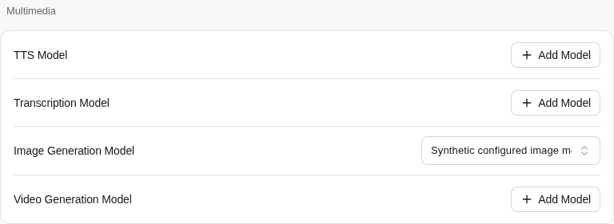

# Images SDK convergence validation

Product commit: `6f9ac071c4b9dc5bb18c7ddf8b785b2b8b2a8b5a`.
Product tree: `60503e47ef8c058d8ba9efcb929fe2e4ac211828`.
Parent: `7bcbba5ac85a2ba0769b48ed8d4334db4b7806f7`.
The subsequent evidence-only commit does not change product files or tests.

The pinned SDK owns JSON generation and reference-image encoding/parsing. Four
product files change (+127/-150 lines), seven test files (+233/-200), and the
capability documentation (+124/-166). Agent runtime and SDK dependency/core have
no change. Legacy omitted-model and multipart policies fail before dispatch;
configured-model JSON policies remain accepted. See [configuration and compatibility](../../images-capability.md).

## Local checks on the product tree

| Check | Result |
| --- | --- |
| Initial compatibility regression on parent code | exit 1, four expected policy/default failures retained |
| `go test -buildvcs=false -p=2 -timeout=120s ./internal/imagecapability ./cmd/internal/core -count=1 -json` | exit 0; 44 top-level tests, 155 total test nodes, 135 leaves |
| `node .husky/checks.mjs` with the affected files staged | exit 0; package selection, golangci-lint 2.10.1 and both packages' tests passed |
| `go vet -buildvcs=false ./internal/imagecapability ./cmd/internal/core` | exit 0 |
| `bash scripts/check-agent-core-boundary.sh` | exit 0; runtime/contextview match official `bf0318c5e363b62dd67ddf3fe8855a5b7c8b0046` |
| `go build -buildvcs=false -p=2 -o <task-server> ./cmd/agent` | exit 0 |
| `git diff --check` and review of added public content | passed; no private configuration, credentials, endpoints or project material |

Go uses the existing cloud toolchain (1.25.7), `GOFLAGS=-mod=readonly -buildvcs=false`
for the hook, and the repository's pinned lint binary. Automatic VCS stamping is
unavailable for the linked checkout; the exact tree is independently recorded.
The first hook invocation failed because the lint binary was absent from PATH;
using the already verified installed 2.10.1 binary resolved that tooling error.

Native-loop coverage includes actual `spawn_agent` admission, a child session,
the production DI authorizer, the SDK image tool, the child's hash report and
the supervisor's ordinary `send`. Generation and reference-image cases each
perform one image POST and one send. Revocation, foreign and missing references
perform zero image POSTs. Unknown performs one image POST and no send. These use
synthetic query/storage ports and HTTP responses, not live model decisions.

HTTP coverage includes original-byte/hash preservation, configured model
selection, JSON references, timeout/cancellation, non-200 responses, redirects,
disconnects, declared and chunked response limits, replay-body removal, private
error suppression and no automatic second POST. Image checks are size/MIME-magic
checks, not full format decoding. No cross-call/restart deduplication is claimed.

## Current application observation

A fresh cloud-only Server built from this product tree, Vite Web, and a separate
PostgreSQL database were used. Existing QA instances and data were not changed.
The application was served on task-local loopback; no infrastructure address is
published here. Login used a temporary local synthetic account.

One explicitly synthetic SQL Bot fixture was used only for settings inspection;
there was **no Bot creation POST, workspace provisioning or image request** in
this UI check. Provider/model creation and native `image_model_id` saving/readback
used the real authenticated HTTP APIs. The provider target was the reserved
`example.invalid` domain; no real model or credential was configured. The fixture
account's onboarding-completed metadata was set via its own profile API so this
check did not trigger a second Bot creation flow.

A fresh single-tab Chromium context logged in and opened the Bot's General
settings. The existing Multimedia card displayed the configured image model,
with no browser page errors. The image below is an inspected screenshot of that
current application, cropped to the relevant existing UI; it is not a mockup.

The startup probe initially used GET on the HEAD-only health endpoint (405);
HEAD returned 200 without restarting the healthy Server. A browser wait for
network idle timed out with the application's live connections; waiting for the
actual settings component succeeded. The failed observations are retained in
the task evidence instead of being counted as successful UI checks.

This demonstrates native configuration persistence and UI display. It does not
establish a browser-to-paid-provider generation, PostgreSQL child-run durability
for this increment, workspace readiness, NAS/PC/mobile or deployment acceptance.
The earlier 40f service/PG/workspace evidence and 7b CI are separate historical
results, not checks of this product tree. No full local repository aggregate was
rerun. The previous 7b local aggregate's ten failures remain recorded; a new
standard PR CI run must be assessed by its exact head. Human QA remains pending.
